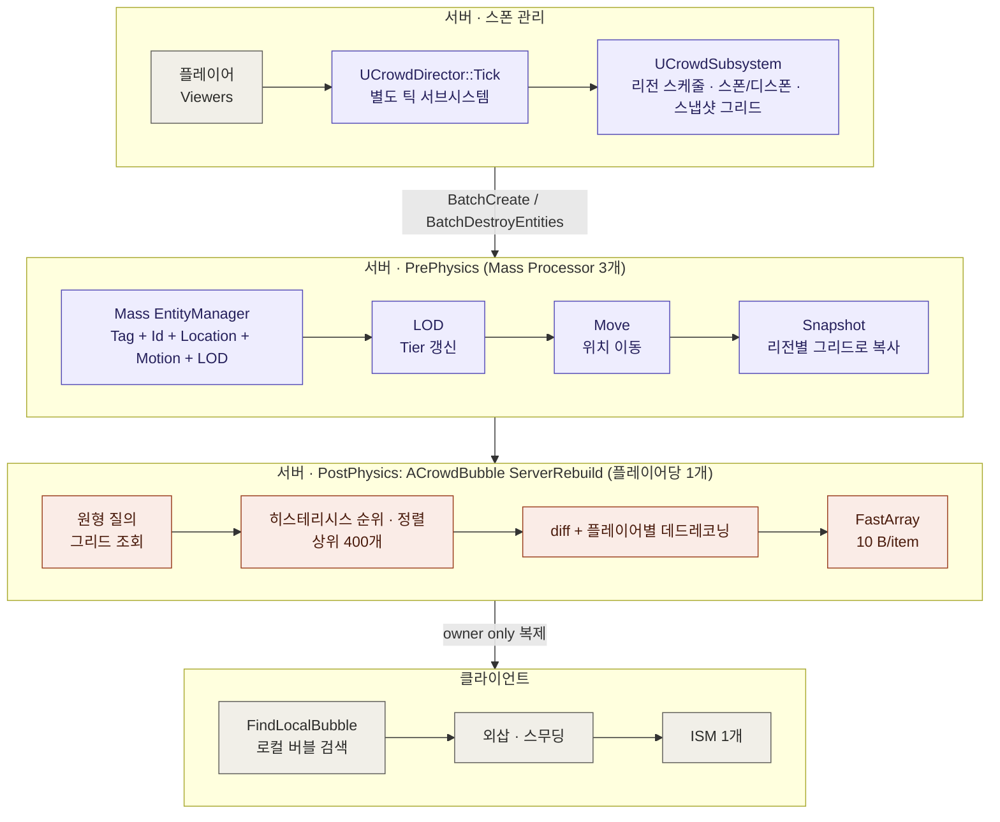
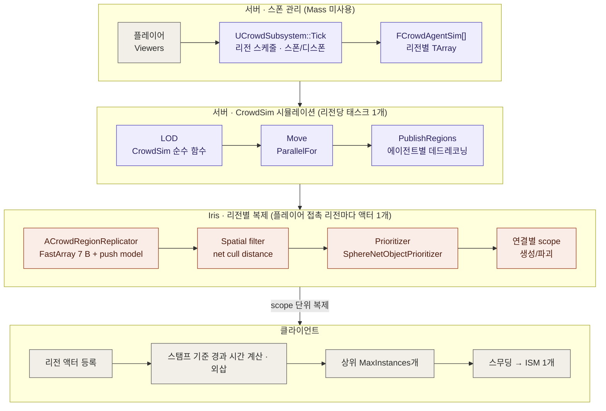

# MassBubble: Mass Entity 구현과 Iris 구현 비교

플레이어 주변의 군중(수천 명)을 서버가 시뮬레이션하고 클라이언트로 복제하는 MassBubble의 두 가지 구현 방식 비교 정리 문서입니다.

## 1. 요약 및 핵심 비교

| 비교 항목 | Mass Entity 구현 | Iris 구현 | 
| ----- | ----- | ----- | 
| **에이전트 저장 방식** | Mass entity (tag + fragment 4개) | 리전별 `TArray<FCrowdAgentSim>` | 
| **시뮬레이션 실행 방식** | `UMassProcessor` 3개 (LOD → Move → Snapshot) | `CrowdSim` 순수 함수, 리전당 태스크 1개 (`ParallelFor`) | 
| **초기 스폰 주체** | 별도 틱 서브시스템 (`UCrowdDirector`) | `UCrowdSubsystem::Tick` 자체 처리 | 
| **복제 단위** | 플레이어당 `ACrowdBubble` 1개 (인접 에이전트 400개) | 리전당 `ACrowdRegionReplicator` 1개 (해당 리전 전체 에이전트) | 
| **수신 대상 결정 주체** | 서버 코드 직접 계산 (그리드 질의, 히스테리시스, 정렬) | Iris spatial filter (액터 위치 및 net cull distance 기준) | 
| **전송 우선순위/순서** | 상한 400개 제한 (`MaxAgentsPerBubble`) | Iris prioritizer 및 연결 대역폭 기반 | 
| **변경 감지 방식** | 플레이어별 `SentPos/SentVel` 데드레코닝 + FastArray 더티 | 에이전트 공유 `SentPos/SentVel` 데드레코닝 + push model + FastArray 더티 | 
| **위치 데이터 포맷** | int16 + 200m 래티스 원점 (원점 이동 시 전체 재전송) | uint16 리전 상대 좌표 (원점 이동 없음) | 
| **아이템 데이터 크기** | 10 B | 7 B | 
| **상태 경과 시간(Age) 기준** | 클라이언트 도착 시각 (`RecvTime`) | 아이템 스탬프 및 리전 최신 스탬프 연산 | 
| **클라이언트 처리 방식** | 로컬 버블 폴링 검색 후 버블 전체 아이템 렌더링 | 리전 액터 등록 후 반경 내 상위 `MaxInstances`개 렌더링 | 
| **Mass 모듈 의존성** | `MassEntity`, `MassCommon`, `MassSimulation`, `MassCore` | 없음 | 

### 주요 결과요약

* **서버 복제 판단 CPU 오버헤드 감소:** 기본 설정 틱당 139 µs → 26 µs (1명, 5.3배 개선), 3,491 µs → 57 µs (32명 집중, 61.6배 개선), 5,261 µs → 1,119 µs (32명 분산, 4.7배 개선).

* **클라이언트당 전송량 증가:** 레거시 반경 내 400개 전송(약 2.4 KB/s) 대비 Iris scope 단위 리전 전송으로 기본 설정 기준 11.6\~15.8 KB/s 전송 (복제 반경 조정 시 최소 5.8 KB/s).

* **서버 CPU 성능 우선**: **Iris 방식**이 플레이어 밀집 환경에서도 CPU 병목 없이 훨씬 효율적입니다.

* **네트워크 대역폭 우선**: **Mass 기반 레거시 방식**이 필요한 400개만 추출해서 보내므로 전송량 측면에서는 더 효율적입니다.

### Mass Entity 구조



### Iris 구조



Iris 도입으로 복제 제어 주체가 서버 전용 코드에서 Iris 시스템으로 이관되었으며, 시뮬레이션 구조가 순수 배열 기반으로 단순화되었습니다.

## 3. 코드 비교

### 3.1 에이전트 데이터 구조

Mass 구현은 태그 및 4개의 프래그먼트로 구성된 엔티티 아키타입을 사용합니다.

```
// Mass 구현: Crowd/CrowdFragments.h, Crowd/CrowdSubsystem.cpp
USTRUCT()
struct MASSBUBBLE_API FCrowdMotionFragment : public FMassFragment
{
    GENERATED_BODY()
    UPROPERTY() FVector2f Velocity = FVector2f::ZeroVector;
    UPROPERTY() float RetargetTimer = 0.f;
    UPROPERTY() uint32 Rng = 1;
    UPROPERTY() float Heading = 0.f;
    UPROPERTY() float CruiseSpeed = 140.f;
};

USTRUCT()
struct MASSBUBBLE_API FCrowdLODFragment : public FMassFragment
{
    GENERATED_BODY()
    UPROPERTY() ECrowdLOD Tier = ECrowdLOD::Off;
    UPROPERTY() float PendingDelta = 0.f;
};

FMassArchetypeHandle UCrowdSubsystem::GetAgentArchetype()
{
    if (!AgentArchetype.IsValid())
    {
        AgentArchetype = EntityManager->CreateArchetype({
            FCrowdAgentTag::StaticStruct(),
            FCrowdIdFragment::StaticStruct(),
            FCrowdLocationFragment::StaticStruct(),
            FCrowdMotionFragment::StaticStruct(),
            FCrowdLODFragment::StaticStruct() });
    }
    return AgentArchetype;
}

```

Iris 구현은 단일 구조체 기반으로 변경되었으며 데드레코닝 데이터를 직접 포함합니다.

```
// Iris 구현: Crowd/CrowdSim.h
struct FCrowdAgentSim
{
    uint32 NetId = 0;
    ECrowdLOD Tier = ECrowdLOD::Off;
    FVector2D Location = FVector2D::ZeroVector;
    FVector2f Velocity = FVector2f::ZeroVector;
    float RetargetTimer = 0.f;
    uint32 Rng = 1;
    float Heading = 0.f;
    float CruiseSpeed = 140.f;
    float PendingDelta = 0.f;

    // 공유 데드레코닝 상태 (플레이어 개수 독립적)
    FVector2D SentPos = FVector2D::ZeroVector;
    FVector2f SentVel = FVector2f::ZeroVector;
    double SentTime = 0.0;
};

```

* Mass 프래그먼트 총합: 64 B

* Iris 구조체: 88 B (플레이어별 버블 아이템 데이터의 공유화로 전체 메모리 효율 향상)

### 3.2 시뮬레이션 실행

Mass는 프로세서 단위 쿼리 선언 및 디스패치를 수행하며 런타임 엔티티 생성 특성상 프루닝 비활성화 오버라이드가 요구됩니다.

```
// Mass 구현: Crowd/CrowdProcessors.cpp
void UCrowdMovementProcessor::ConfigureQueries(const TSharedRef<FMassEntityManager>& EntityManager)
{
    EntityQuery.Initialize(EntityManager);
    EntityQuery.AddTagRequirement<FCrowdAgentTag>(EMassFragmentPresence::All);
    EntityQuery.AddRequirement<FCrowdIdFragment>(EMassFragmentAccess::ReadOnly);
    EntityQuery.AddRequirement<FCrowdLocationFragment>(EMassFragmentAccess::ReadWrite);
    EntityQuery.AddRequirement<FCrowdMotionFragment>(EMassFragmentAccess::ReadWrite);
    EntityQuery.AddRequirement<FCrowdLODFragment>(EMassFragmentAccess::ReadWrite);
    EntityQuery.RegisterWithProcessor(*this);
}

virtual bool ShouldAllowQueryBasedPruning(const bool bRuntimeMode) const override { return false; }

```

Iris는 독립된 리전 단위 `ParallelFor` 순수 함수 호출 방식으로 전환되었습니다.

```
// Iris 구현: Crowd/CrowdSim.h, Crowd/CrowdSubsystem.cpp
inline FMoveStats MoveRegion(TArrayView<FCrowdAgentSim> Agents, const FIntPoint& Coord, const FMoveParams& Params)
{
    // 리전 내 에이전트 이동 연산 수행
    ...
}

void UCrowdSubsystem::RunPerRegion(int32 Num, TFunctionRef<void(int32)> Body) const
{
    if (CrowdCVars::ParallelMove != 0 && Num > 1)
    {
        ParallelFor(TEXT("OptCrowd.Regions"), Num, 1, Body);
        return;
    }
    for (int32 Index = 0; Index < Num; ++Index) { Body(Index); }
}

```

### 3.3 스폰 처리

Mass는 실행 중 구조 변경(Creation Context) 제약에 따른 펌핑 프로세스를 거치나, Iris는 배열 추가 단순화로 직관적 처리가 가능합니다.

```
// Mass 스폰
const auto CreationContext = EM.BatchCreateEntities(GetAgentArchetype(), Count, NewEntities);
for (int32 i = 0; i < NewEntities.Num(); ++i) { ... }

// Iris 스폰
for (int32 i = 0; i < Count; ++i)
{
    Region.Agents.Add(MakeAgent(Region, Region.SpawnCursor + i));
}

```

### 3.4 복제 대상 filtering 및 필터링 주체

Mass는 서버에서 직접 개별 플레이어 기준 정렬 및 filtering을 수행합니다.

```
// Mass 구현: Net/CrowdBubble.cpp
// 버블 반경 내부 후보군 수집 및 정렬 (최대 MaxAgentsPerBubble 개)
if (Candidates.Num() > Tuning.MaxAgentsPerBubble)
{
    Candidates.Sort([](const FCandidate& L, const FCandidate& R) { return L.Rank < R.Rank; });
    Candidates.SetNum(Tuning.MaxAgentsPerBubble, EAllowShrinking::No);
}

```

Iris는 서버의 개별 플레이어 계산 로직을 제거하고, 리전 대표 액터 및 Iris Spatial Filter로 계산을 이관합니다.

```
// Iris 구현: Crowd/CrowdSubsystem.cpp
ACrowdRegionReplicator* Replicator = World->SpawnActorDeferred<ACrowdRegionReplicator>(...);
const double CullDistanceCm = static_cast<double>(T.ReplicationRadiusCm) + 0.70710678 * static_cast<double>(T.RegionSizeCm);
Replicator->ServerInitialize(Region.Coord, T.RegionSizeCm, Region.Agents.Num(), CullDistanceCm, T.ReplicationHz);
Replicator->FinishSpawning(Transform);

```

### 3.5 네트워크 와이어 포맷 및 스탬프 구조

| 항목 | Mass (10 B) | Iris (7 B) | 
| ----- | ----- | ----- | 
| **위치 데이터** | 상대 offset (int16, 원점 변경 시 재전송) | 리전 모서리 기준 상대 좌표 (uint16) | 
| **속도 데이터** | int8 (VX, VY) | int8 (VX, VY) | 
| **시간/상태** | 도착 시간 추적 | 8-bit 스탬프 (`uint8 Stamp`, 서버 시간 1/32초 단위) | 

```
// Iris 복제 아이템 구조 (7 B)
USTRUCT()
struct MASSBUBBLE_API FCrowdAgentItem : public FFastArraySerializerItem
{
    GENERATED_BODY()
    UPROPERTY() uint16 X = 0;
    UPROPERTY() uint16 Y = 0;
    UPROPERTY() int8 VX = 0;
    UPROPERTY() int8 VY = 0;
    UPROPERTY() uint8 Stamp = 0;

    bool operator==(const FCrowdAgentItem& Other) const
    {
        return X == Other.X && Y == Other.Y && VX == Other.VX && VY == Other.VY && Stamp == Other.Stamp;
    }
};

```

## 4. Iris 환경 설정 (`DefaultEngine.IrisCrowd.ini`)

```
[SystemSettings]
net.Iris.UseIrisReplication=1
net.IsPushModelEnabled=1
net.SubObjects.DefaultUseSubObjectReplicationList=1

[/Script/IrisCore.ObjectReplicationBridgeConfig]
+FilterConfigs=(ClassName=/Script/MassBubble.CrowdRegionReplicator, DynamicFilterName=Spatial)
+PrioritizerConfigs=(ClassName=/Script/MassBubble.CrowdRegionReplicator, PrioritizerName=SphereNetObjectPrioritizer)

```

## 5. 상세 성능 비교

### 5.1 서버 복제 CPU 연산 성능 (단일 스레드 기준)

| 시나리오 조건 | 리전 수 / 에이전트 수 | Mass 구현 (µs/틱) | Iris 구현 (µs/틱) | 성능 개선 비율 | 
| ----- | ----- | ----- | ----- | ----- | 
| **1명 접속** | 25 / 10,000 | 139 (스냅샷 38 + 버블 102) | 26 | **5.3배** | 
| **8명 밀집** | 25 / 10,000 | 940 (스냅샷 80 + 버블 860) | 56 | **16.8배** | 
| **32명 밀집** | 25 / 10,000 | 3,491 (스냅샷 85 + 버블 3,406) | 57 | **61.6배** | 
| **8명 분산** | 200 / 80,000 | 1,326 (스냅샷 451 + 버블 875) | 281 | **4.7배** | 
| **32명 분산** | 655 / 262,000 | 5,261 (스냅샷 1,664 + 버블 3,597) | 1,119 | **4.7배** | 

### 5.2 클라이언트당 전송 대역폭 분석

| 시나리오 | Mass 수신 개수 | Mass KB/s | Iris 수신 개수 | Iris 유효 렌더링 비율 | Iris KB/s | 
| ----- | ----- | ----- | ----- | ----- | ----- | 
| **1명 접속** | 400 | 2.42 | 4,000 | 20% | 11.61 | 
| **8명 밀집** | 400 | 2.44 | 4,400 | 18% | 15.13 | 
| **32명 밀집** | 400 | 2.50 | 4,500 | 17% | 15.79 | 
| **8명 분산** | 400 | 2.36 | 4,500 | 18% | 11.66 | 
| **32명 분산** | 400 | 2.37 | 4,500 | 18% | 12.35 | 

### 5.3 반경 및 리전 크기 조정에 따른 전송 효율 변화

| 설정 구성 | CPU 사용량 (1명 / 32명 분산) | 클라이언트 수신 에이전트 | 유효 렌더 비율 | 전송 대역폭 (KB/s) | 
| ----- | ----- | ----- | ----- | ----- | 
| **Mass (기본 400개 제한)** | 139 / 5,261 µs | 400 | 100% | 2.4–2.5 KB/s | 
| **Iris (반경 150m, 리전 128m)** | 26 / 1,119 µs | 4,000–4,500 | 17%–20% | 11.6–15.8 KB/s | 
| **Iris (반경 100m, 리전 128m)** | 20 / 742 µs | 2,500–2,800 | 28%–32% | 9.0–11.3 KB/s | 
| **Iris (반경 100m, 리전 64m)** | 12 / 437 µs | 1,588–1,622 | 47%–49% | 6.9–7.2 KB/s | 
| **Iris (반경 100m, 리전 32m)** | 10 / 431 µs | 1,141–1,161 | 66%–69% | 5.8–6.5 KB/s | 

## 6. 핵심 변경사항 요약

* **수신 데이터 범위 변경:** 플레이어별 근접 400개 고정 방식에서 Scope 내 리전 전체 수신으로 변경. 렌더링은 클라이언트의 `DrawRadiusCm` 및 `MaxInstances`로 제어.

* **데드레코닝 오차 관리 기준 변경:** 거리 기반 오차 연산에서 에이전트 LOD Tier별 고정 오차 허용값(`NearErrorCm`, `FarErrorCm`) 적용.

* **시간 동기화 정확도 향상:** 단일 스탬프 기반 시간 관리로 재접속/지연 접속 클라이언트의 위치 예측 오차 감소 (60초 시뮬레이션 후 오차: 도착시간 기준 325cm → 스탬프 기준 31cm).

* **액터 수명 관리 주체 변경:** 플레이어별 `ACrowdBubble` 제거. `UCrowdSubsystem`이 리전 복제 액터 수명 직접 관리.