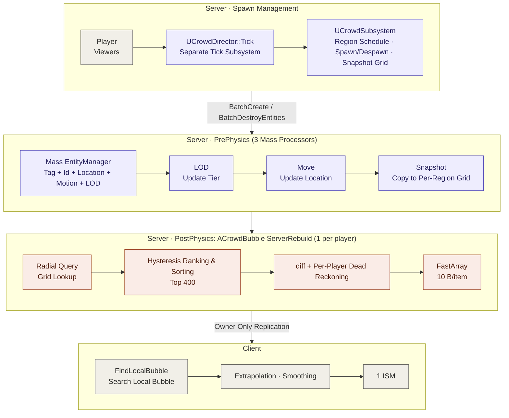
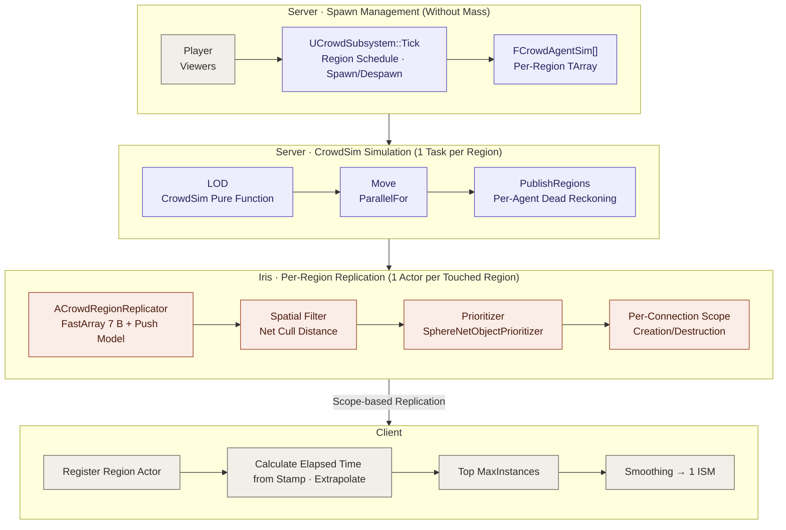

# MassBubble: Comparison of Mass Entity vs. Iris Implementation

A comparison document analyzing two implementation approaches for MassBubble, where the server simulates thousands of agents around players and replicates them to clients.

## 1. Executive Summary & Key Comparison

| Category | Mass Entity Implementation | Iris Implementation |
| ----- | ----- | ----- |
| **Agent Storage Format** | Mass entity (Tag + 4 Fragments) | Per-region `TArray<FCrowdAgentSim>` |
| **Simulation Execution** | 3 `UMassProcessor`s (LOD → Move → Snapshot) | `CrowdSim` pure functions, 1 task per region (`ParallelFor`) |
| **Initial Spawning Controller** | Dedicated tick subsystem (`UCrowdDirector`) | Handled directly in `UCrowdSubsystem::Tick` |
| **Replication Unit** | 1 `ACrowdBubble` per player (400 nearby agents) | 1 `ACrowdRegionReplicator` per region (all agents in region) |
| **Replication Target Determination** | Calculated directly by server code (Grid query, hysteresis, sorting) | Iris Spatial Filter (based on actor location & net cull distance) |
| **Transmission Priority / Order** | Hard cap at 400 agents (`MaxAgentsPerBubble`) | Based on Iris prioritizer and connection bandwidth |
| **Change Detection Method** | Per-player `SentPos/SentVel` dead reckoning + FastArray dirty | Shared `SentPos/SentVel` dead reckoning + Push model + FastArray dirty |
| **Location Format** | int16 + 200m lattice origin (full resend on origin shift) | uint16 region-relative coordinates (no origin shift) |
| **Item Data Size** | 10 B | 7 B |
| **State Elapsed Time (Age) Metric** | Client arrival timestamp (`RecvTime`) | Item stamp & region latest stamp calculation |
| **Client Processing Method** | Local bubble polling search → render all bubble items | Register region actor → render top `MaxInstances` within radius |
| **Mass Module Dependency** | `MassEntity`, `MassCommon`, `MassSimulation`, `MassCore` | None |

### Key Results Summary

* **Server Replication Overhead Reduction:** 139 µs → 26 µs per tick (1 player, 5.3x improvement), 3,491 µs → 57 µs (32 dense players, 61.6x improvement), 5,261 µs → 1,119 µs (32 dispersed players, 4.7x improvement).

* **Increased Per-Client Bandwidth:** Replaces legacy fixed 400-agent radius (~2.4 KB/s) with scope-based region transmission (11.6–15.8 KB/s under default settings, configurable down to 5.8 KB/s).

* **Server CPU Performance Priority:** The **Iris implementation** is significantly more efficient in high-density player environments, eliminating CPU bottlenecks.

* **Network Bandwidth Priority:** The **Mass-based legacy implementation** is more bandwidth-efficient since it filters and transmits only 400 required agents.

### Mass Entity Architecture



### Iris Architecture



By adopting Iris, replication filtering authority shifted from server-custom code to the Iris framework, simplifying the simulation model into pure array structures.

## 3. Code Comparison

### 3.1 Agent Data Structure

The Mass implementation uses an Entity Archetype containing tags and 4 fragments:

```cpp
// Mass Implementation: Crowd/CrowdFragments.h, Crowd/CrowdSubsystem.cpp
USTRUCT()
struct MASSBUBBLE_API FCrowdMotionFragment : public FMassFragment
{
    GENERATED_BODY()
    UPROPERTY() FVector2f Velocity = FVector2f::ZeroVector;
    UPROPERTY() float RetargetTimer = 0.f;
    UPROPERTY() uint32 Rng = 1;
    UPROPERTY() float Heading = 0.f;
    UPROPERTY() float CruiseSpeed = 140.f;
};

USTRUCT()
struct MASSBUBBLE_API FCrowdLODFragment : public FMassFragment
{
    GENERATED_BODY()
    UPROPERTY() ECrowdLOD Tier = ECrowdLOD::Off;
    UPROPERTY() float PendingDelta = 0.f;
};

FMassArchetypeHandle UCrowdSubsystem::GetAgentArchetype()
{
    if (!AgentArchetype.IsValid())
    {
        AgentArchetype = EntityManager->CreateArchetype({
            FCrowdAgentTag::StaticStruct(),
            FCrowdIdFragment::StaticStruct(),
            FCrowdLocationFragment::StaticStruct(),
            FCrowdMotionFragment::StaticStruct(),
            FCrowdLODFragment::StaticStruct() });
    }
    return AgentArchetype;
}
```

The Iris implementation converts to a single struct with embedded dead reckoning state:

```cpp
// Iris Implementation: Crowd/CrowdSim.h
struct FCrowdAgentSim
{
    uint32 NetId = 0;
    ECrowdLOD Tier = ECrowdLOD::Off;
    FVector2D Location = FVector2D::ZeroVector;
    FVector2f Velocity = FVector2f::ZeroVector;
    float RetargetTimer = 0.f;
    uint32 Rng = 1;
    float Heading = 0.f;
    float CruiseSpeed = 140.f;
    float PendingDelta = 0.f;

    // Shared Dead Reckoning State (Player Count Independent)
    FVector2D SentPos = FVector2D::ZeroVector;
    FVector2f SentVel = FVector2f::ZeroVector;
    double SentTime = 0.0;
};
```

* Total size of Mass Fragments: 64 B
* Iris struct size: 88 B (Consolidates per-player bubble item states, improving overall memory footprint)

### 3.2 Simulation Execution

Mass requires explicit query declaration and dispatch per processor, as well as override settings for runtime entity pruning.

```cpp
// Mass Implementation: Crowd/CrowdProcessors.cpp
void UCrowdMovementProcessor::ConfigureQueries(const TSharedRef<FMassEntityManager>& EntityManager)
{
    EntityQuery.Initialize(EntityManager);
    EntityQuery.AddTagRequirement<FCrowdAgentTag>(EMassFragmentPresence::All);
    EntityQuery.AddRequirement<FCrowdIdFragment>(EMassFragmentAccess::ReadOnly);
    EntityQuery.AddRequirement<FCrowdLocationFragment>(EMassFragmentAccess::ReadWrite);
    EntityQuery.AddRequirement<FCrowdMotionFragment>(EMassFragmentAccess::ReadWrite);
    EntityQuery.AddRequirement<FCrowdLODFragment>(EMassFragmentAccess::ReadWrite);
    EntityQuery.RegisterWithProcessor(*this);
}

virtual bool ShouldAllowQueryBasedPruning(const bool bRuntimeMode) const override { return false; }
```

Iris transitions to pure function processing via isolated per-region `ParallelFor` tasks.

```cpp
// Iris Implementation: Crowd/CrowdSim.h, Crowd/CrowdSubsystem.cpp
inline FMoveStats MoveRegion(TArrayView<FCrowdAgentSim> Agents, const FIntPoint& Coord, const FMoveParams& Params)
{
    // Execute movement logic for agents within region
    ...
}

void UCrowdSubsystem::RunPerRegion(int32 Num, TFunctionRef<void(int32)> Body) const
{
    if (CrowdCVars::ParallelMove != 0 && Num > 1)
    {
        ParallelFor(TEXT("OptCrowd.Regions"), Num, 1, Body);
        return;
    }
    for (int32 Index = 0; Index < Num; ++Index) { Body(Index); }
}
```

### 3.3 Agent Spawning

Mass requires a structural pumping process due to Creation Context constraints, whereas Iris simplifies spawning to standard array insertion.

```cpp
// Mass Spawning
const auto CreationContext = EM.BatchCreateEntities(GetAgentArchetype(), Count, NewEntities);
for (int32 i = 0; i < NewEntities.Num(); ++i) { ... }

// Iris Spawning
for (int32 i = 0; i < Count; ++i)
{
    Region.Agents.Add(MakeAgent(Region, Region.SpawnCursor + i));
}
```

### 3.4 Replication Filtering Authority

Mass performs per-player sorting and filtering directly on the server thread.

```cpp
// Mass Implementation: Net/CrowdBubble.cpp
// Collect and sort candidates within bubble radius (Up to MaxAgentsPerBubble)
if (Candidates.Num() > Tuning.MaxAgentsPerBubble)
{
    Candidates.Sort([](const FCandidate& L, const FCandidate& R) { return L.Rank < R.Rank; });
    Candidates.SetNum(Tuning.MaxAgentsPerBubble, EAllowShrinking::No);
}
```

Iris eliminates per-player computation logic on the server, delegating filtering to Region Replicator Actors and Iris Spatial Filters.

```cpp
// Iris Implementation: Crowd/CrowdSubsystem.cpp
ACrowdRegionReplicator* Replicator = World->SpawnActorDeferred<ACrowdRegionReplicator>(...);
const double CullDistanceCm = static_cast<double>(T.ReplicationRadiusCm) + 0.70710678 * static_cast<double>(T.RegionSizeCm);
Replicator->ServerInitialize(Region.Coord, T.RegionSizeCm, Region.Agents.Num(), CullDistanceCm, T.ReplicationHz);
Replicator->FinishSpawning(Transform);
```

### 3.5 Wire Format & Timestamp Structure

| Property | Mass (10 B) | Iris (7 B) |
| ----- | ----- | ----- |
| **Location Data** | Relative offset (int16, full resend on origin shift) | Region-corner relative coordinates (uint16) |
| **Velocity Data** | int8 (VX, VY) | int8 (VX, VY) |
| **Time/State Data** | Arrival timestamp tracking | 8-bit stamp (`uint8 Stamp`, 1/32 sec resolution) |

```cpp
// Iris Replicated Item Structure (7 B)
USTRUCT()
struct MASSBUBBLE_API FCrowdAgentItem : public FFastArraySerializerItem
{
    GENERATED_BODY()
    UPROPERTY() uint16 X = 0;
    UPROPERTY() uint16 Y = 0;
    UPROPERTY() int8 VX = 0;
    UPROPERTY() int8 VY = 0;
    UPROPERTY() uint8 Stamp = 0;

    bool operator==(const FCrowdAgentItem& Other) const
    {
        return X == Other.X && Y == Other.Y && VX == Other.VX && VY == Other.VY && Stamp == Other.Stamp;
    }
};
```

## 4. Iris Environment Configuration (`DefaultEngine.IrisCrowd.ini`)

```ini
[SystemSettings]
net.Iris.UseIrisReplication=1
net.IsPushModelEnabled=1
net.SubObjects.DefaultUseSubObjectReplicationList=1

[/Script/IrisCore.ObjectReplicationBridgeConfig]
+FilterConfigs=(ClassName=/Script/MassBubble.CrowdRegionReplicator, DynamicFilterName=Spatial)
+PrioritizerConfigs=(ClassName=/Script/MassBubble.CrowdRegionReplicator, PrioritizerName=SphereNetObjectPrioritizer)
```

## 5. Detailed Performance Metrics

### 5.1 Server Replication CPU Performance (Single-threaded)

| Scenario Setup | Regions / Total Agents | Mass (µs/tick) | Iris (µs/tick) | Improvement Ratio |
| ----- | ----- | ----- | ----- | ----- |
| **1 Player** | 25 / 10,000 | 139 (Snapshot 38 + Bubble 102) | 26 | **5.3x** |
| **8 Players (Clustered)** | 25 / 10,000 | 940 (Snapshot 80 + Bubble 860) | 56 | **16.8x** |
| **32 Players (Clustered)** | 25 / 10,000 | 3,491 (Snapshot 85 + Bubble 3,406) | 57 | **61.6x** |
| **8 Players (Dispersed)** | 200 / 80,000 | 1,326 (Snapshot 451 + Bubble 875) | 281 | **4.7x** |
| **32 Players (Dispersed)** | 655 / 262,000 | 5,261 (Snapshot 1,664 + Bubble 3,597) | 1,119 | **4.7x** |

### 5.2 Per-Client Transmission Bandwidth Analysis

| Scenario Setup | Mass Received | Mass KB/s | Iris Received | Iris Render Ratio | Iris KB/s |
| ----- | ----- | ----- | ----- | ----- | ----- |
| **1 Player** | 400 | 2.42 | 4,000 | 20% | 11.61 |
| **8 Players (Clustered)** | 400 | 2.44 | 4,400 | 18% | 15.13 |
| **32 Players (Clustered)** | 400 | 2.50 | 4,500 | 17% | 15.79 |
| **8 Players (Dispersed)** | 400 | 2.36 | 4,500 | 18% | 11.66 |
| **32 Players (Dispersed)** | 400 | 2.37 | 4,500 | 18% | 12.35 |

### 5.3 Efficiency Impact of Radius and Region Size Tuning

| Configuration | CPU Usage (1P / 32P Dispersed) | Client Received Agents | Valid Render Ratio | Bandwidth (KB/s) |
| ----- | ----- | ----- | ----- | ----- |
| **Mass (Fixed 400 Cap)** | 139 / 5,261 µs | 400 | 100% | 2.4–2.5 KB/s |
| **Iris (Radius 150m, Region 128m)** | 26 / 1,119 µs | 4,000–4,500 | 17%–20% | 11.6–15.8 KB/s |
| **Iris (Radius 100m, Region 128m)** | 20 / 742 µs | 2,500–2,800 | 28%–32% | 9.0–11.3 KB/s |
| **Iris (Radius 100m, Region 64m)** | 12 / 437 µs | 1,588–1,622 | 47%–49% | 6.9–7.2 KB/s |
| **Iris (Radius 100m, Region 32m)** | 10 / 431 µs | 1,141–1,161 | 66%–69% | 5.8–6.5 KB/s |

## 6. Key Architecture Changes

* **Received Data Scope:** Transitioned from a fixed 400-agent radius per player to receiving entire regions within Iris scope. Rendering is capped via client-side `DrawRadiusCm` and `MaxInstances`.

* **Dead Reckoning Error Thresholds:** Replaced dynamic distance error functions with static per-tier LOD thresholds (`NearErrorCm`, `FarErrorCm`).

* **Time Synchronization Accuracy:** Replaced arrival time estimation with single-stamp timestamp tracking, significantly reducing extrapolation drift for late-joining/reconnecting clients (Error after 60s sim: 325cm with arrival time vs. 31cm with stamp).

* **Actor Lifecycle Management:** Eliminated per-player `ACrowdBubble`. Lifecycle of region replicator actors is now managed centrally by `UCrowdSubsystem`.