# MassBubble - World Partition + PCG + Mass Entity 멀티플레이 최적화 (UE 5.8, C++)

**Unreal Engine 5.8 데디케이티드 대규모 서버 최적화 샘플**

서버 권위(Server-Authoritative) **PCG** 기반 **Mass Entity** 시뮬레이션 · 플레이어별 **AOI(Area of Interest) 복제** · 클라이언트 **ISM 배치 렌더링**


---

## 목차

- [개요](#개요)
- [핵심 요약](#핵심-요약)
- [아키텍처](#아키텍처)
  - [구성도](#구성도) · [데이터 흐름](#데이터-흐름) · [스레딩 모델](#스레딩-모델) · [설계 원칙](#설계-원칙)
- [구현 상세](#구현-상세)
  - [1. Data-Oriented 시뮬레이션 (Mass Entity)](#1-data-oriented-시뮬레이션-mass-entity)
  - [2. Region 기반 Population 스트리밍](#2-region-기반-population-스트리밍)
  - [3. PCG 스폰 계획](#3-pcg-스폰-계획)
  - [4. 거리 기반 LOD와 Time-slicing](#4-거리-기반-lod와-time-slicing)
  - [5. 병렬 이동 처리](#5-병렬-이동-처리)
  - [6. Snapshot과 공간 격자](#6-snapshot과-공간-격자)
  - [7. 플레이어별 AOI 복제 — `ACrowdBubble`](#7-플레이어별-aoi-복제--acrowdbubble)
  - [8. 와이어 포맷 — 데이터 양자화 및 격자 원점 설정](#8-와이어-포맷-wire-format--데이터-양자화-및-격자-원점-설정)
  - [9. 데드 레코닝 (Dead Reckoning)](#9-데드-레코닝-dead-reckoning)
  - [10. 클라이언트 렌더링](#10-클라이언트-렌더링)
  - [11. 모듈 분리 — `ClientOnly`](#11-모듈-분리--clientonly)
  - [12. World Partition Streaming Anchor](#12-world-partition-streaming-anchor)
  - [13. World Partition 로딩 / 언로딩 최적화](#13-world-partition-로딩--언로딩-최적화)
  - [14. 서버 다이어트 — 사용하지 않는 플러그인 제거](#14-서버-다이어트--사용하지-않는-플러그인-제거)
- [계측과 실험 설계](#계측과-실험-설계-프로파일-결과)
- [검증 (Automation Tests)](#검증-automation-tests)
- [설계 수치](#설계-수치)
  - [해석적 추정](#해석적-추정-기본-설정) · [실측 결과](./Tools/Profiling.md)
- [시작하기](#시작하기)
  - [요구 사항](#요구-사항) · [빌드](#빌드) · [실행](#실행) · [테스트](#테스트)
- [설정](#설정)

---

## 개요

수천~수만 규모의 대규모 NPC를 **데디케이티드 서버에서 시뮬레이션**하고, 접속한 각 플레이어에게 **자기 주변(AOI)만** 복제하는 파이프라인의 레퍼런스 구현입니다.

NPC 규모가 커져도 아래 네 가지 비용이 모두 **관측 가능한 상한**을 갖도록 설계했습니다. 모든 최적화는 CVar 킬스위치로 개별 on/off 할 수 있어, 시뮬레이션을 통해서 확인합니다.

| 비용 | 기존 구현 (Actor-per-NPC) | MassBubble 프로젝트 |
|---|---|---|
| 서버 CPU · 시뮬레이션 | NPC마다 Actor/Component Tick, 전원을 매 프레임 갱신 | Mass chunk 단위 연속된 배열로 처리, 거리 기반 LOD + time-slicing, 병렬 chunk 처리 |
| 서버 CPU · 대역폭 · 복제 | NPC마다 ActorChannel, 프로퍼티 비교, 풀 상태 전송 | **플레이어당 Actor 1개**, Push Model, FastArray delta, Dead reckoning, 10 B 양자화 레코드 |
| 서버 · World Partition 스트리밍 | 셀 로드 / 언로드 직후 엔진이 강제하는 GC, 같은 프레임에 겹치는 NPC 일괄 spawn / despawn | 엔진 streaming 시간 제한 프로파일, **Quiet GC**, **Incremental GC**, WP 고부하 구간 spawn / despawn 시분할 처리 시간 축소, Hitch 로그 |
| 클라이언트 · 렌더링 | NPC마다 Actor + Component + Draw call | **ISM 1개**, 프레임당 batch update 1회 |

**Non-goals** : AI(행동 트리 · 길찾기 · 충돌 회피), 애니메이션, 외부 저장소 저장, 안티치트는 범위 밖입니다. NPC 로직은 의도적으로 단순하게 움직이며, 최적화 대상 파이프라인(시뮬레이션 → 스냅샷 → 복제 → 렌더)을 검증하기 위한 워크로드 역할만 합니다. 다만 새 region의 시작 위치는 PCG 그래프로 정할 수 있습니다 ([PCG 스폰 계획](#3-pcg-스폰-계획)).

---

## 핵심 요약

| 영역 | 접근 방식 | 효과 | 주요 파일 |
|---|---|---|---|
| 시뮬레이션 | 접근 패턴 단위 fragment 분리, 단일 Archetype, **LOD를 값(fragment)으로 저장** | 데이터 연속 배치를 통해 캐시 미스를 방지, LOD 변경 시 메모리 재배치 연산 부하로 인한 **구조적 성능 저하**(Structural Change)를 근본적으로 차단 | `CrowdFragments.h` |
| 시뮬레이션 | 거리 기반 **LOD + time-slicing** (1 / 2 / 6 / 0 프레임) + 보정(hysteresis) | 기본 설정 · 뷰어 1명 · region당 400개(랜덤 배치) 기준 실제 이동 연산 횟수를 크게 감소 **≈ 830 / 10,000** (해석적 추정) | `CrowdProcessors.cpp`<br>`CrowdMath.h` |
| 시뮬레이션 | 개체별 병렬 처리(`ParallelForEachEntityChunk`) 및 로컬 영역 내 독립적인 데이터 기록 | Worker thread 분산, lock 불필요 | `CrowdProcessors.cpp` |
| 스트리밍 | Region 소유 상태 및 실시간 제한 기준 처리 + 부하 발생 시 생성/소멸 축소 + **결정론적 복구** | WP 셀 unload/reload와 무관, spawn으로 인한 프레임 드랍 방지 | `CrowdSubsystem.cpp` |
| 스폰 계획 | **UCrowdPCGPlanner 기반 새 region 생성 위치 결정** (`UCrowdPCGPlanner`) + `CrowdPlan::BuildAgents`를 Point의 에이전트 변환 | 디자이너 설정 밀도 및 분포 기반 서버 인구(Population) 초기 상태. 기존 리전 스케줄러를 통한 스폰 시점·예산·영속성 관리 (PCG는 데이터 생성기 역할). 시분할 스폰 및 결정론적 복구 시스템과의 연동. PCG 그래프 실패 시 랜덤 배치 폴백. | `CrowdPCGPlanner.cpp`<br>`CrowdPCGHost.cpp`<br>`CrowdPlan.h` |
| 스트리밍 | **WP 로딩 / 언로딩 순간 버벅임(Hitch) 방지** + 엔진 streaming CVar 프로파일 + 고부하 셀 감시 + **Quiet GC** + **Incremental GC** | 셀 로드 / 제거 중에는 GC · NPC 구조 변경을 미루고 엔진 작업과 GC 자체는 프레임에 분산, Hitch 원인(GC / WP / crowd)을 로그로 구분 | `MassBubbleStreamingMonitor.cpp`<br>`MassBubbleRuntimeConfig.cpp` |
| 공간 탐색 | Region별 균일 격자 + **계수 정렬**(counting sort) 기반으로 재배치 | 연산 속도 최적화 O(N + cells), 초기 구동 이후 재할당 없음, 전체 맵 크기와 무관하게 안정적인 성능 유지 | `CrowdCellGrid.h` |
| 공간 탐색 | 실제 플레이어의 bubble에 닿는 region만 snapshot | 봇 전용 region은 grid 구축(복사 + counting sort) 생략 | `CrowdSubsystem.cpp` |
| 복제 | **플레이어당 Actor 1개로 제한** (`bOnlyRelevantToOwner` + `COND_OwnerOnly`) + **Push Model** | NPC당 ActorChannel 제거, 변경 사항(Dirty)이 없을 경우 데이터 비교 연산 비용을 0으로 최적화 | `CrowdBubble.cpp` |
| 복제 | 데이터 정밀도 축소(**데이터 경량화/양자화**) 및 200m 격자 기준 **좌표 재설정**(Origin Rebasing) | agent당 **10 B** (기존 52 B 대비 −81%) | `CrowdNetMath.h` |
| 복제 | **Dead reckoning** (거리별 허용 오차) | 등속 직진 에이전트는 heartbeat(2초) 사이에 재전송 0회, 데드 레코닝 활성화 시 총 메시지 송신량이 기존 대비 **15% 미만**으로 감소 | `CrowdNetMath.h`, `CrowdTests.cpp` |
| 복제 | **Iris / legacy 겸용** FastArray | 동일한 빌드 환경에서 전송 옵션 설정을 통해 성능 및 호환성을 비교. Network Insights에서 두 경로 모두 클라이언트로 `AgentArray`가 복제되는 것을 확인 | `CrowdBubble.cpp`<br>`MassBubbleRuntimeConfig.cpp` |
| 클라이언트 | 외삽 + **smoothing**(속도 이징 · 위치 보정 · yaw) + **ISM 1개 batch update** | 400 agent = Actor 1 / Render State 및 Draw Call 최적화 | `CrowdRenderSubsystem.cpp` |
| 빌드 | **`ClientOnly` 모듈 분리** | 서버 타깃에 렌더 모듈이 포함되지 않음 | `MassBubble*.Target.cs` |
| 검증 | CVar 킬스위치, stat / CSV / Insights 통합 계측, **Hitch 로그**, Automation Test 17종 | 최적화를 측정하고 성능 검증, Hitch는 원인별로 구분 | `CrowdSettings.cpp`<br>`MassBubbleStats.h`<br>`MassBubbleStreamingMonitor.cpp`<br>`CrowdTests.cpp`<br>`CrowdPlanTests.cpp` |

---

## 아키텍처

### 구성도

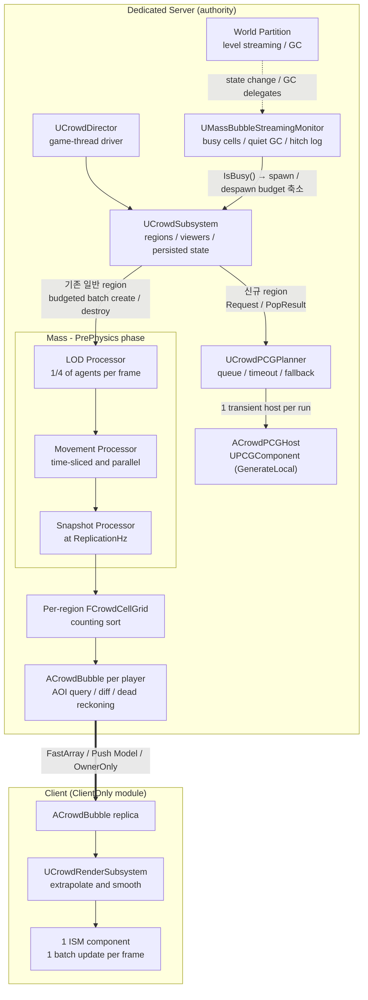

### 데이터 흐름

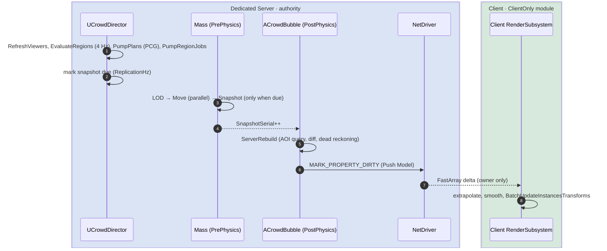

### 스레딩 모델

| 컴포넌트 | 실행 위치 | 근거 |
|---|---|---|
| `UCrowdDirector`, `UCrowdSubsystem` | Game thread | Entity create/destroy 같은 structural change는 Mass 처리 중에는 불가 → `IsProcessing()` 확인 후 실행 |
| `UCrowdPCGPlanner`, `ACrowdPCGHost` | Game thread | 계획 큐 · host actor 생성 / 파괴 · 결과 수신이 모두 game thread에서 이뤄집니다. 그래프 실행 자체는 PCG 실행기가 처리하고 끝나면 delegate로 알려 주며, `UCrowdSubsystem::PumpPlans`가 매 프레임 확인합니다 |
| `UMassBubbleStreamingMonitor` | Game thread (tickable world subsystem) | 레벨 스트리밍 상태 변경 · GC delegate가 game thread에서 호출됨. `UCrowdSubsystem`이 같은 thread에서 `IsBusy()`를 읽으므로 lock 불필요 |
| `UCrowdLODProcessor` | Game thread (`bRequiresGameThreadExecution`) | Game-thread-only 서브시스템(뷰어 목록)에 접근 |
| `UCrowdMovementProcessor` | Worker threads (`ParallelForEachEntityChunk`) | 자기 chunk 데이터만 쓰기, 설정은 불변 POD(Plain Old Data, 구조체) 스냅샷으로 읽기 |
| `UCrowdSnapshotProcessor` | Game thread | 서브시스템이 소유한 region grid에 쓰기 |
| `ACrowdBubble::Tick` | Game thread, `TG_PostPhysics` | PrePhysics Mass phase가 만든 스냅샷을 같은 프레임에 소비 |
| `UCrowdRenderSubsystem::Tick` | Client game thread | ISM transform 갱신 |

### 설계 원칙

- **서버만 원본 상태를 소유** : Mass entity는 서버 / standalone에서만 존재합니다 (`ExecutionFlags`, `ShouldCreateSubsystem`). 클라이언트는 양자화된 AOI 뷰만 가집니다.
- **액터 외부 상태 분리** : NPC 상태의 소유자는 Actor가 아니라 Region(서버 서브시스템)입니다. World Partition 셀 스트리밍과 생명주기가 분리됩니다.
- **고부하 작업은 스트리밍 유휴(Idle) 시점으로** : World Partition 셀이 로드 / 제거되는 동안에는 NPC spawn / despawn 시분할 처리시간 줄이고, 셀 언로드 후 GC는 고부하 셀이 없어질 때 실행합니다. GC 자체도 Incremental GC로 여러 프레임에 나눕니다. 서버의 한 프레임 지연은 모든 플레이어의 지연입니다.
- **최적화 항목마다 비활성화 수단(킬 스위치) 구현** : A/B 측정이 가능해야 최적화를 증명할 수 있습니다.
- **순수 로직은 헤더 온리(Header-Only)로 구현** : `CrowdMath.h`, `CrowdCellGrid.h`, `CrowdNetMath.h`, `CrowdWander.h`, `CrowdSmoothing.h`, `CrowdPlan.h`는 월드 · Mass · 네트워크 · PCG 없이 단위 테스트됩니다.
- **PCG는 생성기이고, 스케줄러는 Region입니다** : PCG 그래프는 새 region의 시작 위치(점)만 돌려줍니다. 언제 populate할지 · 시분할 처리시간 · 영속은 `UCrowdSubsystem`이 그대로 맡으므로, PCG를 켜도 spawn / 복원 경로는 하나로 유지됩니다.
- **유효하지 않은 상태는 설계 단계에서 원천 차단** : 설정값을 불변식에 맞게 clamp 합니다 (예: bubble 반경은 int16 안전 범위 이하).

---
## 구현 상세

### 1. Data-Oriented 시뮬레이션 (Mass Entity)

agent는 단일 Archetype(`FCrowdAgentTag` + fragment 4종)으로 표현합니다. fragment를 **접근 패턴 단위**로 쪼개, LOD 패스는 `Location`을 읽어 `LOD`만 쓰고, 이동 패스는 `Location` · `Motion` · `PendingDelta`를 갱신하며, snapshot 패스는 전부 읽기 전용으로 접근합니다. Mass는 chunk 안에 fragment별 연속된 배열로 저장하므로 쓰지 않는 데이터가 캐시 라인을 오염시키지 않고, 프로세서의 읽기/쓰기 선언(`EMassFragmentAccess`)을 통해 안전한 병렬 처리를 위한 데이터 의존성 관계가 확립됩니다.

```cpp
// Crowd/CrowdFragments.h (요약) — 합계 64 B / agent (+ entity handle 8 B = 72 B)
struct FCrowdAgentTag : FMassTag
{
};

struct FCrowdIdFragment : FMassFragment   // 16 B, read-mostly
{
	uint32 NetId;
	int32 HomeX;
	int32 HomeY;
	int32 RegionSlot;
};

struct FCrowdLocationFragment : FMassFragment   // 16 B, double (LWC)
{
	FVector2D Location;
};

struct FCrowdMotionFragment : FMassFragment   // 24 B
{
	FVector2f Velocity;
	float RetargetTimer;
	uint32 Rng;
	float Heading;       // 마지막 걷기 구간의 방향 (멈춰 있는 동안에도 유지)
	float CruiseSpeed;   // agent 고유의 순항 속도
};

struct FCrowdLODFragment : FMassFragment   //  8 B
{
	ECrowdLOD Tier;
	float PendingDelta;
};
```

- **LOD는 Tag가 아니라 Fragment 값입니다.** Tag 추가/제거는 Archetype 간 이동(structural change)이지만, 값 쓰기는 O(1)입니다.
- **`RegionSlot` 인덱스**로 snapshot 패스에서 agent당 hash lookup을 제거했습니다.
- **`FVector2D`(double) 위치**는 LWC(Large World Coordinates)에 안전하며, 양자화는 복제 경계에서만 수행합니다.
- 첫 agent는 런타임에 spawn되므로 시작 시점에는 매칭되는 Archetype이 없고, Mass는 매칭되는 Archetype이 없는 프로세서를 **최적화 대상에서 제외**(Query Pruning)합니다. 세 프로세서 모두 `ShouldAllowQueryBasedPruning()`이 `false`를 반환하고, 최초 spawn은 tickable subsystem(`UCrowdDirector`)이 초기화 및 트리거 역할을 수행합니다.

#### MassEntity 메모리 및 성능 최적화 지표 — Mass Debugger (PIE)

| 성능 평가 항목 | 측정 수치 및 명세 | 최적화 성과 및 기술적 의의 |
| :--- | :--- | :--- |
| **단일 아키타입 구성** | `0x742BE11D` (1개로 통합) | LOD 단계를 Tag가 아닌 Fragment 값으로 설계하여 상태 변화 시 발생하는 **동적 아키타입 이동 연산(Structural Change)을 원천 차단**했습니다. 사용자(뷰어)가 늘어 agent가 늘어도 Archetype은 1개로 유지되고, 그 안의 Entity · Chunk 수만 늘어납니다. |
| **개체당 메모리 최적화** | **72 B** (Fragment 64 B + Handle 8 B) | fragment 4종(16 + 16 + 24 + 8 B)에 entity handle 8 B를 더한 값입니다. Mass는 fragment별 연속 배열로 저장하므로 패스마다 필요한 fragment만 CPU 캐시에 올라옵니다. |
| **청크 점유율 (Occupancy)** | **68.7%** (평균 1,250 / 최대 1,820 Entity) | Entity 10,000개가 128 KiB 청크(Chunk) 8개에 담겨 있습니다 (72 B × 1,820 ≈ 128 KiB). 점유율은 청크가 얼마나 찼는지에 따라 달라지는 값입니다. |
| **메모리 파편화 낭비율** | **6.139%** (64.875 KiB) | 할당 1.031 MiB 중 낭비 64.875 KiB입니다. Entity 수에 따라 달라지는 값으로, 수가 적을 때 비율이 크게 나왔습니다. |
| **공간 복잡도 성능** | 구축: `O(N + cells)` / 질의: `O(방문 셀 + 에이전트)` | 복잡도를 최소화하고, 내부 배열을 `Reset()` 및 `EAllowShrinking::No`로 재사용하여 **초기 실행 이후 런타임 메모리 추가 할당**이 없습니다. |
| **네트워크 데이터 절감** | 개체당 데이터 **10B 압축** | 데이터 양자화 및 좌표 재설정(Origin Rebasing)을 통해 **기존 방식 대비 네트워크 송수신량을 약 81% 절감**했습니다. |

에디터 PIE에서 Mass가 위 구성대로 동작하는지 Mass Debugger로 확인한 캡처입니다. 구성 확인용이며 성능 벤치마크가 아닙니다.

<p align="center">
  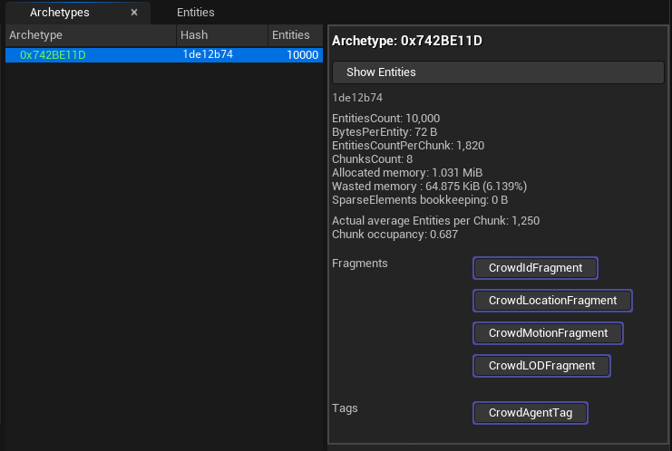<br>
  <sub>Mass Debugger › Archetypes — <code>0x742BE11D</code> · Entity 10,000 · Chunk 8</sub>
</p>

<p align="center">
  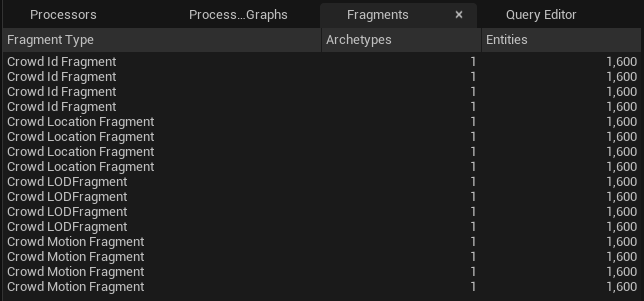<br>
  <sub>Mass Debugger › Fragments (<code>Coordinate Space</code> 변경 전 · Entity 1,600)</sub>
</p>

- **fragment 4종이 같은 entity 집합에 부착** : `Crowd Id` · `Location` · `Motion` · `LOD` Fragment 모두 같은 Archetype 1개에 붙어 있고, Entity 수는 Archetypes 탭과 같습니다.

<p align="center">
  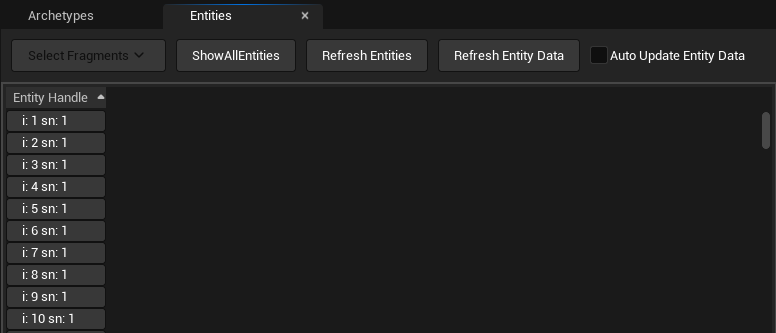<br>
  <sub>Mass Debugger › Entities</sub>
</p>

- **Entity 핸들** : Entities 탭의 핸들(`i`: index, `sn`: serial number)로 agent가 실제 entity로 생성되어 있음을 확인할 수 있습니다.

<p align="center">
  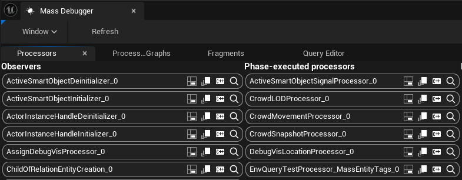<br>
  <sub>Mass Debugger › Processors</sub>
</p>

- **프로세서 등록** : `CrowdLODProcessor_0` · `CrowdMovementProcessor_0` · `CrowdSnapshotProcessor_0`가 *Phase-executed processors*에 등록되어 있습니다 (Observer가 아님). 같은 목록의 SmartObject · DebugVis · EnvQuery 계열은 엔진 / 플러그인 기본 프로세서입니다.

<p align="center">
  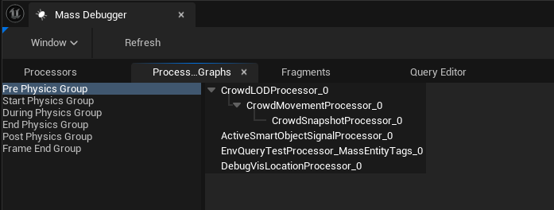<br>
  <sub>Mass Debugger › Process Graphs › Pre Physics Group</sub>
</p>

- **실행 순서** : `Pre Physics Group`에서 `CrowdLODProcessor` → `CrowdMovementProcessor` → `CrowdSnapshotProcessor`가 의존성 체인으로 이어져 있어, `ExecuteAfter`로 선언한 순서(LOD → Move → Snapshot)가 그대로 컴파일된 것을 볼 수 있습니다. 엔진 기본 프로세서는 별도 루트로 표시됩니다.

### 2. Region 기반 Population 스트리밍

NPC 상태의 소유자를 Actor가 아니라 서버 서브시스템의 **Region**으로 두었습니다 (기본 128 m : World Partition 런타임 그리드 셀 크기와 맞추도록 설계). World Partition 셀이 unload/reload 되어도 NPC가 사라지거나 초기화되지 않습니다.

```cpp
// Crowd/CrowdSubsystem.h
enum class ECrowdRegionState : uint8
{
	Inactive,   // 엔티티가 없으며, 보존된 압축 상태만 남음
	Planning,   // 한 번도 populate된 적 없음: 스폰 계획(PCG 그래프 실행)을 기다리는 중, 엔티티 없음
	Spawning,   // 엔티티가 슬라이스 단위로 생성되는 중 (프레임당 할당된 생성 제한에 맞춤)
	Active,     // 엔티티가 배치가 완료되었고 시뮬레이션이 활성화된 상태
	Despawning, // 압축 상태를 보존하고 엔티티를 차례대로 소멸시키는 중
};
```

```cpp
// Crowd/CrowdSubsystem.cpp — TickDirector / PumpRegionJobs
// Mass 프레임워크가 프로세싱 중이 아닐 때만 구조적 변경(생성 / 소멸)이 허용됩니다.
if (!EntityManager->IsProcessing())
{
	PumpRegionJobs();
}

// PumpRegionJobs: 개수가 아니라 실제 시간으로 제한합니다. (요약)
const bool bBudgeted = CrowdCVars::BudgetedPump != 0;                          // 0 = 이전 고정 개수 방식 (A/B)
const bool bStreamingBusy = Monitor.IsValid() && Monitor->IsBusy();            // WP가 셀을 로드 / 추가 / 제거 중인가
const double BudgetMs = bStreamingBusy ? T.SpawnBudgetBusyMs : T.SpawnBudgetMs; // 0.25 ms : 1.0 ms
const double Deadline = FPlatformTime::Seconds() + 0.001 * BudgetMs;
const int32 Batch = bBudgeted ? T.StructuralBatchSize : T.MaxSpawnPerFrame;    // 64

int32 Budget = T.MaxSpawnPerFrame;                                             // 프레임당 하드 캡
bool bDidWork = false;
while (Budget > 0 && SpawnQueue.Num() > 0)
{
	// 프레임당 최소 1 batch는 항상 진행하고, 시분할 처리시간을 넘기면 다음 프레임으로 넘깁니다.
	if (bBudgeted && bDidWork && FPlatformTime::Seconds() >= Deadline)
	{
		break;
	}

	FCrowdRegion& Region = Regions[SpawnQueue[0]];
	// BatchCreateEntities(엔티티 일괄 생성)
	const int32 Used = SpawnSlice(Region, FMath::Min(Budget, Batch));
	Budget -= FMath::Max(Used, 1);
	bDidWork = true;
	if (Region.State == ECrowdRegionState::Active)
	{
		SpawnQueue.RemoveAt(0);
	}
	// 아직 agent가 남은 region은 다음 반복(또는 다음 프레임)이 이어서 처리합니다.
}
// despawn도 같은 규칙입니다 (DespawnBudgetMs / DespawnBudgetBusyMs, BatchDestroyEntities)
```

- **스트리밍 대상 연산** : 각 뷰어(플레이어 및 가상 뷰어) 주변 체비쇼프(Chebyshev) 반경을 중심으로 `ActiveRegionRadius`(기본 2 → 5×5)를 **4 Hz** 주기로 활성화 대상을 실시간으로 관리합니다.
- **우선순위** : 새로 활성화할 region은 가장 가까운 뷰어 기준 오름차순으로 처리해 플레이어 주변부터 채웁니다.
- **사용자 수에 따른 규모** : 활성 region은 모든 뷰어 5×5 영역의 합집합이라(겹치는 region은 한 번만 계산) 사용자(뷰어)가 늘면 활성 region과 agent가 늘어납니다. Mass에서는 단일 Archetype 안의 Entity · Chunk 수가 늘고 Archetype은 1개로 유지됩니다. 뷰어 1명(25 region)에서 모든 region이 상한(`AgentsPerRegion` 400)까지 채워지면 10,000개입니다.
- **비활성화 유예 (Hysteresis 완충 처리)** : 더 이상 필요 없는 region은 `RegionDeactivateDelaySec`(10초) 동안 유지한 뒤 despawn 처리합니다. 이를 통해 영역 경계를 반복해서 오가는 플레이어로 인해 발생하는 불필요한 Spawn/Despawn 처리를 방지합니다. 스폰 계획을 기다리는 `Planning` region도 같은 유예 뒤에 계획이 취소됩니다 ([PCG 스폰 계획](#3-pcg-스폰-계획)).
- **시분할 기반 타임슬라이싱 (Time-slicing)** : 개수가 아니라 **시간**으로 제한합니다. `StructuralBatchSize`(64)개씩 `BatchCreateEntities` / `BatchDestroyEntities`를 호출하고 매 batch 뒤에 시계를 확인해, `SpawnBudgetMs` / `DespawnBudgetMs`(각 1.0 ms)를 넘으면 다음 프레임으로 넘깁니다. 프레임당 최소 1 batch는 항상 진행하므로 대기열이 멈추지 않고, `MaxSpawnPerFrame`(500) / `MaxDespawnPerFrame`(1,000)은 하드 캡으로 남습니다.
- **스트리밍 연동 시분할 시간** : `UMassBubbleStreamingMonitor`가 World Partition 셀의 로딩 / AddToWorld / RemoveFromWorld를 감지하는 동안(`IsBusy()`)에는 시분할 시간이 `SpawnBudgetBusyMs` / `DespawnBudgetBusyMs`(각 0.25 ms)로 줄어듭니다. 엔진이 이미 프레임을 쓰는 구간에 NPC 구조 변경까지 얹지 않기 위해서입니다.
- **A/B** : `opt.crowd.BudgetedPump 0`이면 이전 방식(프레임당 고정 500 / 1,000개, 시계 확인 없음)으로 돌아가 스트리밍 Hitch를 재현할 수 있습니다.
- **결정론적 복원** : despawn 시 `FCrowdSavedAgent`(NetId, 위치, 속도, retarget timer, RNG state, 진행 방향, 순항 속도)를 메모리에 보존하고 재활성화 때 그대로 복원합니다. PCG를 쓰지 않거나 그래프가 실패한 경우의 최초 생성은 `Seed = Hash32(regionCoordHash ^ WorldSeed)`와 agent별 xorshift32로 재현 가능하고, PCG를 쓰는 경우에는 그래프가 낸 점에서 결정론적으로 만들어져(같은 region · 같은 그래프 · 같은 월드 데이터 = 같은 점) 같은 보존 경로로 복원됩니다.

### 3. PCG 스폰 계획

새로운 리전(Region)이 활성화될 때 인구가 배치된 적이 없다면, 에이전트를 단순 균일 난수로 무작위 배치하는 대신 **PCG 그래프**에 이 리전의 에이전트가 어디서 시작하는지를 질의합니다. 이에 따라 디자이너가 그래프로 정의한 밀도와 분포가 서버 인구(Population)의 초기 상태가 됩니다.

이 구조에서 **PCG는 순수한 데이터 생성기** 역할을 수행하며, region을 언제 채울지(뷰어 위치, 유예 시간, 시분할 처리, 영속성 등)에 대한 제어는 기존과 같이 UCrowdSubsystem이 담당합니다. PCG 그래프는 스포너 노드 없이 오직 포인트(Point) 데이터만 반환하며, 이 점들을 에이전트로 변환하는 규칙은 월드, UObject, PCG 등에 대한 의존성 없이 독립적으로 테스트할 수 있는 `CrowdPlan::BuildAgents` 함수에 구현되어 있습니다.

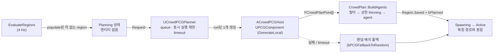

```cpp
// Crowd/CrowdSubsystem.cpp — BeginSpawn (요약)
if (Region.bPlanned || Region.Saved.Num() > 0)
{
	StartSpawning(Region);   // 인구가 이미 정해진 region(영속 / 계획됨)은 그대로 복원
	return;
}
if (CanPlanWithPCG())        // opt.crowd.PCG != 0 && planner 존재 && 그래프 로딩 중 / 준비됨
{
	BeginPlan(Region);       // State = Planning, UCrowdPCGPlanner::Request(coord, seed, cap)
	return;
}
StartSpawning(Region);       // PCG 없음: region seed에서 결정론적으로 랜덤 생성
```

#### PCG 그래프 작성 규칙

- 출력 데이터 및 좌표계
  - 출력 노드의 포인트 데이터는 정확히 region 하나 분량이어야 합니다.
  - 그래프는 리전 바운드를 기준으로 한 번만 실행되며, 출력되는 점은 월드 좌표계를 따릅니다. 에이전트는 AgentGroundZ 높이에서 이동하므로 X와 Y 좌표만 사용됩니다.
- 그리드 좌표 공간 (Coordinate Space) 설정
  - **`Create Points Grid`** 노드의 좌표 공간은 Origin Component로 설정해야 합니다.
  - 매 실행마다 리전 중심에 생성되는 호스트 액터를 기준으로 그리드가 만들어지므로, 모든 리전이 일관된 규칙으로 포인트를 수신할 수 있습니다.
- 밀도(Density) 및 에이전트 수 산정
  - 밀도가 0 이하인 포인트는 유효하지 않은 점으로 간주합니다.
  - 유효 포인트의 개수가 곧 해당 리전의 에이전트 수가 되며, 설정된 `AgentsPerRegion` 값을 초과할 경우 균일하게 축소합니다.
- 높이 바운드 설정
  - 높이 방향 바운드는 AgentGroundZ를 기준으로 위아래 1PCGBoundsHalfHeightCm1(기본값 100m) 범위로 설정됩니다.
  - 랜드스케이프나 메시를 샘플링하는 그래프는 이 값을 실제 지형 높이에 알맞게 맞추어야 합니다.
- 스포너 노드 배제
  - PCG 그래프 내부에서 액터나 엔티티를 직접 생성하는 스포너 노드는 사용하지 않습니다.
  - Mass Entity 생성 및 관리는 전적으로 `UCrowdSubsystem`이 담당합니다.
- 에셋 패키징 및 폴백(Fallback) 처리
  - 데디케이티드 서버를 포함한 쿠킹된 빌드에는 반드시 해당 PCG 그래프 에셋이 포함되어야 합니다.
  - 에셋 로드에 실패할 경우 `[CrowdPCG]` 에러 로그를 기록하고 기존의 랜덤 배치 방식으로 안전하게 폴백합니다.
<p align="center">
  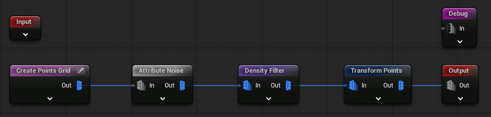<br>
  <sub>Spawn Graph <code>PCG_MassAgentSpawner</code> — Create Points Grid → Attribute Noise → Density Filter → Transform Points → Output</sub>
</p>

#### 진단과 A/B

| 도구 | 용도 |
|---|---|
| `opt.crowd.PCG` (0 / 1) | 아직 populate되지 않은 region을 PCG 없이 랜덤 배치 (A/B). 이미 populate된 region은 그대로 유지됩니다 |
| `opt.crowd.PCG.Stats` | planner 상태(그래프 로딩 / ready / FAILED), 큐 · 실행 중 수, 요청 · 성공 · 실패 · timeout · 취소 수, 평균 / 최대 지연 시간 |
| `opt.crowd.PCG.Replan` | 비활성 region의 계획 · 영속 상태를 지워, 다음에 필요해질 때 현재 그래프 · 설정으로 다시 생성 (그래프를 고친 뒤). Active region은 agent를 유지합니다 |
| `stat OptCrowd` · CSV | `PCG Plan Pump` 사이클 · `Plan` 타이밍 · `PlansPending` |
| `opt.crowd.Stats` · `[Hitch]` 로그 | `planning` region 수, `pcg plans pending` |
| Verbose 로그 | `[Crowd] region (x,y) planned: 점 → agent` (거부 · 솎음 내역과 지연 시간 포함). 첫 계획이 도착하면 `[CrowdPCG] first plan arrived`가 한 번 남습니다 |

### 4. 거리 기반 LOD와 Time-slicing

| Tier | 거리 (가장 가까운 뷰어 기준) | 시뮬레이션 주기 |
|---|---|---|
| High | < 40 m | 매 프레임 |
| Medium | 40 – 100 m | 2 프레임마다 |
| Low | 100 – 200 m | 6 프레임마다 |
| Off | ≥ 200 m | 동결 |

```cpp
// Crowd/CrowdMath.h — hysteresis 완충 구역을 적용한 LOD 티어 계산
inline ECrowdLOD ComputeTier(float Dist, ECrowdLOD Current, const FCrowdTuning& T)
{
	const ECrowdLOD Wanted =
		Dist < T.LODDistanceCm[0] ? ECrowdLOD::High :
		Dist < T.LODDistanceCm[1] ? ECrowdLOD::Medium :
		Dist < T.LODDistanceCm[2] ? ECrowdLOD::Low : ECrowdLOD::Off;

	if (Wanted == Current)
	{
		return Current;
	}
  
	// 더 하위 티어로 전환: '경계선 + 완충 거리(Hysteresis)'를 초과해야만 전환
	if (static_cast<uint8>(Wanted) > static_cast<uint8>(Current))
	{
		return Dist > T.LODDistanceCm[static_cast<int32>(Current)] + T.LODHysteresisCm ? Wanted : Current;
	}
	// 더 상위(세밀한) 티어로 전환: '경계선 - 완충 거리(Hysteresis)' 안으로 진입해야만 전환
	return Dist < T.LODDistanceCm[static_cast<int32>(Wanted)] - T.LODHysteresisCm ? Wanted : Current;
}
```

```cpp
// Crowd/CrowdProcessors.cpp — UCrowdMovementProcessor : 티어별 타임슬라이싱(Time-slicing) 수행
// 0 = 동결, 1 = 매 프레임 업데이트, N = N 프레임마다 업데이트 (NetId를 기준으로 에이전트들을 여러 프레임에 균등 분산)
const int32 Interval = bTimeSlice ? Tuning.LODIntervalFrames[static_cast<int32>(LOD.Tier)] : 1;
if (Interval == 0)
{
	continue;
}
if (Interval > 1 && ((Frame + Ids[i].NetId) % static_cast<uint32>(Interval)) != 0u)
{
	LOD.PendingDelta += DeltaTime;   // 업데이트가 스킵된 프레임의 누적 델타 시간을 기록
	continue;
}
const float Step = FMath::Min(LOD.PendingDelta + DeltaTime, Tuning.MaxStepDeltaSec);
LOD.PendingDelta = 0.f;

```

- **LOD 분산 처리(Time-slicing)** : 에이전트 NetId와 프레임 카운트에 비트 연산(& 3)을 적용해서 매 프레임 전체의 1/4씩만 LOD를 재분류하여 CPU 스파이크 방지합니다.
- **델타 시간 누적 및 상한 제어** : 스킵된 프레임 시간을 누적해 다음 업데이트 때 일괄 연산하되, 상한선(MaxStepDeltaSec, 0.5초)을 두어 순간이동 현상 방지합니다.
- **시각적 불일치(Desync) 차단** : 동결(Off 티어)된 에이전트의 스냅샷 속도를 0으로 강제하여, 클라이언트 외삽(Extrapolation) 시 멈춘 NPC가 걸어 다니는 시각적 오류 차단합니다.

```cpp
// Crowd/CrowdProcessors.cpp — UCrowdSnapshotProcessor
// 클라이언트 측 외삽(Extrapolation)으로 인해 서버에서 동결된 에이전트가 이동하는 시각적 오류를 방지하고자, Off 티어는 속도를 0으로 강제함
const FVector2f Velocity = (LODs[i].Tier == ECrowdLOD::Off) ? FVector2f::ZeroVector : Motions[i].Velocity;
```

### 5. 병렬 이동 처리

Movement Processor는 `bRequiresGameThreadExecution = false`이며 `ParallelForEachEntityChunk`로 chunk를 worker thread에 분산합니다.

```cpp
// Crowd/CrowdProcessors.cpp — UCrowdMovementProcessor::Execute
std::atomic<int32> Simulated{ 0 };

// 자체 Chunk의 데이터만 수정하므로, 여러 Chunk에서 병렬로 안전하게 실행할 수 있습니다.
auto ProcessChunk = [&](FMassExecutionContext& ChunkContext)
{
	int32 LocalSimulated = 0;
	// ... agent 루프: time-slicing(시간 분할) → CrowdWander::Advance (배회 구간 · region 경계 band · 안전 clamp)
	Simulated.fetch_add(LocalSimulated, std::memory_order_relaxed);   // chunk당 atomic 1회 (Clamped 카운터도 동일)
};

if (CrowdCVars::ParallelMove != 0)
{
	EntityQuery.ParallelForEachEntityChunk(Context, ProcessChunk);
}
else
{
	EntityQuery.ForEachEntityChunk(Context, ProcessChunk);
}
```

- **Thread-safety 근거** — (1) chunk-local write만 수행, (2) 설정은 UObject가 아니라 불변 POD 스냅샷 `FCrowdTuning`에서 읽음, (3) RNG state가 agent별 fragment 안에 있어 공유 난수 생성기가 없음, (4) 통계 카운터(`Simulated`, `Clamped`)는 chunk 단위로 모아 각각 atomic 1회.
- **배회 모델 (`CrowdWander.h`)** : agent는 직선 **구간**(`MinRetargetSec`–`MaxRetargetSec`)을 등속으로 걷고, 다음 구간의 방향은 이전 방향에 작은 회전(≤ `MaxTurnDeg`)을 더한 값입니다. 구간 하나가 곧 dead reckoning이 보낼 (위치, 속도) 한 쌍이라 부드러운 움직임이 대역폭을 더 쓰지 않습니다. region 경계에서는 반사하지 않고, 경계 안쪽 **band**에서 모든 agent가 같은 회전율(`WallTurnRateDeg`)로 휘어 빠져나오게 해 열린 땅의 밀도를 균일하게 유지합니다. 스텝은 구간 경계에서 쪼개지므로 time-slicing으로 건너뛰며 걸어도 같은 경로를 걷습니다. 모델 전체가 순수 함수이고 `Crowd.Wander.*` 테스트가 검증합니다.
- `UCrowdSubsystem`은 `TMassExternalSubsystemTraits`에서 `GameThreadOnly = true`로 선언해, 이 서브시스템을 요구하는 프로세서(LOD, Snapshot)가 game thread에서만 접근하도록 명시합니다.

#### Unreal Insights 검증

<p align="center">
  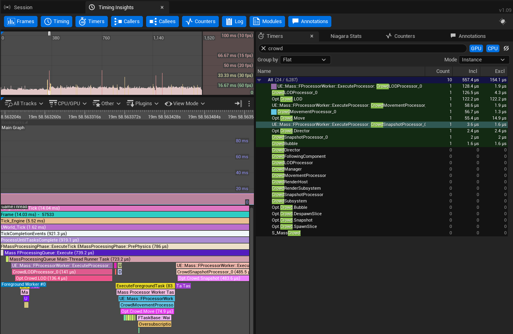<br>
  <sub>Unreal Insights › Timing Insights — 타이머 필터 <code>crowd</code></sub>
</p>

- **스레드 배치** : `CrowdLODProcessor_0`(≈ 141 µs)와 `CrowdSnapshotProcessor_0`(≈ 485 µs, snapshot이 실행된 프레임)는 Game Thread의 `MassProcessingQueue Main-Thread Runner Task` 안에서, `CrowdMovementProcessor`(`Opt.Crowd.Move` ≈ 75 µs)는 `Foreground Worker #0`의 `Mass Processor Worker Task`에서 실행됩니다. [스레딩 모델](#스레딩-모델) 표의 배치(LOD · Snapshot = game thread, Movement = worker)와 같습니다.
- **`OPT_SCOPE` 이벤트** : 프로세서 스코프 안에 `Opt.Crowd.LOD` / `Opt.Crowd.Move` / `Opt.Crowd.Snapshot`이 중첩되어 보이고, 타이머 패널에는 `Opt.Crowd.Director`, `Opt.Crowd.Bubble`, `Opt.Crowd.SpawnSlice` / `DespawnSlice`가 같은 이름 체계로 나열됩니다 ([계측과 실험 설계](#계측과-실험-설계-프로파일-결과)).
- **프레임 비중** : 이 프레임에서 Mass `PrePhysics` phase 전체는 ≈ 0.79 ms, 프레임은 14.03 ms입니다. 단일 프레임 샘플이므로 벤치마크가 아니며, 비교 측정은 A/B 스위치로 합니다.

### 6. Snapshot과 공간 격자

복제 계층이 Mass `EntityManager`를 직접 순회하지 않도록, Snapshot Processor가 `ReplicationHz`(기본 10 Hz)마다 위치 · 속도 · ID를 region별 평탄(flat) 배열로 복사합니다. 스냅샷이 필요 없는 프레임은 쿼리를 아예 실행하지 않고 반환합니다.

```cpp
// Crowd/CrowdProcessors.cpp — UCrowdSnapshotProcessor::Execute
UCrowdSubsystem* Crowd = Context.GetMutableSubsystem<UCrowdSubsystem>();
if (Crowd == nullptr || !Crowd->IsSnapshotDue())
{
	return; 
}
```

Region(128 m)마다 8×8 셀(셀 16 m)의 **균일 격자**를 두고, 스냅샷마다 **counting sort**로 처음부터 다시 만듭니다.

```cpp
// Crowd/CrowdCellGrid.h — EndBuild
for (int32 i = 0; i < Num; ++i)                      // 히스토그램 (셀별 에이전트 수 카운트)
{
	const int32 Cell = CellIndex(Agents[i].Pos);
	CellOfAgent[i] = Cell;
	++CellStart[Cell + 1];
}
for (int32 c = 0; c < NumCells; ++c)                 // 셀별 시작 offset 계산
{
	CellStart[c + 1] += CellStart[c];
}
// ... Cursor = copy of CellStart
for (int32 i = 0; i < Num; ++i)                      // 셀 정렬 순서대로 에이전트 인덱스 배치
{
	Order[Cursor[CellOfAgent[i]]++] = i;
}
```

- **복잡도** : 격자 구축 O(N + cells), 질의 O(방문 셀 + 내부에 유효한 agent 수). 내부 배열은 `Reset()` / `EAllowShrinking::No`로 재사용하므로 초기 실행 이후 할당이 없습니다.
- **Region별 격자인 이유** : 격자가 작아(8×8) 캐시에 상주하고, 월드가 수십 km여도 비용이 늘지 않습니다. 전역 단일 dense 격자는 수 km 떨어진 플레이어들을 모두 덮는 bounding box가 필요합니다.
- **질의** : 원의 AABB(사각형) → 셀 범위 → 제곱거리(`sqrt` 없음)로 정확한 원 판정. region 밖으로 삐져나온 agent는 경계 셀로 clamp되어 **유실되지 않으며**, 이 성질은 테스트로 검증합니다.
- **Snapshot Scope** : 모든 live region이 아니라 **실제 플레이어의 bubble에 닿는 region만** snapshot합니다 (`BubbleRadiusCm` + `SnapshotMarginCm`(20 m) 반경). 서버 전용 봇(virtual viewer)만 보는 region은 어차피 복제되지 않으므로 grid 구축(복사 + counting sort)을 건너뜁니다. 범위 밖 region의 grid는 오래된 데이터이므로 `ForEachAgentInCircle`도 해당 region을 건너뛰어 stale agent를 내보내지 않습니다. `opt.crowd.SnapshotScope 0`이면 이전 동작(모든 live region)으로 돌아갑니다.

```cpp
// Crowd/CrowdSubsystem.cpp — BeginSnapshot (요약)
const double Reach = T.BubbleRadiusCm + T.SnapshotMarginCm;      // 15,000 + 2,000 cm
for (const FCrowdViewer& Viewer : Viewers)
{
	if (Viewer.bVirtual)
	{
		continue;   // 봇 / anchor는 복제 대상이 아님
	}
	// Viewer ± Reach 사각형이 덮는 region 중 Active / Spawning 상태인 것만 RegionSnapshotMask[Slot] = 1
}
// mask가 켜진 region의 Grid만 BeginBuild / EndBuild 합니다.
// ForEachAgentInCircle은 mask 밖 region(= 오래된 grid)을 건너뜁니다.
```

### 7. 플레이어별 AOI 복제 — `ACrowdBubble`

400명짜리 이웃을 400개의 replicated Actor로 만들지 않고, **플레이어당 Actor 1개**가 AOI 전체를 FastArray로 복제합니다 (Epic의 MassReplication 플러그인이 쓰는 Client Bubble 계열의 접근과 같은 아이디어를 최소 구현으로 작성했습니다).

```cpp
// Net/CrowdBubble.cpp — 생성자와 복제 프로퍼티
ACrowdBubble::ACrowdBubble()
{
	bReplicates = true;
	bOnlyRelevantToOwner = true;        // 소유 클라이언트에게만 relevant
	bAlwaysRelevant = false;
	bNetLoadOnClient = false;
	SetNetUpdateFrequency(20.f);        // Push Model이 비교 대상을 결정 → dirty가 없으면 비용 0
	SetMinNetUpdateFrequency(2.f);
	PrimaryActorTick.TickGroup = TG_PostPhysics;   // PrePhysics Mass phase가 만든 snapshot을 같은 프레임에 소비
}

void ACrowdBubble::GetLifetimeReplicatedProps(TArray<FLifetimeProperty>& OutLifetimeProps) const
{
	Super::GetLifetimeReplicatedProps(OutLifetimeProps);

	FDoRepLifetimeParams Params;
	Params.bIsPushBased = true;
	Params.Condition = COND_OwnerOnly;
	DOREPLIFETIME_WITH_PARAMS_FAST(ACrowdBubble, AgentArray, Params);
	DOREPLIFETIME_WITH_PARAMS_FAST(ACrowdBubble, OriginLattice, Params);
}
```

`ServerRebuild()`는 `SnapshotSerial`이 바뀐 프레임(≈ `ReplicationHz`)에만 실행되며 네 단계로 구성됩니다.

1. **기준점 이동** : 뷰어가 origin에서 110 m를 넘어 벗어났을 때만 갱신합니다.
2. **관심구역 필터링** : `ForEachAgentInCircle`로 반경 내 후보를 모으고, `MaxAgentsPerBubble`(400)을 넘으면 순위(`CrowdNet::InterestRank`)가 높은 상위 N개만 남깁니다. 이미 복제 중인 agent는 10 % 더 가까운 것으로 치고 반경의 110 %까지 머무를 수 있어(`InterestCandidate`), 관심구역 경계에서 agent가 들락날락하며 전체 레코드를 다시 보내는 일이 줄어듭니다 (테스트 `Crowd.Interest`).
3. **진입/유지/이탈 판정** : `NetId → index` 맵과 epoch mark-and-sweep으로 진입 / 유지 / 이탈을 판정합니다.
4. **Dirty 마킹** : 바뀐 item만 `MarkItemDirty`, 구조가 바뀌면 `MarkArrayDirty`, 마지막에 Push Model dirty.

```cpp
// Net/CrowdBubble.cpp — ServerRebuild (요약)
++Epoch;
for (const FCandidate& Candidate : Candidates)
{
	const int32* IndexPtr = IdToIndex.Find(Agent.NetId);
	if (IndexPtr == nullptr)                          // 1) interest set에 진입
	{
		const int32 NewIndex = Items.AddDefaulted();
		FillItem(Items[NewIndex], Agent, OriginWorld, Now);
		Items[NewIndex].SeenEpoch = Epoch;
		IdToIndex.Add(Agent.NetId, NewIndex);
		AgentArray.MarkItemDirty(Items[NewIndex]);
		++NumDirty;
		bStructural = true;
		continue;
	}

	FCrowdAgentItem& Item = Items[*IndexPtr];         // 2) 유지: 클라이언트의 믿음에서 벗어났을 때만 재전송
	Item.SeenEpoch = Epoch;
	if (bRebase || CrowdNet::ShouldResend(Agent.Pos, Agent.Vel, Item.SentPos, Item.SentVel,
	                                      Now - Item.SentTime, Tolerance, Tuning.VelocityEpsCmPerSec))
	{
		FillItem(Item, Agent, OriginWorld, Now);
		AgentArray.MarkItemDirty(Item);
		++NumDirty;
	}
}

for (int32 i = Items.Num() - 1; i >= 0; --i)         // 3) 이탈: swap-remove, 항목당 O(1)
{
	if (Items[i].SeenEpoch == Epoch)
	{
		continue;
	}
	IdToIndex.Remove(Items[i].NetId);
	Items.RemoveAtSwap(i);
	if (i < Items.Num())   // 마지막 요소가 i로 이동했다
	{
		IdToIndex[Items[i].NetId] = i;
	}
	bStructural = true;
}

if (bStructural)
{
	AgentArray.MarkArrayDirty();
}
if (bStructural || NumDirty > 0)
{
	MARK_PROPERTY_DIRTY_FROM_NAME(ACrowdBubble, AgentArray, this);
}
// Push Model: 이 호출이 없으면 프로퍼티는 비교조차 되지 않는다 (FastArray의 MarkItemDirty와는 별개)
```

> `opt.crowd.DeadReckoning 0`이면 `ShouldResend` 대신 "움직이거나 방금 멈춘 agent는 매 tick 재전송"하는 기존 로직이 실행됩니다 (A/B 측정용).

#### Iris / Legacy 복제 겸용 설계

`FCrowdAgentArray`는 표준 `FFastArraySerializer`라서 legacy NetDriver(`NetDeltaSerialize`)와 Iris(기존 FastArray 정의 지원) **양쪽에서 동작**하며, 같은 빌드를 `-UseIrisReplication=0 / 1` 파라미터로 바꿔 가며 비교할 수 있습니다. 두 시스템의 동작 차이 때문에 다음 처리가 들어 있습니다.

```cpp
// Net/CrowdBubble.cpp — ServerRebuild: swap-remove 이후 (요약)
Items.RemoveAtSwap(i);
if (i < Items.Num())
{
	FCrowdAgentItem& Moved = Items[i];                  // 마지막 요소가 slot i로 이동
	IdToIndex[Moved.NetId] = i;
	FillItem(Moved, Candidates[Moved.CandidateIndex].Agent, OriginWorld, Now);   // agent의 현재 상태로 갱신
	AgentArray.MarkItemDirty(Moved);                    // slot i의 내용이 바뀌었으므로 전송
}

// Net/CrowdBubble.h — FCrowdAgentItem::MarkReceived: 복제 값이 실제로 바뀐 경우에만 외삽 시계를 다시 시작
if (bFirstTime || NetId != AppliedNetId || X != AppliedX || Y != AppliedY || VX != AppliedVX || VY != AppliedVY)
{
	RecvTime = Now;
	// Applied* = 현재 복제 값
}
```

- **`Swap-Remove 이후 재전송 이슈 (Iris 호환성)`**: 레거시 FastArray 직렬화는 각 아이템을 고유한 고유 ID(ReplicationID)로 추적하므로 RemoveAtSwap으로 배열 순서가 바뀌어도 추가적인 네트워크 비용이 발생하지 않습니다. 반면, UE 5의 새로운 Iris 복제 시스템은 배열의 '인덱스'를 기준으로 엘리먼트를 식별합니다. 따라서 빈 슬롯 i로 이동한 마지막 아이템은 Iris 입장에서 i번 슬롯의 내용이 변경된 것으로 인식되어 클라이언트에 다시 전송됩니다. 이때 중요하게 처리해야 할 점은, 슬롯 i로 옮겨진 에이전트의 데이터를 현재 최신 상태로 먼저 갱신해주어야 한다는 것입니다. 그렇지 않으면 클라이언트가 과거의 오래된 기준 위치를 바탕으로 외삽(Extrapolation)을 새로 시작하게 되어, 캐릭터가 순간적으로 뒤로 강하게 튀는(Rubber-banding) 시각적 부작용이 발생합니다.
- **`MarkReceived`** : Iris는 값이 같은 item도 보고할 수 있습니다. 그때마다 `RecvTime`을 갱신하면 agent가 마지막 기준 위치로 돌아가 같은 거리를 다시 걷게 되므로, 직전에 적용한 값(`Applied*`)과 다를 때만 시계를 재시작합니다.
- **`operator==`** : Iris(와 FastArray 변경 감지)는 item을 값으로 비교하므로 복제 필드(`NetId`, `X`, `Y`, `VX`, `VY`)만 비교에 참여시킵니다. 서버 / 클라이언트 bookkeeping 필드는 제외됩니다.
- **`bReplicateUsingRegisteredSubObjectList = true`** : Iris는 등록된 sub object 목록으로만 sub object를 복제합니다. 지금 bubble에는 sub object가 없지만, 추가돼도 올바르게 동작하도록 켜 두었습니다.
- **확인 방법** : 콘솔 `opt.net.Info`는 이 프로세스가 요청한 복제 시스템(Iris / legacy)과 `net.IsPushModelEnabled`, `net.SubObjects.DefaultUseSubObjectReplicationList`(Iris는 1 필요)를 로그로 남깁니다. Iris가 실제로 bubble을 복제하는지는 `Net.Iris.PrintPushBasedStatuses`(`CrowdBubble`이 `PushBased: 1`로 표시되어야 함)와 시작 시 `LogIris` 로그로 확인하고, 클라이언트 `opt.crowd.RenderStats 1` 화면 출력에도 `net=` 항목으로 복제 모드가 표시됩니다.

#### Network Insights 검증 분석

Iris와 Legacy FastArray 모두에서 `ACrowdBubble`의 `AgentArray`가 클라이언트로 정상 복제되는 것을 확인했습니다. 두 캡처는 서로 다른 실행 환경에서 추출한 패킷으로, 대역폭 비교(KB/s 벤치마크)가 아닌 **런타임 직렬화 및 복제 경로 검증**을 목적으로 합니다.

<p align="center">
  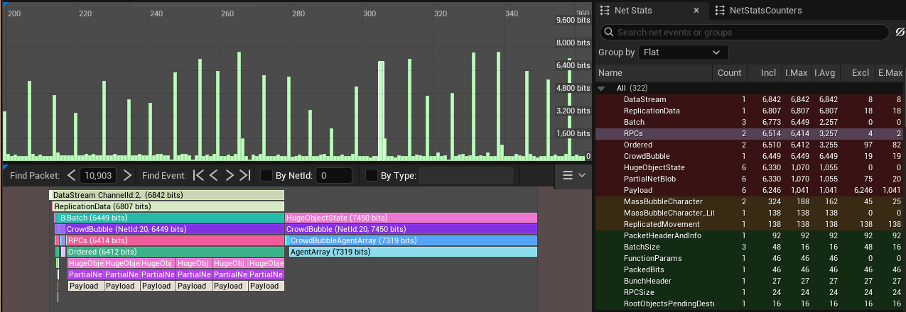<br>
  <sub>Networking Insights › Iris (<code>-UseIrisReplication=1</code>) — <code>DataStream</code> 패킷, <code>AgentArray</code> 전체가 <code>HugeObjectState</code> → <code>PartialNetBlob</code> 조각으로 전송</sub>
</p>

<p align="center">
  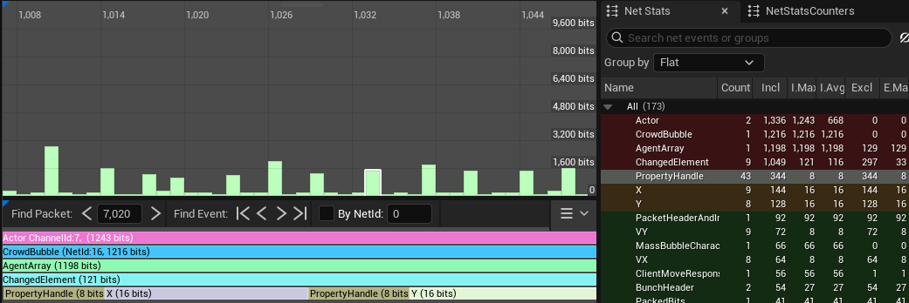<br>
  <sub>Networking Insights › legacy FastArray (<code>-UseIrisReplication=0</code>) — <code>Actor</code> 채널 패킷, 변경된 element만 <code>ChangedElement</code>로 전송</sub>
</p>

| 분류 | Iris (`-UseIrisReplication=1`) | Legacy FastArray (`-UseIrisReplication=0`) |
| :--- | :--- | :--- |
| **최상위 이벤트** | `DataStream` (Channel 2 / 6,842 bits) | `Actor` (Channel 7 / 1,243 bits) |
| **버블 오브젝트** | `CrowdBubble` (NetId 20) | `CrowdBubble` (NetId 16 / 1,216 bits) |
| **`AgentArray` 구조** | `HugeObjectState` ➔ `CrowdBubbleAgentArray` (7,319 bits) | `AgentArray` (1,198 bits) |
| **전송 단위** | `PartialNetBlob` (6조각 분할 스트리밍 / 총 6,246 bits) | `ChangedElement` (9개 가변 데이터 / 총 1,049 bits) |
| **하위 프로퍼티** | 없음 (배열 전체가 단일 모놀리식 블록으로 직렬화) | `PropertyHandle` + `X·Y` · `VX·VY` 개별 필드 분리 |
- **복제 파이프라인 활성화 교차 검증**: 동일한 버블 컨테이너 데이터가 구동 모드에 따라 상이한 최상위 채널(`DataStream` vs `ActorChannel`)로 완벽히 분기되는 것을 확인했습니다. 타임라인 이벤트 구조의 근본적인 차이(`HugeObjectState` ➔ `PartialNetBlob` 패킷 분할 메커니즘 vs `ChangedElement` 가변 델타 동기화)를 통해 엔진 레벨에서 런타임에 직렬화 아키텍처가 완전히 교체 적용됨을 실증했습니다.
- **Legacy FastArray 정밀 델타 전송 및 와이어 포맷 정합성**: 동기화 처리가 필요한 에이전트 데이터만 9개의 `ChangedElement` 이벤트로 정밀 분리되어 수신되며, 엘리먼트 스코프 내부에서도 변동이 감지된 프로퍼티만 `PropertyHandle` 유도 컨텍스트와 함께 페이로드에 컴팩트하게 패킹됩니다 (X 9회, Y 8회, VX 8회, VY 9회 수신 확인). 이 타임라인 트레이스에 수집된 필드별 데이터 할당량은 자체 구현한 압축 와이어 포맷 명세(X·Y: 16 bits `int16`, VX·VY: 8 bits `int8`)와 소수점 비트 단위까지 완벽히 일치함을 증명했습니다.
- **Iris Replication 시스템적 한계**: 현 단계에서 Iris 엔진은 엘리먼트 단위의 가변 바이너리 분할 생성을 지원하지 않고, `AgentArray` 전체를 하나의 거대한 단일 상태 블록(7,319 bits)으로 직렬화하여 처리하는 특성을 보입니다. 대형 원시 객체를 조각내어 안전하게 분할 스트리밍하는 `PartialNetBlob` 경로(샘플 패킷 내 `Payload` 6조각 분할 수신 확인)를 강제하게 되며, 이로 인해 FastArray 고유의 가변 델타 압축 효율(Delta 전송 이득)이 일시적으로 감쇄됩니다. 본 프로파일링 분석 결과는 앞서 클라이언트 레이어에서 연산 폭주를 예방하기 위해 설계한 수신 캐시 검증 시스템(`MarkReceived` 예외 처리)의 기술적 필요성을 명확하게 뒷받침합니다.
- **프로파일러 데이터 판독 시 주의사항**
  - **식별자 체계 격리**: 시각화 툴에 표기된 상위 `NetId`(20 및 16)는 복제용 네트워크 액터 컨테이너 자체가 부여받은 내부 핸들이며, 구조체 배열 내부에서 각 NPC 에이전트를 추적하는 도메인 데이터인 `FCrowdAgentItem::NetId` 값과는 완전히 독립된 별개의 관리 코드입니다.
  - **대역폭 수치 직접 비교 불가**: 두 트레이스는 패킷의 전송 아키텍처 성격 자체가 완전히 다릅니다. Iris 트레이스는 대형 구조체의 전체 상태를 분할 전송하는 과정 중 포착된 시점이며, Legacy 트레이스는 순수 가변 델타 압축 패킷입니다. 따라서 단순히 표기된 개별 패킷 비트 수만으로 시스템 전체의 우위를 단정할 수 없으며, 고정 통제 조건에서의 장기 평균 송신량(KB/s) 데이터는 추가 실측 실험 섹션을 통해 정량적 지표로 업데이트될 예정입니다.

### 8. 와이어 포맷 (Wire Format) — 데이터 양자화 및 격자 원점 설정

| 필드 | 타입 | 크기 | 단위 / 범위 |
|---|---|---|---|
| `NetId` | `uint32` | 4 B | 안정 ID (region이 despawn → respawn 되어도 유지) |
| `X`, `Y` | `int16` × 2 | 4 B | bubble origin 기준 오프셋, 1 cm 단위, ±327 m |
| `VX`, `VY` | `int8` × 2 | 2 B | 5 cm/s 단위, ±635 cm/s |
| **합계** | | **10 B** | FastArray per-item 헤더 별도 |

최적화 전 방식(`FVector` 위치 24 B + `FVector` 속도 24 B + `int32` id ≈ **52 B**) 대비 약 **81% 감소**입니다.

```cpp
// Net/CrowdBubble.h (요약) — UPROPERTY가 없는 필드는 복제되지 않는 양쪽 bookkeeping
USTRUCT()
struct FCrowdAgentItem : public FFastArraySerializerItem
{
	GENERATED_BODY()

	UPROPERTY() uint32 NetId = 0;
	UPROPERTY() int16  X = 0;     // 1 cm 단위, 격자 원점(Origin) 기준 오프셋
	UPROPERTY() int16  Y = 0;
	UPROPERTY() int8   VX = 0;    // 5 cm/s 단위
	UPROPERTY() int8   VY = 0;

	// server only: 클라이언트가 현재 믿고 있는 값 (dequantized)
	FVector2D SentPos; FVector2f SentVel; double SentTime = 0.0; uint32 SeenEpoch = 0;
	// client (and standalone): 수신 시각, 외삽의 기준
	double RecvTime = 0.0;
};
```

int16 오프셋의 한계(±327.67 m)를 극복하고 네트워크 대역폭(패킷 크기)을 극단적으로 줄이기 위해서 위치 데이터는 **200 m 격자에 스냅(Snap)된 버블별 기준 원점의 상대 좌표**로 전송합니다.
시스템이 보장하는 불변 조건은 다음과 같습니다.
- 뷰어는 원점(Origin) 기준 항상 ≤ 110 m (RebaseDistanceCm)
- 에이전트는 뷰어 기준 항상 ≤ 210 m (MaxBubbleRadiusCm)
- 결과: 최대 오프셋은 320 m이므로, int16 데이터 범위(< 327.67 m)를 안전하게 만족합니다.
- 버블별 기준 원점은 `ACrowdBubble`에 `FIntPoint OriginLattice` 형식으로 저장됩니다.
```cpp
// Net/CrowdNetMath.h
constexpr double OriginLatticeCm   = 20000.0;  // origin을 200 m 격자에 snap
constexpr double RebaseDistanceCm  = 11000.0;  // 110 m: 격자 반칸(100 m) + 10 m hysteresis
constexpr float  MaxBubbleRadiusCm = 21000.f;  // 110 m + 210 m = 320 m < 327.67 m (int16 @ 1 cm)

FORCEINLINE int16 QuantizeOffset(double RelativeCm)
{
	return static_cast<int16>(FMath::Clamp(FMath::RoundToInt(RelativeCm / PosUnitCm), -32768, 32767));
}

/** True when the viewer has left the safe zone around the current origin and the origin has to move (full resend). */
FORCEINLINE bool NeedsRebase(const FVector2D& Viewer, const FVector2D& OriginWorld)
{
	return FMath::Max(FMath::Abs(Viewer.X - OriginWorld.X), FMath::Abs(Viewer.Y - OriginWorld.Y)) > RebaseDistanceCm;
}
```

```cpp
// Crowd/CrowdSettings.cpp — 잘못된 설정이 불변식을 깨지 못하도록 clamp
Out.BubbleRadiusCm = FMath::Clamp(S.BubbleRadiusCm, 1000.f, CrowdNet::MaxBubbleRadiusCm);
```
- **원점 재설정**(Origin Rebase) 최적화
	- Rebase는 플레이어 대상 전체 재전송을 유발하므로 비용이 높습니다. 격자 경계의 플레이어 지터링으로 인한 빈번한 원점 교체를 방지하고자 10m의 히스테리시스를 적용했습니다.
	- 테스트 결과: ±3m 지터 환경에서 단순 반올림 방식은 매 스텝마다 원점이 Flip 되었지만, 히스테리시스 적용 시 Rebase 0회 기록.
- **패킷 제외를 통한 대역폭 최적화**:
	- Yaw: 클라이언트가 이동 속도 방향(정지 시 NetId 해시)으로 자체 유도.
	- Z: 평면 월드 기반의 클라이언트 설정값 적용.
	- Sent* / SeenEpoch: 서버 내부 로직용(Server-Only) 변수로 패킷 전송 제외.

### 9. 데드 레코닝 (Dead Reckoning)

- **클라이언트**: 최신 수신 데이터를 바탕으로 SentPos + SentVel × min(Δt, `MaxExtrapolationSec`) 연산을 수행해 실시간 위치를 외삽(Extrapolation)합니다.
- **서버**: 서버가 시뮬레이션하는 클라이언트의 예측값이 실제 위치(True Position) 기준 허용 오차를 벗어나거나, 에이전트의 속도가 크게 변한 경우, 또는 걷는 에이전트가 `HeartbeatSec` 동안 조용했던 경우에만 데이터를 재전송(네트워크 갱신)합니다.

```cpp
// Net/CrowdNetMath.h
inline bool ShouldResend(
	const FVector2D& TruePos, const FVector2f& TrueVel,
	const FVector2D& SentPos, const FVector2f& SentVel,
	double SecondsSinceSent, float ToleranceCm, float VelocityEpsCmPerSec)
{
	// 클라이언트가 지금 그리는 위치와 같은 함수로 예측 (외삽 상한 포함)
	const FVector2D Predicted = Extrapolate(SentPos, SentVel, SecondsSinceSent);
	if (FVector2D::DistSquared(TruePos, Predicted) > static_cast<double>(ToleranceCm) * ToleranceCm)
	{
		return true;
	}

	const FVector2f DeltaV = TrueVel - SentVel;
	if (DeltaV.SizeSquared() > VelocityEpsCmPerSec * VelocityEpsCmPerSec)
	{
		return true;
	}

	// 걷는 agent가 HeartbeatSec 동안 조용했다면, 클라이언트의 외삽이 바닥나기 전에 다시 보냄
	return SecondsSinceSent >= HeartbeatSec && !SentVel.IsNearlyZero();
}
```

```cpp
// Net/CrowdBubble.cpp — FillItem: 양자화 round-trip
// 양자화 처리 후 복원된 값 기준: 데드 레코닝 오차 검사는 클라이언트가 인지하는 값(예측치)과 비교해야 합니다.
Item.SentPos = OriginWorld + FVector2D(CrowdNet::DequantizeOffset(Item.X), CrowdNet::DequantizeOffset(Item.Y));
Item.SentVel = FVector2f(CrowdNet::DequantizeVelocity(Item.VX), CrowdNet::DequantizeVelocity(Item.VY));
```

```cpp
// Net/CrowdNetMath.h — 서버와 클라이언트가 같은 함수 · 같은 상수를 씁니다
constexpr double MaxExtrapolationSec = 3.0;   // 마지막 갱신 이후 클라이언트가 외삽하는 최대 시간 (서버도 이 값을 전제로 판단)
constexpr double HeartbeatSec        = 2.0;   // 걷는 agent가 이만큼 조용하면 다시 보냄

FORCEINLINE FVector2D Extrapolate(const FVector2D& SentPos, const FVector2f& SentVel, double SecondsSinceSent)
{
	const double Elapsed = FMath::Clamp(SecondsSinceSent, 0.0, MaxExtrapolationSec);
	return SentPos + FVector2D(SentVel.X, SentVel.Y) * Elapsed;
}

// Net/CrowdBubble.cpp — 클라이언트 절반: 수신 상태 + 속도 × 경과 시간 (위 함수를 그대로 호출)
FVector2D FCrowdAgentItem::GetExtrapolatedPosition(const FVector2D& OriginWorld, double Now) const
{
	const FVector2D Base = OriginWorld + FVector2D(CrowdNet::DequantizeOffset(X), CrowdNet::DequantizeOffset(Y));
	return CrowdNet::Extrapolate(Base, GetVelocity(), Now - RecvTime);
}
```

- **서버 상태 비용** : agent × 플레이어마다 `SentPos` / `SentVel` / `SentTime`을 서버가 보유합니다 (복제되지 않는 bookkeeping).
- **양자화 round-trip** : 양자화 오차까지 포함해, 클라이언트가 보는 값과 같은 기준으로 비교합니다.
- **거리별 허용 오차** : 30 m 이내 `NearErrorCm`(30 cm), 그 밖 `FarErrorCm`(150 cm). 가까운 agent는 부드러움, 먼 agent는 대역폭을 우선합니다.
- **속도 임계(25 cm/s)** : 방향 전환이 위치 오차로 드러나기 전에 선제적으로 재전송합니다.
- **외삽 상한 · heartbeat** : `MaxExtrapolationSec`(3.0초)은 `CrowdNet`에 있는 **공유 상수 하나**이고, 서버가 모르는 클라이언트 전용 상한은 없습니다. 서버는 같은 `Extrapolate()`로 클라이언트가 그리는 위치를 예측하고, 걷는 agent가 `HeartbeatSec`(2.0초) 동안 조용하면 상한이 바닥나기 전에 다시 보냅니다 (멈춰 있는 agent는 외삽하지 않으므로 heartbeat도 없습니다). 연결이 멈추면 agent는 상한 위치에서 멈추고(`DrivingVelocity`가 상한 이후 0) 멀리 날아가지 않습니다. 초기 버전은 서버(무한 외삽 가정)와 클라이언트(1.5초 후 중단)의 상한이 달라, 걷다가 멈춘 뒤 다음 갱신에서 제자리로 튀었습니다 (테스트 `Crowd.DeadReckoning` · `Crowd.Presentation`).

### 10. 클라이언트 렌더링

`UCrowdRenderSubsystem`이 매 프레임 (1) 외삽, (2) smoothing, (3) 단일 ISM에 batch write를 수행합니다.

```cpp
// MassBubbleRender/CrowdRenderSubsystem.cpp — Tick (요약)
const CrowdSmoothing::FFrame Frame = CrowdSmoothing::MakeFrame(Params, DeltaTime);   // 프레임당 1회: 1 − e^(−rate·Δt), 프레임 레이트에 독립

for (int32 Index = 0; Index < Count; ++Index)
{
	const FCrowdAgentItem& Item = Items[Index];
	const FVector2D Target = Item.GetExtrapolatedPosition(Origin, Now);   // dead reckoning, client half
	const FVector2f TargetVelocity = Item.GetDrivingVelocity(Now);        // 외삽 상한 이후에는 0
	// ... Visuals(NetId): 첫 등장 / 재진입은 Begin()으로 서버 위치에서 바로 시작, 그 외에는 CrowdSmoothing::Step()
	Transforms.Emplace(FRotator(0.0, Yaw, 0.0), FVector(Shown.X, Shown.Y, Z), Scale);
}

// one call, one render-state update for the whole crowd
Instances->BatchUpdateInstancesTransforms(0, Transforms, /*bWorldSpace=*/false, /*bMarkRenderStateDirty=*/true, /*bTeleport=*/true);
```

- **`ACrowdRenderHost`** : Transient, 비복제, Tick 없음, 충돌 없음. 단일 `UInstancedStaticMeshComponent`만 보유합니다.
- **Smoothing (`CrowdSmoothing.h`)** : 복제 상태는 "위치 + 구간별 등속"이라 그대로 그리면 구간마다 모서리가 생기고, 정지는 급정거, dead reckoning 보정은 점프로 보입니다. (1) 그리는 속도가 복제된 속도로 지수 수렴해(`VelocityEasingRate` 7/s) 회전은 짧은 곡선, 정지는 짧은 미끄러짐이 됩니다. (2) 위치는 그 속도로 dead reckoning(velocity feed-forward)한 뒤, (3) 서버가 예측하는 위치로 끌어당겨(`CorrectionRate` 4/s) 오차가 쌓이지 않게 하고, (4) yaw는 그리는 속도를 따라가며(`YawRate` 10/s) 서 있으면 마지막 방향을 유지합니다. 목표에서 `SnapDistanceCm`(500 cm) 넘게 벗어나면 미끄러지지 않고 바로 이동합니다. 모든 계수는 `α = 1 − e^(−rate·Δt)` 형태라 프레임 레이트와 무관합니다 (테스트: 걷는 agent는 예측 위치에서 0.5 cm 이내, 60 fps는 144 fps와 2 cm 이내, 30 fps는 6 cm 이내의 같은 곡선). 위치만 저역통과하던 초기 버전은 걷는 agent를 수 cm 뒤따랐습니다. `opt.crowd.RenderSmoothing 0`이면 smoothing 없이 외삽 위치를 그대로 그립니다 (A/B).
- **재진입 처리** : `Epoch`를 통해 직전 프레임의 렌더링 여부를 판단합니다. 이를 통해 버블(Bubble) 범위에 다시 들어온 에이전트가 이전 위치에서부터 미끄러지듯 날아오는 오작동을 방지하고, 현재 위치에서 다시 시작합니다 (바라보던 방향은 유지).
- **버퍼 재사용** : `Transforms` 배열은 warm-up 이후 할당이 없고, 인스턴스 수가 변하더라도 뒤에서부터 add/remove 하므로 생존 인스턴스의 인덱스가 바뀌지 않습니다. NetId별로 그리는 상태를 담는 `Visuals` 맵은 bubble을 떠난 agent가 쌓여 인스턴스 수의 2배 + 64를 넘을 때만 한꺼번에 정리합니다.
- **단일 코드 경로** : standalone / listen host에서도 동일하게 동작합니다. Authoritative 측은 `FCrowdAgentItem::PostReplicatedAdd*` 콜백을 받지 않으므로 `FillItem` 단계에서 `RecvTime`을 직접 기록하도록 처리했습니다.
- **Nanite 미사용** : 단순한 저폴리곤 실린더 메시를 사용하므로 Nanite가 고폴리곤 지오메트리를 처리할 때 발생하는 최적화 오버헤드가 필요하지 않습니다.
- **에셋 비동기 로드** : Agent 메시 / 머티리얼은 bubble이 처음 도착할 때 `FStreamableManager`로 비동기 요청합니다. 동기 로드로 game thread가 멈추는 것을 피하며, 로드가 끝나면 다음 프레임부터 군중이 그려집니다. 로드에 실패하면 에러 로그를 한 번 남기고 재시도를 멈춥니다(`bHostFailed`).

### 11. 모듈 분리 — `ClientOnly`

렌더링 코드는 `MassBubbleRender`(ClientOnly) 모듈에 두고, 서버 타깃에는 포함하지 않습니다.

```csharp
// MassBubbleServer.Target.cs
public class MassBubbleServerTarget : TargetRules
{
	public MassBubbleServerTarget(TargetInfo Target) : base(Target)
	{
		Type = TargetType.Server;
		ExtraModuleNames.Add("MassBubble");      // 서버 타켓에서 명시적으로 MassBubbleRender 모듈 제외
		bUseLoggingInShipping = true;           // 원인 분석을 위해 Shipping 서버에도 로그 유지
	}
}
```

```cpp
// MassBubbleRender/CrowdRenderSubsystem.cpp — 명시적으로 서버에서는 생성되지 않도록 이중 방어
bool UCrowdRenderSubsystem::ShouldCreateSubsystem(UObject* Outer) const
{
	if (!Super::ShouldCreateSubsystem(Outer))
	{
		return false;
	}
	if (IsRunningDedicatedServer() || IsRunningCommandlet())
	{
		return false;
	}
	const UWorld* World = Cast<UWorld>(Outer);
	return World != nullptr && World->GetNetMode() != NM_DedicatedServer;
}
```

| Target | Type | 로드되는 모듈 | 용도 |
|---|---|---|---|
| `MassBubbleServer` | Server | `MassBubble` | 데디케이티드 서버 |
| `MassBubbleClient` | Client | `MassBubble`, `MassBubbleRender` | 서버 접속용 클라이언트 |
| `MassBubble` | Game | `MassBubble`, `MassBubbleRender` | Standalone / listen server |
| `MassBubbleEditor` | Editor | `MassBubble`, `MassBubbleRender` | PIE에서 *dedicated server + N clients*를 한 프로세스로 실행 |

참고: 렌더 모듈은 자체 stat group(`STATGROUP_OptRender`)과 CSV category(`OptRender`)를 정의합니다. `MassBubble` 모듈의 CSV category 심볼을 모듈 경계 너머로 `dllimport` 하는 비용을 피하기 위해서입니다.

### 12. World Partition Streaming Anchor

서버 스트리밍(`wp.Runtime.EnableServerStreaming=1`)에서는 기본적으로 PlayerController만 streaming source이므로, 아무도 보고 있지 않은 AI 전용 구역은 unload 됩니다. `AMassBubbleStreamingAnchor`는 **한 위치에 (1) WP streaming source와 (2) crowd viewer 등록**을 함께 연동하여, 셀 스트리밍과 NPC population이 같은 기준으로 움직이게 합니다.

```cpp
// World/MassBubbleStreamingAnchor.cpp — BeginPlay 
if (World->GetNetMode() == NM_Client)
{
	// 배치된 앵커는 클라이언트의 레벨 복사본에도 존재합니다. 클라이언트에서는 스트리밍을 수행해서는 안 됩니다.
	SetActorTickEnabled(false);
	StreamingSource->DisableStreamingSource();
	return;
}

if (bStreamWorldPartition)
{
	StreamingSource->EnableStreamingSource();
}
if (bRegisterAsCrowdViewer)
{
	Crowd->RegisterVirtualViewer(this);   // 이 위치 주변 population 유지
}
```

- **서버 전용 virtual viewer**라서 `ACrowdBubble`을 갖지 않습니다. 복제 비용 없이 *시뮬레이션 · region 스트리밍 · WP 스트리밍* 부하만 재현하는 **부하 테스트 봇**으로 쓸 수 있습니다 (`opt.crowd.SpawnBots N` 또는 `-OptBots=N`). 복제 비용은 실제 클라이언트로 측정해야 합니다.
- 레벨에 직접 배치하는 anchor는 World Partition 디테일에서 **"Is Spatially Loaded"를 비활성화**해야 합니다. 그렇지 않으면 anchor가 자신이 유지해야 할 바로 그 셀 안에 존재하게 됩니다.
- **점진적 생성 / 제거** : 봇은 한 번에 만들지 않습니다. `opt.crowd.SpawnBots N` / `-OptBots=N`은 `UCrowdSubsystem`에 작업을 맡기고, `TickBotRamp`가 `BotRampIntervalSec`(기본 1초)마다 1개씩 생성합니다 (`ClearBots`도 1개씩 제거하며, 아직 생성 전인 봇은 취소). 수십 개 셀이 한 프레임에 로드 / 언로드되고 GC가 뒤따르는 burst를 피하기 위해서이며, `opt.crowd.BotRampSec 0`이 그 burst를 재현합니다.
- **Low priority streaming source** : 봇의 source는 `EStreamingSourcePriority::Low`라서 실제 플레이어가 기다리는 셀이 먼저 로드됩니다. 서버가 느린 로딩을 기다리지도 않습니다 (`wp.Runtime.BlockOnSlowStreaming=0`).
- **셀 활성화 수준 설정 (Load Only / Full Activate)** : `opt.crowd.BotActivateCells`가 `1`(기본)이면 봇이 플레이어처럼 셀을 Activated(컴포넌트 등록 · BeginPlay · tick)까지 올려 가장 무거운 부하를 재현하고, `0`이면 Loaded까지만 올립니다. Mass crowd에는 Actor가 필요 없으므로 population만 유지하려면 `0`으로 충분합니다.
- **Streaming Source 활성화 이전 필수 설정 및 호출 시퀀스** : `SpawnActorDeferred` → `ConfigureAsRuntimeBot()` → `FinishSpawning` 순서입니다. streaming source를 켜는 시점이 `BeginPlay`이므로, 우선순위 · 목표 상태는 그보다 먼저 설정해야 합니다.
- **동심원 배치** : 봇은 원점 중심의 3개 궤도(반경 × 1.0 / 0.75 / 0.5)에 나뉘어 일정 속도로 순회하므로 active 영역이 덜 겹칩니다. `RF_Transient`라 저장되지 않습니다.

### 13. World Partition 로딩 / 언로딩 최적화

#### 문제 상황
* World Partition 셀 로드/언로드 시 컴포넌트 등록·해제 및 엔진 강제 GC 발생하게 됩니다.
* 데디케이티드 서버의 프레임이 지연되면 **접속 중인 모든 플레이어의 틱이 동반 지연**됩니다.
* 이 타이밍에 대규모 NPC Spawn / Despawn이 겹칠 경우 극심한 프레임 드랍(Hitch) 유발하게 됩니다.

#### 최적화 내역
* **엔진 작업 분산:** 단일 프레임에 집중되던 엔진 부하 작업(셀 등록 · 해제, GC)을 여러 프레임으로 분산 처리합니다.
* **고부하 작업 이연:** 고부하 작업(GC 및 구조 변경)을 스트리밍 유휴(Idle) 시점으로 스케줄링 이연합니다.
* **원인 식별 정교화:** 잔여 성능 저하(Hitch) 발생 시, **로그 분류**를 통해 병목 원인을 명확히 추적 및 식별할 수 있도록 합니다.


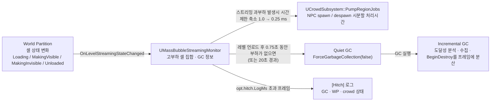

| 단계 | 구성 요소 | 역할 |
|---|---|---|
| ① 분산 | 엔진 streaming CVar 프로파일 | AddToWorld / RemoveFromWorld의 프레임당 시간 제한을 낮추고, 동시에 로딩하는 셀 수를 제한 |
| ② 감지 · 양보 | `UMassBubbleStreamingMonitor` → `UCrowdSubsystem` | 셀이 로딩 / 추가 / 제거 중인 동안 NPC spawn / despawn 시분할 처리시간을 1.0 → 0.25 ms로 축소 |
| ③ 지연 | Quiet GC | 셀 언로드 직후 GC를 막고, World Partition 부하가 없을 때 실행 |
| ④ 분할 | Incremental GC | GC 자체(도달성 분석 · 수집 · BeginDestroy)를 여러 프레임 · 프레임당 시간 제한으로 나눠 실행 |
| ⑤ 귀속 | Hitch 로그 | 긴 프레임마다 GC · WP · crowd 상태를 함께 기록해 원인을 구분 |
| ⑥ 부하 재현 · 격리 | 점진적 봇 생성 삭제, Snapshot Scope  | 스트리밍 부하를 한 번에 처리하지 않고, 복제되지 않는 region의 비용을 제거 |

#### ① 엔진 streaming CVar 프로파일

엔진의 레벨 스트리밍 시, 단일 셀의 로드/언로드 연산을 <b>프레임별 시분할 시간 제한(Time-Slicing)</b>에 맞추어 분산 처리합니다. 이 제한과 동시 로딩 수를 서버 용도에 맞게 조정한 프로파일을 `Core/MassBubbleRuntimeConfig.cpp`에 두고, 첫 월드가 시작될 때 한 번 적용합니다.

| CVar | 값 | 적용 대상 | 목적 |
|---|---|---|---|
| `s.ForceGCAfterLevelStreamedOut` | 0 | 공통 | 셀 언로드 직후 엔진이 강제하는 GC를 끄고, 대신 ③ Quiet GC가 실행 |
| `s.LevelStreamingActorsUpdateTimeLimit` | 3.0 | 공통 | 프레임당 AddToWorld(셀의 액터를 월드에 추가) 시간 제한 (ms) |
| `s.PriorityLevelStreamingActorsUpdateExtraTime` | 2.0 | 공통 | 우선순위 셀에 주는 추가 시간 (ms) |
| `s.LevelStreamingComponentsRegistrationGranularity` | 4 | 공통 | 프레임 시간 체크 주기당 컴포넌트 등록 개수. 값을 낮출수록 타임 아웃(Time Budget 초과) 및 프레임 드랍 현상을 방지. |
| `s.UnregisterComponentsTimeLimit` | 1.0 | 공통 | 프레임당 RemoveFromWorld(셀의 컴포넌트 해제) 시간 제한 (ms) |
| `s.LevelStreamingComponentsUnregistrationGranularity` | 2 | 공통 | 프레임 시간 체크 주기당 해제하는 컴포넌트 수 |
| `wp.Runtime.BlockOnSlowStreaming` | 0 | 데디케이티드 서버 | 셀이 아직 로딩 중이어도 서버 틱(= 모든 플레이어)을 멈추지 않음 |
| `wp.Runtime.MaxLoadingLevelStreamingCells` | 2 | 데디케이티드 서버 | 동시에 로딩하는 셀 수 제한 → PostLoad / 등록 작업의 burst 축소 |

```cpp
// Core/MassBubbleRuntimeConfig.cpp — ApplyStreamingProfile (요약)
IConsoleVariable* Var = IConsoleManager::Get().FindConsoleVariable(Entry.Name);
if (Var == nullptr)
{
	/* 이 엔진 버전에 없는 CVar: 경고 로그 후 건너뜀 */
}
else if (Var->GetFlags() & ECVF_ReadOnly)
{
	/* 읽기 전용: DefaultEngine.ini [SystemSettings]에 넣으라고 경고 */
}
else
{
	Var->Set(Entry.Value, ECVF_SetByProjectSetting);   // ini / 커맨드라인 / 콘솔이 항상 우선
	// 적용 후 값이 프로파일 값과 다르면 "상위 우선순위 소스가 소유 중"이라는 경고
}
```

- **우선순위** : `ECVF_SetByProjectSetting`으로 설정하므로 `DefaultEngine.ini [SystemSettings]` · 커맨드라인 · 콘솔 값이 항상 우선합니다. 값이 의도대로 적용되지 않으면 경고 로그가 남습니다.
- **엔진 버전 방어** : 이 엔진 버전에 없는 CVar는 시작 시 경고를 남기고 건너뜁니다 (엔진 업그레이드로 이름이 바뀌어도 무시되지 않음).
- **적용 범위** : `wp.Runtime.*` 두 항목은 데디케이티드 서버 프로세스에서만 적용됩니다 (`EProfileScope::ServerOnly`). 클라이언트 / standalone에서는 적용하지 않습니다.
- **확인** : 시작 로그에 `[Stream] <CVar> = <값> (was <이전 값>)`가 남고, `opt.stream.Dump`는 항목별 현재 값 · 프로파일 값 · 상태(`profile value active` / `DIFFERENT from profile` / `MISSING in this engine version` / `not used by this process`)를 보여 줍니다. `opt.stream.Apply`는 런타임에 다시 적용하고, `opt.stream.ApplyProfile 0`이면 엔진 기본값을 변경하지 않습니다 (첫 월드 시작 시 읽음).

#### ② `UMassBubbleStreamingMonitor` — 고부하 셀 감시

- 모든 game / PIE 월드에 만들어지는 `UTickableWorldSubsystem`입니다 (commandlet 제외). `FLevelStreamingDelegates::OnLevelStreamingStateChanged`로 셀의 상태 변화를 받으며, 이 delegate는 전역이므로 PIE에서 서버와 클라이언트가 한 프로세스에 있어도 **자기 월드의 이벤트만** 처리합니다.
- **고부하 정의** : 셀이 Loading, MakingVisible, MakingInvisible 상태일 때를 고부하로 정의합니다. 고부하 셀 집합은 TWeakObjectPtr로 관리하여, 최종 상태가 변경되지 않은 채 소멸한 Streaming Level로 인해 월드가 영원히 고부하 상태로 유지되는 현상을 방지합니다. 매 Tick마다 무효화된 항목을 자동으로 정리합니다.
- `IsBusy()` / `GetNumBusyCells()`를 `UCrowdSubsystem`이 읽어 NPC spawn / despawn 시분할 시간을 정합니다. `UCrowdSubsystem`은 초기화할 때 `InitializeDependency`로 Monitor를 먼저 만들어 둡니다.
- 프레임 단위 카운터(상태 변화 수 · 언로드 수 · 고부하 최대치)도 따로 저장합니다. 긴 프레임 안에서 상태 처리가 완료된 셀은 로그를 쓰는 시점에는 이미 고부하 상태가 아니기 때문입니다 (⑤). CSV에는 `StreamingBusyCells`가 기록됩니다.

#### ③ Quiet GC — 셀 언로드 후 GC를 스트리밍 부하가 없는 시점에 실행

엔진 기본 동작은 셀을 언로드한 직후 곧바로 GC를 강제하는 것입니다 (`s.ForceGCAfterLevelStreamedOut`). 셀이 연달아 로드 / 제거되는 구간에서는 이 GC가 한창 바쁜 프레임에 얹히므로, ①에서 이를 끄고 Monitor가 직접 시점을 고릅니다.

```cpp
// Core/MassBubbleStreamingMonitor.cpp — ScheduleQuietGC (요약)
// PendingGCSince: 셀이 Unloaded / Removed가 된 뒤 GC를 기다리기 시작한 시각
const bool bQuiet   = NumBusyCells == 0 && (Now - LastBusyTime) >= GCQuietSec;   // 0.75초 동안 셀 활동 없음
const bool bOverdue = (Now - PendingGCSince) >= GCMaxDeferSec;                   // 고부하가 지속되더라도 20초 후에는 실행
const bool bSpaced  = (Now - LastGCTime)     >= GCMinSpacingSec;                 // 직전 GC와 최소 5초 간격

if (bSpaced && (bQuiet || bOverdue))
{
	bGCRequestedByUs = true;                                  // Hitch 로그가 "our quiet GC"로 귀속하도록 표시
	GEngine->ForceGarbageCollection(/*bForcePurge=*/false);   // purge는 incremental 유지 (전체 purge는 프리즈를 늘림)
	PendingGCSince = -1.0;
	LastGCTime = Now;
}
```

- **로그** : 실행할 때 `[Stream] GC after cell unload: World Partition is quiet (waited N s)` 또는 `waited long enough`가 남아, 어느 경로로 실행됐는지 알 수 있습니다.
- **GC 측정** : Pre / Post GC delegate로 GC가 game thread를 잡은 시간(락 대기 + reachability analysis), 직전 GC와의 간격, 시작 주체(우리의 Quiet GC / 엔진 · 기타)를 기록해 ⑤에서 보여 줍니다.
- **A/B** : `opt.stream.QuietGC 0`이면 이 경로를 끕니다. 엔진 기본 동작과 비교하려면 `s.ForceGCAfterLevelStreamedOut 1`을 함께 지정합니다. 임계값은 `opt.stream.GCQuietSec` / `GCMaxDeferSec` / `GCMinSpacingSec`로 바꿉니다.

#### ④ Incremental GC — GC 자체를 여러 프레임으로 나눔

③이 GC를 **언제** 시작할지 정한다면, Incremental GC는 시작한 GC가 한 프레임을 통째로 잡지 않도록 GC를 **프레임 단위로 나눕니다.** 엔진 설정이라 코드가 아니라 `Config/DefaultEngine.ini`로 켭니다. ①의 프로파일(`opt.stream.Apply`)이 적용하는 값이 아니므로 `opt.stream.Dump`에는 나오지 않습니다.

```ini
; Config/DefaultEngine.ini
[/Script/Engine.GarbageCollectionSettings]
gc.ActorClusteringEnabled=True
gc.AllowParallelGC=True
gc.IncrementalBeginDestroyEnabled=True
gc.CreateGCClusters=True
gc.GarbageEliminationEnabled=True
gc.AssetClustreringEnabled=True

[ConsoleVariables]
gc.AllowIncrementalReachability=1
gc.AllowIncrementalGather=1
gc.IncrementalBeginDestroyTimeLimit=0.002
gc.IncrementalReachabilityTimeLimit=0.002
```

| 설정 | 값 | 역할 |
|---|---|---|
| `gc.AllowIncrementalReachability` | 1 | Reachability Analysis(도달 가능성 분석)를 한 프레임에 끝내지 않고 시간 제한 단위로 나눠 실행 |
| `gc.IncrementalReachabilityTimeLimit` | 0.002 | 분석에 프레임당 허용하는 최대 시간 (초, 2 ms) |
| `gc.AllowIncrementalGather` | 1 | unreachable 객체 수집(Gather)도 나눠 실행 |
| `gc.IncrementalBeginDestroyEnabled` | True | 객체 파괴(BeginDestroy)를 나눠 처리 |
| `gc.IncrementalBeginDestroyTimeLimit` | 0.002 | BeginDestroy 처리에 프레임당 허용하는 최대 시간 (초, 2 ms) |
| `gc.AllowParallelGC` | True | GC 작업을 worker thread에서 병렬로 실행 |

나머지 항목(`gc.*Cluster*` · `gc.GarbageEliminationEnabled`)은 클러스터링과 garbage elimination에 관한 엔진 GC 프로젝트 설정입니다 (Project Settings > Engine > Garbage Collection).

| 프레임 | 월드 틱 (`Tick_Engine`) | GC 작업 (Timers의 Incl) |
|---|---|---|
| 1 (Csv 2471) | 12.36 ms | `ConditionalCollectGarbage` 9.98 ms (`ParallelFor` 5.03 ms 포함). `CollectGarbageIncremental` 1회 (1.31 ms), `CollectGarbageFull` 0회 |
| 2 (Csv 2472) | 2.26 ms | `ConditionalCollectGarbage` 648.7 µs → `IncrementalPurgeGarbage` 646.3 µs (`IncrementalDestroyGarbage` 343 µs) |
| 3 (Csv 2473) | 1.41 ms | `ConditionalCollectGarbage` 176.5 µs → `IncrementalPurgeGarbage` 174.3 µs (`FMemory::Trim` 172.6 µs) |

<p align="center">
  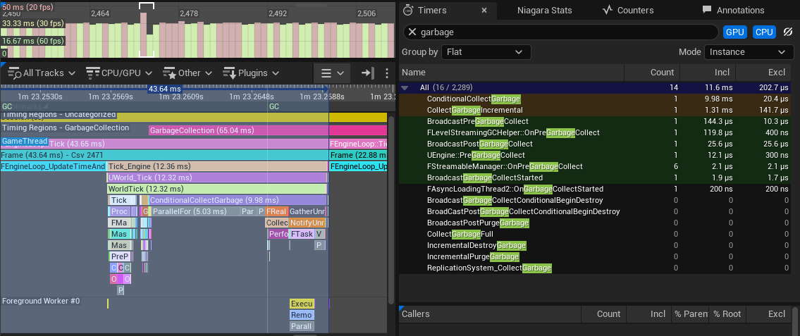<br>
  <sub>1프레임째 (Csv 2471) — GC 시작: 도달성 분석 · 수집, <code>ConditionalCollectGarbage</code> 9.98 ms</sub>
</p>

<p align="center">
  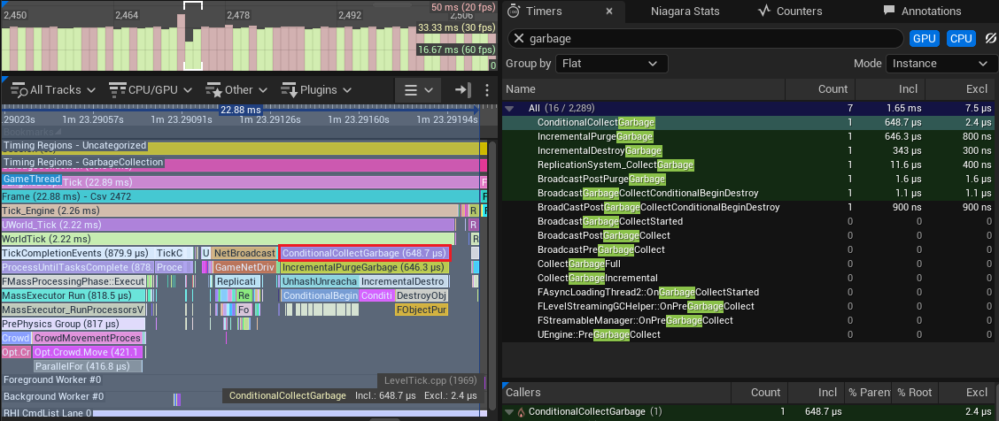<br>
  <sub>2프레임째 (Csv 2472) — <code>IncrementalPurgeGarbage</code> 646.3 µs</sub>
</p>

<p align="center">
  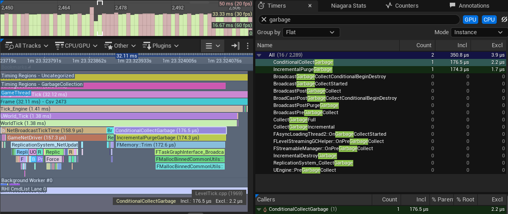<br>
  <sub>3프레임째 (Csv 2473) — <code>IncrementalPurgeGarbage</code> 174.3 µs로 마무리</sub>
</p>
- <b>A/B</b> : Incremental GC 없이 비교하려면 `DefaultEngine.ini`에서 `gc.AllowIncrementalReachability` · `gc.AllowIncrementalGather`를 0으로 바꿔 다시 실행하고, 같은 절차(`opt.hitch.LogMs` · Insights)로 측정합니다.

#### ⑤ Hitch 로그 — 원인을 GC / WP / crowd로 구분

`opt.hitch.LogMs N`(> 0)이면 N ms를 넘긴 프레임마다 한 줄을 남깁니다. Tick에 도착하는 delta는 **직전 프레임**의 길이이므로, 방금 발생한 Hitch를 그 시점의 상태와 함께 기록합니다.

```text
[Hitch] previous frame <ms> ms (average <ms> ms) | GC in the last 2 frames: YES / no
  | world partition: cells busy now=<n>, peak during the last frame=<n>, state changes=<n>, unloads=<n>
  | last GC held the game thread <ms> ms (lock wait + reachability analysis), started <s> after the previous one,
    started by: our quiet GC / engine / other, GCs seen: <n>, <n> frames ago | GC waiting after unload: yes / no
  | crowd: regions planning=<n> spawning=<n> despawning=<n> | queues spawn=<n> despawn=<n> | pcg plans pending=<n> | snapshot regions=<n> | bot ops pending=<n>
```

(실제로는 한 줄로 출력됩니다.)

- **GC가 원인** : `GC in the last 2 frames: YES`이고 `held the game thread`가 깁니다. 셀 언로드 직후에 `started by: engine / other`인 GC가 보이면 프로파일이 적용되지 않은 것입니다 (`opt.stream.Dump`의 `DIFFERENT from profile`).
- **World Partition이 원인** : `peak during the last frame` / `state changes`가 큽니다. 셀 활동이 한 프레임 안에 끝나도 `peak`로 남습니다.
- **NPC spawn / despawn이 원인** : `regions spawning` / `queues`가 차 있습니다 (시분할 처리시간이 부족하거나 `opt.crowd.BudgetedPump 0`). `planning` / `pcg plans pending`은 PCG 계획을 기다리는 region 수이며, 그래프 실행이 밀리는지는 `opt.crowd.PCG.Stats`로 봅니다.

이 항목은 엔진의 레벨 스트리밍 · GC 동작에 의존하므로 Automation Test 대상이 아닙니다. 효과 크기는 `opt.hitch.LogMs` 로그와 [계측과 실험 설계](#계측과-실험-설계-프로파일-결과)의 A/B 스위치로 측정합니다.

#### 에디터 검증 — World Partition (PIE)

<p align="center">
  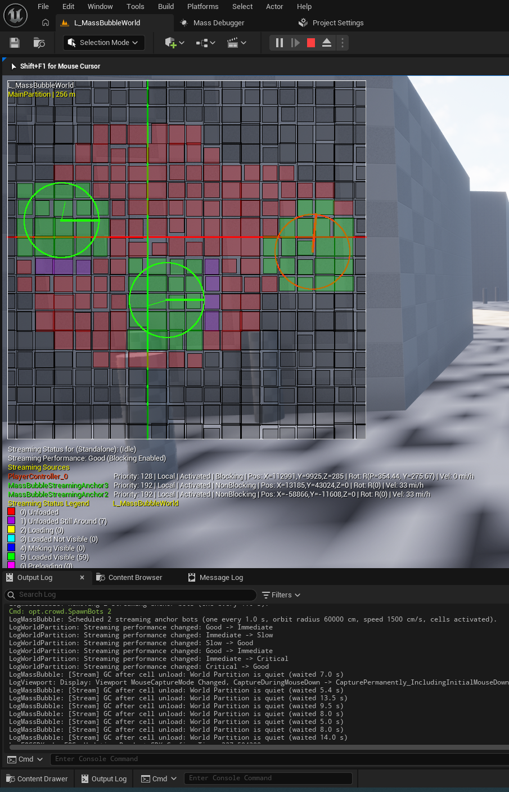<br>
  <sub>Standalone PIE · <code>L_MassBubbleWorld</code> · <code>opt.crowd.SpawnBots 2</code> 실행 후 — Runtime Hash 2D 오버레이와 Output Log</sub>
</p>

- **streaming source 3개** : `PlayerController_0`(Priority 128, Blocking)과 `MassBubbleStreamingAnchor2` / `MassBubbleStreamingAnchor3`(Priority 192, NonBlocking, Activated)가 각각 원으로 표시됩니다. 앵커 source는 실제 플레이어보다 낮은 우선순위(Low = 192)로 셀을 요청합니다.
- **앵커 궤도** : 두 앵커의 위치 (13185, 43024) · (−58866, −11608)은 원점에서 각각 약 45,000 cm / 60,000 cm로, `SpawnBot`의 동심원 배치(`BotOrbitRadiusCm` × 0.75 / 1.0)와 일치합니다. 표시된 속도 33 mi/h도 `BotSpeedCmPerSec`(1500 cm/s ≈ 15 m/s)와 같습니다.
- **셀 상태** : 범례 기준 Loaded Visible 59, Unloaded Still Around 7, Loading · Making Visible 0이고, 상단에는 `Streaming Status: (Idle)` · `Streaming Performance: Good`이 표시됩니다.
- **Quiet GC** : 캡처된 로그의 `[Stream] GC after cell unload: World Partition is quiet (waited …)` 8건이 모두 "quiet" 경로이고, 대기 시간은 5.0–14.0 s로 `GCMaxDeferSec`(20 s) 안입니다. 셀 언로드 직후가 아니라 스트리밍 부하가 없을 때 GC가 실행되고 있습니다.
- **스트리밍 성능 로그** : `SpawnBots` 직후에는 엔진의 `Streaming performance changed` 로그가 Good ↔ Immediate / Slow / Critical 사이를 오가지만 마지막에는 Good으로 돌아옵니다. 봇이 셀을 `Activated`(`opt.crowd.BotActivateCells 1`, 기본값)로 올리는 가장 무거운 설정에서의 캡처입니다.
- **범위** : Standalone PIE라서 데디케이티드 서버 전용 항목(`wp.Runtime.*`, ①)은 적용되지 않은 환경입니다. 서버 프로세스에서의 적용 상태는 `opt.stream.Dump`로 확인합니다.

### 14. 서버 다이어트 — 사용하지 않는 플러그인 제거

데디케이티드 서버는 엔진 기본 플러그인(에디터 도구, 미디어, 오디오, 모바일 등)을 그대로 로드하지만 크라우드 시뮬레이션은 이 중 대부분을 쓰지 않습니다. 서버가 로드하는 모듈과 플러그인을 `MassBubbleDiet`가 JSON 보고서로 기록하고, PowerShell 스크립트 3개(`Run-ServerDiet.ps1` · `Get-DietCandidates.ps1` · `Compare-ServerDiet.ps1`)가 실행 · 제거 후보 선별 · 전후 비교를 맡습니다. 제거 후보는 `.uproject`에서 `Enabled:false` + `TargetAllowList:["Server"]`로 서버에서만 끕니다. 클라이언트와 에디터는 영향을 받지 않습니다.

`-OptBots=8` 서버를 라벨당 5회 실행한 중앙값 (웜업 1회 제외):

| 항목 | 전 | 후 | 변화 |
|---|---|---|---|
| 활성 플러그인 | 192 | 85 | -107 (-55.7%) |
| 로드된 모듈 | 279 | 206 | -73 (-26.2%) |
| `Engine.InitComplete` | 1,191 ms | 1,053 ms | -137 ms (-11.5%) |
| 프로세스 메모리 (안정화) | 352.0 MB | 336.2 MB | -15.9 MB (-4.5%) |
| 실행 파일 | 305.9 MB | 289.9 MB | -16.0 MB (-5.2%) |
| UClasses / UObjects | 5,811 / 38,782 | 5,573 / 36,622 | -238 / -2,160 |

- **기능 손실 없음** : 전후 로그에서 새로 발생한 Warning / Error는 0건이고, 제거된 플러그인의 라이브 객체는 `Mutable` 15개, `PhysicsControl` 2개 외에는 0개입니다.
- **절감 요인** : 실행 파일과 안정화 메모리가 같은 16 MB 줄었습니다. 런타임 힙이 아니라 링크된 코드와 시작 시점의 클래스 등록 비용이 줄어든 것입니다.

측정 절차, 보고서 항목, 해석 시 유의사항, 전체 결과 표는 [SERVER_DIET.md](./Tools/SERVER_DIET.md)를 참고합니다.

---
## 계측과 실험 설계 ([프로파일 결과](./Tools/Profiling.md))

통합 프로파일링 매크로 구현을 통한 교차 분석 편의성 극대화합니다.

```cpp
// Core/MassBubbleStats.h — 한 줄로 cycle stat + CSV timing + Insights 이벤트
#define OPT_SCOPE(StatId, CsvName, TraceName) \
	SCOPE_CYCLE_COUNTER(StatId); \
	CSV_SCOPED_TIMING_STAT(OptCrowd, CsvName); \
	TRACE_CPUPROFILER_EVENT_SCOPE_STR(TraceName)

// 사용 예 (CrowdBubble.cpp)
OPT_SCOPE(STAT_OptCrowd_Bubble, Bubble, "Opt.Crowd.Bubble");
```
- 실시간 모니터링: SCOPE_CYCLE_COUNTER를 이용한 기본 인게임 인스턴트 스탯 수집
- 지표 데이터 수집: CSV_SCOPED_TIMING_STAT를 이용한 경량 타임스탬프 로깅 (엑셀 분석용)
- 정밀 타임라인 분석: TRACE_CPUPROFILER_EVENT_SCOPE_STR를 이용한 Unreal Insights 트레이스 이벤트 전송

| 도구 | 사용법 | 볼 수 있는 것 |
|---|---|---|
| Stat | 서버 `stat OptCrowd` · 클라이언트 `stat OptRender` | Director / Spawn / Despawn / LOD / Move / Snapshot / Bubble / PCG Plan Pump cycle, `Agents Alive`, `Active Regions`, `Agents Simulated / frame`, `Bubble Items`, `Bubble Dirty Items`, `Agents Drawn` [stat-화면-예시](#stat-화면-예시--stat-optcrowd--stat-optrender) |
| Unreal Insights | `-trace=cpu,net,frame` | `Opt.Crowd.*`, `Opt.Render.Update` 스코프, Networking Insights (패킷별 `CrowdBubble` / `AgentArray` 비트 수, Iris · legacy 복제 경로 구분 [network-insights-검증-분석](#network-insights-검증-분석)) |
| Memory Insights | LLM 태그 `OptCrowd/*` (Unreal Insights Memory 트레이스) | 태그별 메모리 추이(`OptCrowd` · `OptCrowd/Entities` · `OptCrowd/Grids` · `OptCrowd/Bubble`), Alloc/Free 이벤트 수 [Memory-insights-그래프-분석](#memory-insights-그래프-분석) |
| CSV Profiler | `csvprofile start` / `csvprofile stop` | 카테고리 `OptCrowd`(`StreamingBusyCells` · `PlansPending` · `WanderClamped` 포함), `OptRender` (Test 빌드에서도 동작) |
| 로그 | `opt.crowd.Stats` | region 상태별 개수(planning 포함), LOD tier 분포, viewer 수, spawn/despawn 큐 길이, snapshot region 수, 대기 중인 봇 작업, PCG planner 요약, WP busy 셀 · 마지막 GC 요약, 현재 스위치 값 |
| PCG 로그 | `opt.crowd.PCG.Stats` | planner 상태(그래프 로딩 / ready / FAILED), 큐 · 실행 중 수, 요청 · 성공 · 실패 · timeout · 취소 수, 평균 / 최대 지연 시간 |
| Hitch 로그 | `opt.hitch.LogMs <ms>` | 임계값을 넘긴 프레임마다 GC(소요 · 간격 · 시작 주체) · WP 셀 활동 · crowd 상태 |
| 스트리밍 프로파일 | `opt.stream.Dump` | 엔진 streaming CVar 프로파일 항목별 현재 값 · 프로파일 값 · 상태 |

### Stat 화면 예시 — `stat OptCrowd` · `stat OptRender`

<p align="center">
  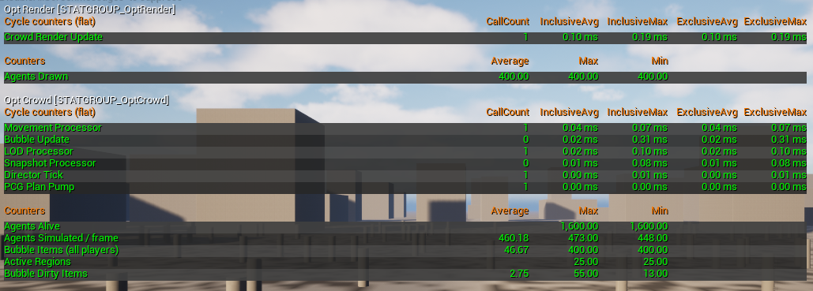<br>
  <sub>PIE 뷰포트에 <code>stat OptRender</code> · <code>stat OptCrowd</code>를 함께 켠 화면 (Opt Render / Opt Crowd 그룹)</sub>
</p>

서버 · 클라이언트 로직이 한 프로세스에서 도는 PIE라서 두 그룹이 한 화면에 나옵니다. 이 캡처의 조건은 agent 10,000개(= region당 400개를 모두 채운 상태) · 뷰어 1명이며, 이전 캡처와는 세션 조건이 달라 값을 직접 비교하지 않습니다. PCG 그래프를 쓰면 agent 수는 그래프가 정하므로(`AgentsPerRegion`은 상한) 이 값과 달라질 수 있습니다. 벤치마크가 아니라 계측이 동작하는지, 값의 규모가 설계와 맞는지 확인하는 용도입니다.

- **Opt Crowd · cycle counters** : `LOD Processor` 0.06 ms, `Movement Processor` 0.05 ms, `Director Tick` ≈ 0 ms (Inclusive Avg). `Snapshot Processor`(평균 0.03 ms, 최대 0.28 ms)와 `Bubble Update`(평균 0.02 ms, 최대 0.18 ms)는 `ReplicationHz`(10 Hz)에만 실행되어 대부분의 프레임에서 CallCount가 0이므로, 실행된 프레임의 비용은 평균이 아니라 최대값으로 봅니다. `Region Spawn Slice` / `Region Despawn Slice`가 비어 있어 이 구간에는 region 생성 · 삭제가 없었습니다.
- **Opt Crowd · counters** : `Agents Alive` 10,000, `Active Regions` 25(= 400 agent × 25 region, 뷰어 1명의 5×5)입니다. 프레임당 이동 연산을 받은 agent(`Agents Simulated / frame`)는 평균 ≈ 737 (716–754)로, [설계 수치](#설계-수치)의 해석적 추정(≈ 830 / 10,000)과 같은 규모입니다.
- **복제 규모** : `Bubble Items`는 400(= `MaxAgentsPerBubble` 상한)이고, 그중 `Bubble Dirty Items`는 8–19개입니다. 신규로 진입한 agent와 dead reckoning 허용 오차를 넘은 agent만 갱신 대상이 되기 때문입니다. 평균(53.33 / 1.52)은 bubble 갱신이 `ReplicationHz`(10 Hz)로만 일어나 프레임 평균이 낮게 표시된 값입니다.
- **Opt Render · 클라이언트** : `Crowd Render Update` 0.08 ms (최대 0.18 ms)로 `Agents Drawn` 400개를 ISM 1개로 그립니다.

### Memory Insights 그래프 분석

<p align="center">
  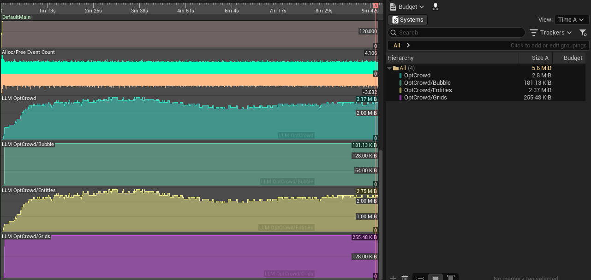<br>
  <sub>Unreal Insights › Memory Insights — <code>Alloc/Free Event Count</code> · LLM <code>OptCrowd</code> · <code>OptCrowd/Bubble</code> · <code>OptCrowd/Entities</code> · <code>OptCrowd/Grids</code></sub>
</p>

LLM(Low Level Memory Tracker) 태그 `OptCrowd/*`의 메모리가 약 10분 동안 어떻게 움직이는지 본 캡처입니다. 실제 메모리 추이가 설계(시분할 스폰, 한 번 확보한 뒤 재사용)와 맞는지 확인하는 용도입니다. LLM은 태그가 붙은 할당만 보여주고 있습니다.

- **`LLM OptCrowd/Entities` — (계단식 상승 후 평형 유지 / Stair-step & Plateau)**
  - 한 번에 수천 개의 엔티티를 생성하여 메모리 스파이크(Spike)를 유발하는 대신, 프레임당 스폰 예산(Budget)에 맞춰 에이전트를 시분할(Time-sliced)로 점진적 생성함에 따라 계단식으로 우상향하다가 인구가 포화된 시점에 완벽한 수평선(Plateau)을 이룹니다.
- **`LLM OptCrowd/Grids` · `LLM OptCrowd/Bubble` — 초기 수직 상승 후 수평 유지 (Flatline)**
  - 공간 분할용 셀 그리드(`FCrowdCellGrid`)와 플레이어별 관심 영역 버블(`ACrowdBubble`)에 필요한 메모리가 초기화 시점에 한 번 확보된 뒤, 추가 동적 할당 없이 재사용(Pooling)되고 있음을 뜻합니다.
- **`Alloc/Free Event Count` — 안정적인 이벤트 빈도**
  - 런타임 전반에 걸쳐 할당 / 해제 이벤트가 일정한 빈도로 안정적으로 유지됩니다.

### A/B 킬스위치 (CVar)

각 최적화는 런타임에 끌 수 있으며, **한 번에 하나**의 명령어만 바꿔가면서 실행합니다.

| CVar | 기본값 | 동작 / 격리되는 비용 |
|---|---|---|
| `opt.crowd.Enable` | 1 | 시뮬레이션 마스터 스위치. `0`이어도 봇은 계속 동작하므로 **엔진 스트리밍 비용만 분리** |
| `opt.crowd.TimeSlicing` | 1 | `0` = 모든 agent를 매 프레임 갱신 → time-slicing 효과 |
| `opt.crowd.LOD` | 1 | `0` = 전원 High LOD → LOD 분류와 이동 연산량 |
| `opt.crowd.ParallelMove` | 1 | `0` = 단일 스레드 `ForEachEntityChunk` → 병렬화 효과 |
| `opt.crowd.Replicate` | 1 | `0` = snapshot / bubble 갱신 정지 → **시뮬레이션 비용만 분리** |
| `opt.crowd.DeadReckoning` | 1 | `0` = 움직이는 agent를 매 tick 재전송 → 대역폭 · 직렬화 비용 |
| `opt.crowd.ReplicationHz` | 0 | `> 0`이면 프로젝트 설정의 Replication Hz를 덮어씀 |
| `opt.crowd.BudgetedPump` | 1 | `0` = spawn / despawn을 프레임당 고정 개수로 처리 (일괄처리) → **스트리밍 Hitch 재현** |
| `opt.crowd.SnapshotScope` | 1 | `0` = 모든 live region을 snapshot (이전 동작) → snapshot 범위 효과 |
| `opt.crowd.BotRampSec` | -1 | 봇 생성 / 제거 간격(초). `0` = 한 프레임에 전부 (burst), `< 0` = 프로젝트 설정(`BotRampIntervalSec`) |
| `opt.crowd.BotActivateCells` | 1 | 이후 생성되는 봇이 셀을 `1` = Activated (플레이어처럼 BeginPlay · 등록 · tick), `0` = Loaded까지만 (가벼운 부하) |
| `opt.crowd.PCG` | 1 | `0` = 아직 populate되지 않은 region을 PCG 없이 랜덤 배치 → PCG 효과. 이미 populate된 region은 그대로이므로, 비교하려면 `opt.crowd.PCG.Replan`으로 비활성 region을 비운 뒤 다시 방문 |
| `opt.stream.ApplyProfile` | 1 | `0` = 엔진 streaming CVar 프로파일을 적용하지 않음 (첫 월드 시작 시 읽음) |
| `opt.stream.QuietGC` | 1 | `0` = 셀 언로드 후 Quiet GC를 예약하지 않음 |
| `opt.stream.GCQuietSec` | 0.75 | 셀 로딩 / 추가 / 제거가 없는 시간이 이 값 이상이면 "Idle" |
| `opt.stream.GCMaxDeferSec` | 20 | 스트리밍 부하가 없는 시점이 오지 않아도 이만큼 기다린 뒤에는 GC 실행 |
| `opt.stream.GCMinSpacingSec` | 5 | Quiet GC 사이의 최소 간격 |
| `opt.hitch.LogMs` | 0 | `> 0` = 이 시간(ms)을 넘긴 프레임마다 GC / WP / crowd 상태를 로그 |
| `opt.crowd.Render` (client) | 1 | `0` = NPC 렌더 숨김 → **네트워크 비용만 분리** |
| `opt.crowd.RenderSmoothing` (client) | 1 | `0` = smoothing 없이 외삽 위치를 그대로 그림 → smoothing 효과 |
| `opt.crowd.RenderStats` (client) | 0 | `1` = bubble 크기 / 그려진 수 / 최근 1초 내 갱신 수 / 복제 시스템(Iris · legacy)을 화면에 출력 (non-shipping) |

콘솔 명령 (non-shipping): `opt.crowd.Stats` · `opt.crowd.SpawnBots [N=4]` (1–64) · `opt.crowd.ClearBots` · `opt.crowd.Reload` (설정 재로딩, region / grid 크기는 월드 재시작 전까지 유지) · `opt.crowd.PCG.Stats` (planner 상태 요약) · `opt.crowd.PCG.Replan` (비활성 region의 계획 · 영속 상태를 지워 다시 생성).

스트리밍 / 네트워크 점검 명령: `opt.stream.Apply` (프로파일 재적용) · `opt.stream.Dump` (항목별 현재 값) · `opt.net.Info` (Iris / legacy와 관련 CVar를 로그). 이 명령과 `opt.stream.*` · `opt.hitch.LogMs`는 `UE_BUILD_SHIPPING` 가드가 없어 Shipping 서버에도 컴파일되며, `bUseLoggingInShipping = true`로 로그가 유지됩니다.

### 측정 절차

```text
# 서버 콘솔 (또는 -ExecCmds) 
stat OptCrowd
opt.crowd.Stats
csvprofile start
  ...
csvprofile stop

# A/B: 한 번에 하나만 변경
opt.crowd.DeadReckoning 0      # 기존 재전송 방식
opt.crowd.TimeSlicing 0
opt.crowd.LOD 0
opt.crowd.ParallelMove 0
opt.crowd.Replicate 0          # 시뮬레이션 비용만 분리

# PCG: planner 상태 확인과 A/B (한 번에 하나만 변경)
opt.crowd.PCG.Stats            # 그래프 로딩 / ready / FAILED, 큐, 지연 시간
opt.crowd.PCG 0                # 아직 populate되지 않은 region은 PCG 없이 랜덤 배치
opt.crowd.PCG.Replan           # 비활성 region의 계획 · 영속 상태를 지움 → 다음에 필요해질 때 현재 설정으로 다시 생성

# 클라이언트
opt.crowd.Render 0             # 렌더 비용 없이 네트워크 비용만 분리
opt.crowd.RenderStats 1
```

### 스트리밍 Hitch 측정 절차

```text
# 서버 콘솔 (또는 -ExecCmds)
opt.hitch.LogMs 20                 # 20 ms를 넘긴 프레임마다 [Hitch] 로그 (GC / WP / crowd 상태 포함)
opt.stream.Dump                    # 엔진 streaming CVar 프로파일의 현재 상태
opt.crowd.SpawnBots 8              # 봇이 BotRampSec 간격으로 합류 → 셀 로드 / 언로드 유발

# A/B: 한 번에 하나만 변경
opt.crowd.BudgetedPump 0           # spawn / despawn을 프레임당 고정 개수로 (스트리밍 Hitch 재현)
opt.crowd.BotRampSec 0             # 봇을 한 프레임에 전부 생성 (burst)
opt.stream.QuietGC 0               # Quiet GC 끔
s.ForceGCAfterLevelStreamedOut 1   # 엔진 기본 동작(셀 언로드 직후 GC) — opt.stream.QuietGC 0과 함께 사용
opt.crowd.SnapshotScope 0          # 모든 live region을 snapshot
opt.crowd.BotActivateCells 0       # 이후 생성되는 봇은 셀을 Load까지만 (가벼운 부하)
opt.crowd.Enable 0                 # 크라우드를 끄고 봇만 유지 → 엔진 스트리밍 비용만 분리
```

`opt.stream.ApplyProfile`은 첫 월드가 시작될 때 한 번 읽습니다 (이후에는 `opt.stream.Apply`로 다시 적용).

---

## 검증 (Automation Tests)

알고리즘은 header-only 순수 함수(`CrowdMath.h`, `CrowdCellGrid.h`, `CrowdNetMath.h`, `CrowdWander.h`, `CrowdSmoothing.h`, `CrowdPlan.h`)로 분리해, 월드 · Mass · 네트워크 연결 · PCG 없이 테스트합니다.

| 테스트 케이스 | 핵심 검증 내용 | 주요 대상 |
|---|---|---|
| `Crowd.CellGrid` | 대규모 에이전트 생성 시 데이터 유실 및 중복 검증 (brute force와 대조) | 에이전트 누락 방지 |
| `Crowd.Quantization` | 연산 압축 시 발생하는 오차 및 경계값 안전성 검증 | 오차 최소화 / 정밀도 |
| `Crowd.DeadReckoning` | 외삽 계약(서버 · 클라이언트 공유 상한 3초 + heartbeat 2초), 재전송 임계값, 이동 예측 오차, 메시지 수(< 15 %) 검증 | 클라이언트 예측 정확도 |
| `Crowd.Smoothing` | 걷는 agent는 지연 없이, 회전은 곡선으로, 정지는 짧은 미끄러짐으로, 보정은 여러 프레임에 걸쳐 그려지는지와 프레임 레이트 독립성 검증 | 클라이언트 표현 |
| `Crowd.Presentation` | 서버 이동 → 복제 → 클라이언트 smoothing 전 구간을 실제 함수로 돌려, "걷다가 멈추고 되돌아간다"는 증상을 첫 버전에서는 감지하고 현재 버전에서는 걷는 agent가 정지해 보이는 비율 < 1 % · 역방향 점프 0 · 오차 p99 ≤ 40 cm임을 검증 | 보이는 결과 |
| `Crowd.Interest` | AOI 경계 hysteresis가 진입 / 이탈 횟수를 1/3 이상 줄이는지, 반경이 int16 상한을 넘지 않는지 검증 | 복제 대상 안정성 |
| `Crowd.Wander.Geometry` | 박스 진입 / 이탈 시간, band 폭, 호가 열린 땅으로 돌아오는지 vs 갇히는지, 좌우 회전 분포 | 배회 모델 기하 |
| `Crowd.Wander.TimeSlicing` | 1 / 2 / 6 프레임 · 0.5초 단위로 쪼개 걸어도 같은 경로 | time-slicing 무결성 |
| `Crowd.Wander.Containment` | 300 agent × 300초, 안전 clamp 0회로 region 안에 머물고 band에 갇히지 않음 | region 이탈 방지 |
| `Crowd.Wander.Recovery` | band 안이나 벽 바로 앞에서 시작해도 빠져나옴 | 복구 |
| `Crowd.Wander.Smoothness` | 반전(90° 초과) 0회, 평균 회전 완만, 속도 범위 준수, 정지 비율이 모델과 일치 | 움직임 품질 |
| `Crowd.Wander.Density` | 열린 땅 밀도 균일(±12 %), 경계에 쌓이지 않음 (< 1.25배, 이전 조향 방식은 3.7배) | 밀도 분포 |
| `Crowd.Math` | 시뮬레이션 난수, 해시 충돌, 경계 규칙의 정확성 검증 | 연산 무결성 |
| `Crowd.Plan.Filter` | NaN / Inf · density ≤ 0 · 경계 band 안 · region 밖 점 거부, 모든 점의 행방이 합계와 일치 | PCG 점 필터 |
| `Crowd.Plan.Thinning` | 상한 초과 시 정확히 상한 개수, 점 순서와 무관, 균일, seed가 0인 점도 구분 | PCG 상한 thinning |
| `Crowd.Plan.Agent` | 계획된 agent의 초기 상태 불변식(속도 범위 · 난수열 ≠ 0 · 정지 · 헤딩), yaw 옵션은 헤딩만 바꿈 | 점 → agent |
| `Crowd.Plan.Wander` | 계획된 agent(경계 band 바로 앞에 몰린 최악의 경우 포함)가 안전 clamp 없이 1분간 region 안에 머묾 | 계획 ↔ 배회 모델 |

> 테스트 이름의 `MassBubble.` 접두사는 생략했습니다 (전체 이름 예: `MassBubble.Crowd.CellGrid`).

```cpp
// CrowdTests.cpp 
// 데드 레코닝을 사용할 때 전송되는 메시지 수가 최적화 전 메시지 수의 15% 미만인지 검증합니다.
TestTrue(TEXT("dead reckoning sends under 15% of the naive messages"),
	DeadReckoningMessages * 100 < NaiveMessages * 15);

// 오차 수정이 일어나기 직전 틱까지는 오차가 허용 오차 이내였다가,
// 이후 |v - vSent| * dt 만큼 오차가 누적되며 커집니다.
// (예: 최고 속도 180 cm/s로 걷다 180도 반전하면 속도 차이는 360 cm/s가 되며,
//  이는 0.1초 짜리 1틱 동안 36 cm의 오차가 발생함을 의미합니다.)
TestTrue(TEXT("client prediction error stays bounded"),
	MaxPredictionError < Tolerance + 2.0 * Tuning.MaxSpeedCmPerSec * Dt + 5.0);

// 히스테리시스(Hysteresis) 대조군 설정: 경계면에서 미세한 흔들림(Jitter)이 발생할 때, 
// 동일한 입력 조건에서 일반적인 반올림 방식을 쓰면 거의 매 스텝마다 값이 Flip 됩니다.
TestEqual(TEXT("hysteresis: no rebase while jittering on the border"), HysteresisRebases, 0);
TestTrue(TEXT("(for contrast) naive rounding would flip on almost every step"), NaiveFlips > 150);

// CrowdPlanTests.cpp — PCG가 점을 어떤 순서로 내놓아도 같은 crowd가 만들어지는지 검증합니다.
TestTrue(TEXT("the order the graph delivers the points in does not matter"), bSame);
```

---

## 설계 수치

### 해석적 추정 (기본 설정)

기본 설정, 뷰어 1명, PCG 없이 region당 400개를 균일하게 배치하는 경우를 가정해 **코드 상수에서 도출한 값**입니다. 실측이 아닙니다.

| 항목 | 값 | 산식 |
|---|---|---|
| Agent 밀도 | 0.0244 / m² | 400 / (128 m)² (랜덤 배치. PCG를 쓰면 그래프가 정함) |
| 활성 agent (뷰어 1명) | 10,000 | `AgentsPerRegion`(400) × 5×5 region (PCG를 쓰면 이것이 상한이고, 실제 수는 region별 `min(유효한 점, 400)`의 합) |
| Fragment 메모리 | ≈ 0.64 MB | 64 B × 10,000 (entity handle 8 B를 더하면 72 B × 10,000 ≈ 0.72 MB) |
| 비활성 region 영속 상태 | ≈ 19 KB / region (상한) | `FCrowdSavedAgent` 48 B × 400 |
| LOD 분포(Agent 수) | High ≈ 123 / Medium ≈ 644 / Low ≈ 2,301 / Off ≈ 6,932 | 밀도 × 거리 구간 면적 (40 m / 100 m / 200 m) |
| 프레임당 실제 이동 연산 | **≈ 830** (기존 10,000) | 123 × 1(=1/1 프레임) + 644 / 2(=1/2 프레임) + 2,301 / 6(=1/6 프레임) |
| 복제 레코드 | **10 B / agent** | 4 + 2 × 2 + 1 × 2 (기존 52 B) |
| Bubble 최대 payload (전체 재전송) | ≈ 4 KB | 400 × 10 B (FastArray 헤더 · 패킷 오버헤드 제외) |
| Origin rebase 빈도 | ≈ 200 m 이동당 1회 | 200 m 격자 |
| 클라이언트 렌더 | Actor 1 / Component 1 | ISM 단일 인스턴스 |
| Snapshot 대상 region (뷰어 1명) | 최대 16 (활성 25개 중) | (15,000 + 2,000) cm 반경 사각형이 덮는 region (≤ 4 × 4) |
| NPC spawn / despawn 시분할 처리시간 | 1.0 ms / frame (WP 고부하 시 0.25 ms), batch 64 agent | `SpawnBudgetMs` · `SpawnBudgetBusyMs` · `StructuralBatchSize` |
| PCG 그래프 실행 | 동시 최대 2개, 실행당 timeout 20초 | `PCGMaxConcurrent` · `PCGTimeoutSec` |
| Quiet GC 타이밍 | 0.75초 Idle → 실행, 최대 20초 지연, 최소 5초 간격 | `GCQuietSec` · `GCMaxDeferSec` · `GCMinSpacingSec` |
| Incremental GC 시간 제한 | 2 ms / frame | `gc.IncrementalReachabilityTimeLimit` · `gc.IncrementalBeginDestroyTimeLimit` (`DefaultEngine.ini`) |

PCG 그래프를 쓰면 밀도가 균일하지 않고 agent 수도 달라지므로, LOD 분포 · 이동 연산 수 · 메모리는 위 식에 실제 agent 수와 분포를 넣어 다시 계산해야 합니다.

<!--
실측 결과 템플릿 (측정 후 이 주석을 해제하고 값을 채우세요.
측정하지 않은 행은 삭제하고, 섹션 제목을 "설계 수치와 실측"으로 바꾸고 목차 링크도 갱신하세요.)

### 실측 결과

> 측정 환경: CPU / RAM / OS · 빌드 구성 (Development 또는 Test) · 서버 tick rate · bot 수 · 클라이언트 수

| 실험 | 스위치 | 지표 | OFF | ON | 개선 |
|---|---|---|---|---|---|
| Time-slicing | `opt.crowd.TimeSlicing` 0 → 1 | `Opt.Crowd.Move` (ms / frame) | | | |
| LOD | `opt.crowd.LOD` 0 → 1 | `Agents Simulated / frame` | | | |
| 병렬 이동 | `opt.crowd.ParallelMove` 0 → 1 | `Opt.Crowd.Move` wall time (ms) | | | |
| Dead reckoning | `opt.crowd.DeadReckoning` 0 → 1 | `Bubble Dirty Items`, 서버 송신량 (KB/s) | | | |
| 렌더 분리 | `opt.crowd.Render` 0 → 1 (client) | `Crowd Render Update` (ms) | | | |
| 스트리밍 시분할 처리 | `opt.crowd.BudgetedPump` 0 → 1 (`opt.crowd.BotRampSec 0`으로 burst 유발) | 최대 frame time, `[Hitch]` 로그 횟수 | | | |
| Quiet GC | `opt.stream.QuietGC` 0 + `s.ForceGCAfterLevelStreamedOut` 1 → Quiet GC | GC가 game thread를 잡은 시간 (`[Hitch]` 로그), 셀 busy 중 GC 횟수 | | | |
| Snapshot Scope | `opt.crowd.SnapshotScope` 0 → 1 (봇 다수) | `Opt.Crowd.Snapshot` (ms / snapshot), `snapshot regions` | | | |
-->

---

## 시작하기

### 요구 사항

- **Unreal Engine 5.8** : `MassBubbleServer` / `MassBubbleClient` 타깃은 **소스 빌드 엔진**이 필요합니다.
- Mass 모듈 : `MassEntity`, `MassCommon`, `MassSimulation`, 그리고 5.8에서 추가된 `MassCore`.
- **PCG 플러그인** : `.uproject`에서 PCG 플러그인을 활성화합니다 (`MassBubble.Build.cs`가 `PCG` 모듈에 의존). Project Settings > Game > MassBubble Crowd > PCG의 `SpawnGraph`가 비어 있으면 planner는 만들어지지 않고 region은 랜덤으로 채워집니다. 쿠킹된 빌드(데디케이티드 서버 포함)에는 그래프 에셋이 포함되어야 합니다.
- **GC 설정** : Incremental GC는 `Config/DefaultEngine.ini`의 `gc.*` 값으로 켭니다 (13장 ④).
- **Push Model 활성** : `[SystemSettings] net.IsPushModelEnabled=1`. 꺼져 있으면 dirty 마킹이 효과가 없고 프로퍼티가 일반 경로로 비교됩니다.
- **Iris** : `-UseIrisReplication=1`(또는 `net.Iris.UseIrisReplication`)로 켭니다. Iris는 `net.SubObjects.DefaultUseSubObjectReplicationList=1`이 필요하며, `opt.net.Info`가 현재 설정을 로그로 보여 줍니다.
- **맵 생성** : 월드 파티션 맵(`L_MassBubbleWorld`)은 repository에 추가되어 있지 않습니다. `PopulateTestWorld.py` 스크립트를 이용해서 생성할 수 있습니다. [월드 파티션 맵 생성하기](./Tools/WORLD_PARTITION_SETUP.md)
- World Partition 맵 + 서버 스트리밍 `wp.Runtime.EnableServerStreaming=1`.

### 빌드

- 클라이언트 빌드 : [다운로드](https://drive.google.com/file/d/1oxyFlrTBqCj0E9axmrUBnkvx0m1OARsp/view?usp=sharing)
- 데디케이티드 서버 빌드 : [다운로드](https://drive.google.com/file/d/1MHaeaeesiHfkTWKNaNiU2N-Zf7Ecosye/view?usp=sharing)

```bash
# 소스 빌드 엔진 루트 기준 (경로는 환경에 맞게 수정)
Engine\Build\BatchFiles\Build.bat MassBubbleServer Win64 Development -Project="D:\MassBubble\MassBubble.uproject"
Engine\Build\BatchFiles\Build.bat MassBubbleClient Win64 Development -Project="D:\MassBubble\MassBubble.uproject"
```

### 실행

```bash
# 1) 데디케이티드 서버 + 서버 전용 virtual viewer 8개
#    (클라이언트 없이 시뮬레이션 / region 스트리밍 / WP 스트리밍 부하 재현, 봇은 1초 간격으로 합류)
MassBubbleServer.exe /Game/Maps/L_MassBubbleWorld -log -OptBots=8

# 2) 클라이언트 접속 (복제 · 렌더 비용은 실제 클라이언트로 측정)
MassBubbleClient.exe 127.0.0.1 -log

# 3) 복제 시스템 선택 : 같은 빌드로 Iris / legacy 비교 (확인: 콘솔 opt.net.Info)
MassBubbleServer.exe /Game/Maps/L_MassBubbleWorld -log -UseIrisReplication=1    # 0 = legacy
MassBubbleClient.exe 127.0.0.1 -log -UseIrisReplication=1
```

에디터에서는 **Play As Client + Run Dedicated Server**로 *dedicated server + N clients*를 한 프로세스에서 실행할 수 있습니다 (`MassBubbleEditor` 타깃은 두 모듈을 모두 로드합니다). 조작은 WASD / E / Space / Q / 마우스이며, 폰은 flying 모드로 고정되어 있습니다 (30 m/s로 128 m region을 약 4초에 횡단 → 스트레스 테스트용).

### 테스트

```bash
# Editor: Session Frontend > Automation > 필터 "MassBubble.Crowd" (17개 전부) 또는 "MassBubble.Crowd.Plan" (PCG 스폰 계획 4개)
# Headless:
UnrealEditor-Cmd MassBubble.uproject -ExecCmds="Automation RunTests MassBubble.Crowd; Quit" -unattended -nullrhi -log
```

---

## 설정

**Project Settings > Game > MassBubble Crowd** (`DefaultGame.ini`) 와 **MassBubble Crowd Rendering**. 프로세서는 UObject를 직접 읽지 않고 불변(Immutable) POD(Plain Old Data, 구조체) 스냅샷 `FCrowdTuning`(`GetCrowdTuning()`)을 읽습니다.

| 그룹 | 설정 | 기본값 | 의미 |
|---|---|---|---|
| Regions | `RegionSizeCm` | 12800 | Region 한 변 (WP 런타임 그리드 셀 크기와 맞출 것) |
| | `ActiveRegionRadius` | 2 | 뷰어 주변 활성 region 반경 (Chebyshev) → 5×5 |
| | `AgentsPerRegion` | 400 | Region당 agent 수. PCG 그래프를 쓰면 **상한(cap)**: 개수는 그래프가 정하고 초과분은 균일하게 솎음 |
| | `RegionDeactivateDelaySec` | 10 | despawn 유예 (경계 flicker 방어) |
| | `MaxSpawnPerFrame` / `MaxDespawnPerFrame` | 500 / 1000 | 프레임당 spawn / despawn 하드 캡 (실제 제한은 아래 Streaming의 시분할 처리시간) |
| | `WorldSeed` | 1337 | region seed의 기준 (랜덤 배치, PCG 시드, 점 솎음) |
| PCG | `bUsePCG` | true | 새 region의 시작 위치를 PCG 그래프에 묻기. 월드 시작 때 읽음 (런타임 A/B: `opt.crowd.PCG`) |
| | `SpawnGraph` | (없음) | region 하나분의 **점**을 출력 노드에 내는 PCG 그래프. 비어 있으면 PCG를 쓰지 않음 |
| | `PCGMaxConcurrent` | 2 | 동시에 실행하는 그래프 수 (1–16) |
| | `PCGTimeoutSec` | 20 | 시작 후 이 시간(초)을 넘기면 포기하고 폴백 |
| | `PCGBoundsHalfHeightCm` | 10000 | 생성 bounds의 높이 (`AgentGroundZ` 위아래). Landscape · 메시를 샘플링하는 그래프에 중요 |
| | `bPCGUsePointYaw` | false | 점의 회전(yaw)을 시작 방향으로 사용. 끄면 agent별 랜덤 |
| | `bPCGFallbackToRandom` | true | 그래프가 실패 / timeout이면 랜덤으로 채움. 끄면 그 region은 빈 채로 확정 |
| LOD | `High` / `Medium` / `LowLODDistanceCm` | 4000 / 10000 / 20000 | tier 경계 (40 / 100 / 200 m) |
| | `LODHysteresisCm` | 500 | tier 전환 hysteresis |
| | `High` / `Medium` / `Low` / `OffIntervalFrames` | 1 / 2 / 6 / 0 | 시뮬레이션 주기 (0 = 동결) |
| Movement | `Min` / `MaxSpeedCmPerSec` | 90 / 180 | agent별 순항 속도 범위 (agent마다 한 번 뽑음) |
| | `SpeedVariation` | 0.15 | 걷기 구간마다 순항 속도에서 ±15 % |
| | `Min` / `MaxRetargetSec` | 1.5 / 3.5 | 직선 걷기 구간의 길이 |
| | `MaxTurnDeg` | 60 | 구간 사이 최대 방향 전환 |
| | `WallTurnRateDeg` | 60 | region 경계 band 안의 회전 속도 (deg/s). 낮을수록 부드럽지만 band가 넓어짐 (band ≈ 2 × 최대 속도 / 회전율 + 40 cm) |
| | `IdleChance` | 0.12 | 평균 길이의 걷기 구간이 정지로 바뀔 확률 |
| | `Min` / `MaxIdleSec` | 1.5 / 5 | 정지 시간 (0.1초 이상) |
| | `AgentGroundZ` | 0 | 평면 월드: 모든 agent가 걷는 Z |
| | `MaxStepDeltaSec` | 0.5 | time-slicing 누적 delta 상한 |
| Replication | `ReplicationHz` | 10 | Snapshot 주기 (1–60) |
| | `BubbleRadiusCm` | 15000 | AOI 반경 (≤ 21000, int16 불변식) |
| | `MaxAgentsPerBubble` | 400 | AOI 내 최대 agent 수 |
| | `NearErrorCm` / `FarErrorCm` | 30 / 150 | Dead reckoning 허용 오차 |
| | `NearDistanceCm` | 3000 | near / far 경계 |
| | `VelocityEpsCmPerSec` | 25 | 속도 변화 재전송 임계 |
| | `GridCellSizeCm` | 1600 | 공간 격자 셀 크기 |
| Streaming | `SpawnBudgetMs` / `DespawnBudgetMs` | 1.0 / 1.0 | 프레임당 시분할 처리시간 (ms). batch마다 시계를 확인하며 프레임당 최소 1 batch는 진행 |
| | `SpawnBudgetBusyMs` / `DespawnBudgetBusyMs` | 0.25 / 0.25 | World Partition 셀이 로딩 / 추가 / 제거 중일 때의 시분할 처리사간 (0 허용, 일반 처리시간 이하로 clamp) |
| | `StructuralBatchSize` | 64 | `BatchCreateEntities` / `BatchDestroyEntities` 1회당 agent 수 (8–2048) |
| | `SnapshotMarginCm` | 2000 | snapshot 범위를 실제 플레이어 bubble 반경 바깥으로 넓히는 여유 |
| Bots | `BotOrbitRadiusCm` / `BotSpeedCmPerSec` | 60000 / 1500 | virtual viewer 궤도 반경 / 속도 |
| | `BotRampIntervalSec` | 1 | 봇 생성 / 제거 간격 (초). 0 = 한 프레임에 전부 |
| Render | `MaxInstances` | 2048 | 최대 인스턴스 수 |
| | `VelocityEasingRate` | 7 | 그리는 속도가 복제된 속도를 따라가는 빠르기 (1/s, 0 = 끔) |
| | `CorrectionRate` | 4 | 그리는 위치를 서버 예측 위치로 끌어당기는 빠르기 (1/s) |
| | `YawRate` | 10 | 이동 방향을 바라보는 빠르기 (1/s) |
| | `SnapDistanceCm` | 500 | 목표에서 이보다 멀면 미끄러지지 않고 바로 이동 |
| | `BubbleSearchIntervalSec` | 1 | bubble 도착 전 탐색 주기 |
| | `AgentMesh` / `AgentMaterial` / `AgentScale` / `PivotOffsetCm` / `bCastShadow` | 엔진 실린더 / 없음 / (0.5, 0.5, 1.8) / 90 / false | agent 외형 (50 cm × 180 cm 실린더) |

Project Settings 화면(`DefaultGame.ini`에 저장)입니다. 외삽 상한(`MaxExtrapolationSec` 3초)과 `HeartbeatSec`(2초)은 서버와 클라이언트가 같은 값을 써야 하므로 설정이 아니라 `CrowdNetMath.h`의 상수입니다.

<table>
  <tr>
    <td align="center" valign="top">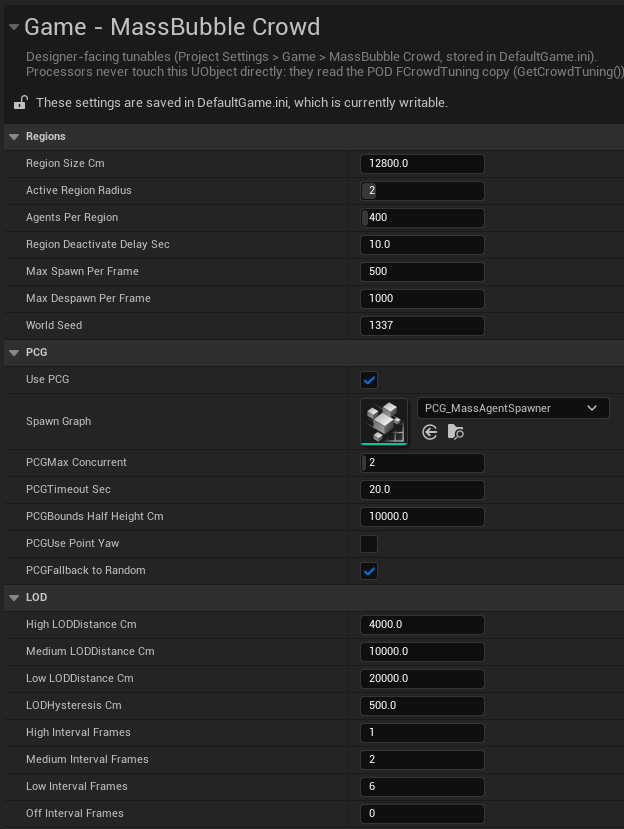</td>
    <td align="center" valign="top">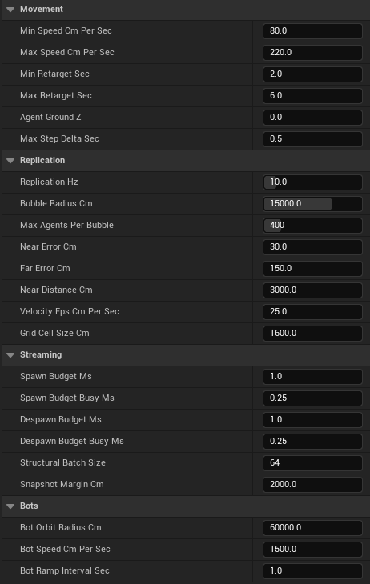</td>
  </tr>
  <tr>
    <td align="center"><sub>Game › MassBubble Crowd — Regions · PCG · LOD</sub></td>
    <td align="center"><sub>Game › MassBubble Crowd — Movement · Replication · Streaming · Bots</sub></td>
  </tr>
</table>

<p align="center">
  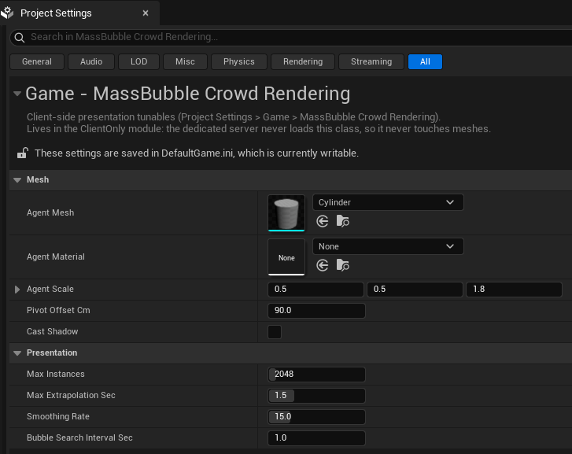<br>
  <sub>Game › MassBubble Crowd Rendering — ClientOnly 모듈이라 데디케이티드 서버는 이 클래스를 로드하지 않습니다</sub>
</p>

스트리밍 프로파일(`s.*` / `wp.*`)과 Quiet GC · Hitch 로그 임계값은 프로젝트 설정이 아니라 CVar(`opt.stream.*`, `opt.hitch.LogMs`)입니다. [계측과 실험 설계](#계측과-실험-설계-프로파일-결과)의 A/B 킬스위치 표를 참고하세요.