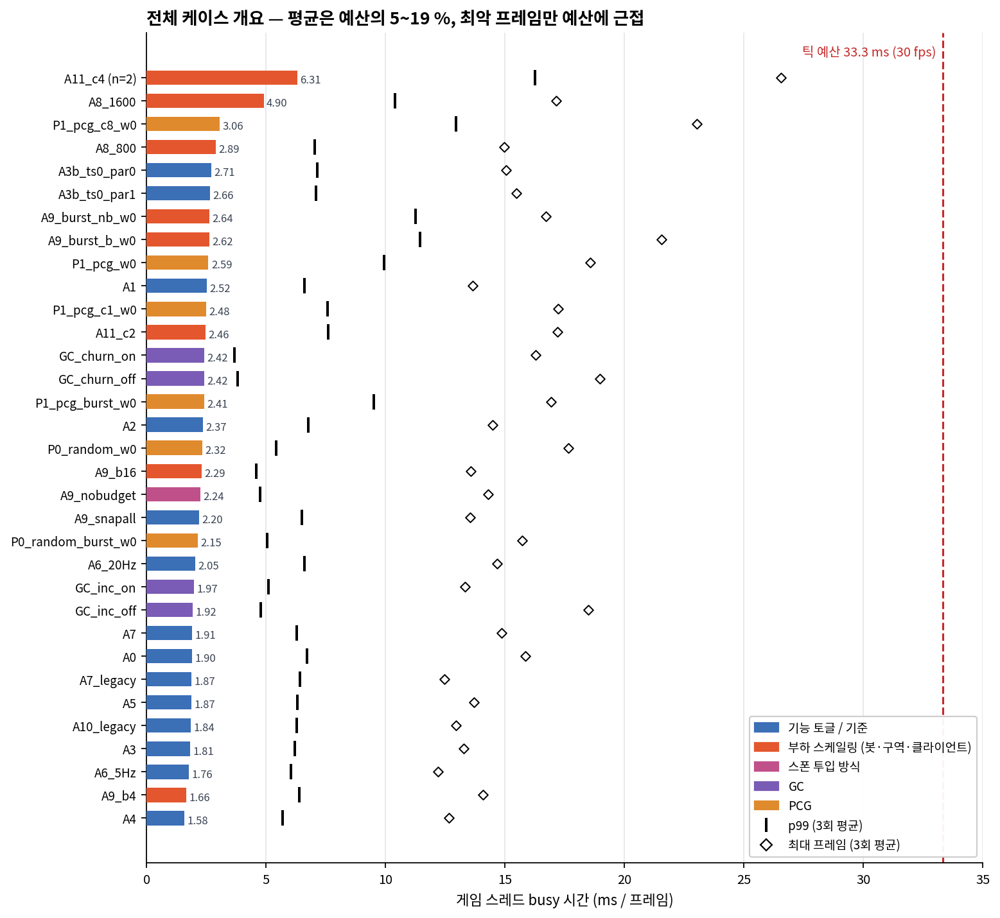
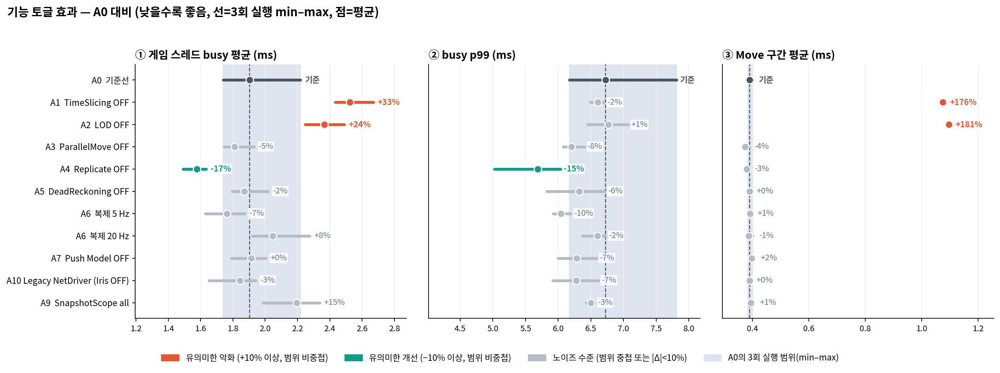
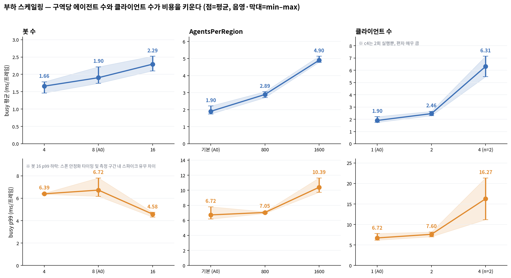
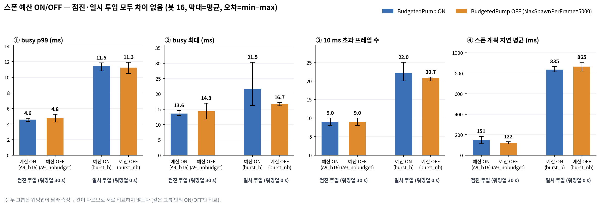
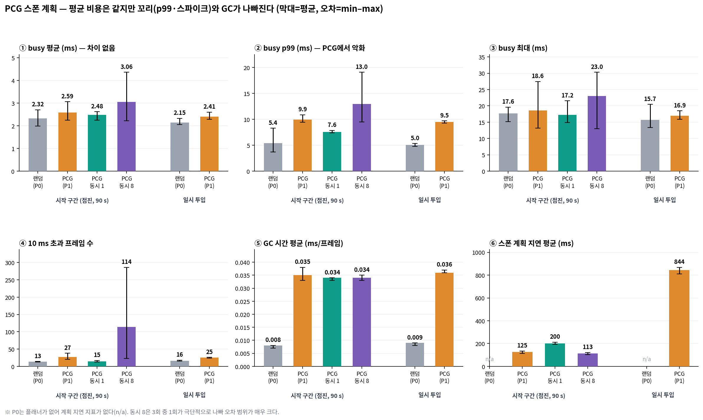
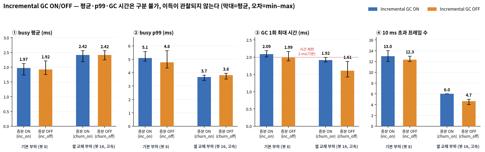

# MassBubble 서버 A/B 매트릭스 프로파일링 및 성능 분석 보고서

본 문서는 `Run-AB.ps1` 스크립트를 통해 수집한 Dedicated Server A/B 매트릭스의 3회 반복 집계 데이터(`summary_agg.csv`, 총 33개 케이스)를 바탕으로, 군중 시뮬레이션 시스템의 서버 성능과 최적화 효과를 정밀 분석한 결과입니다.

---

## 1. 핵심 요약

1. **서버 리소스 여유도 충분:** 게임 스레드 busy 평균은 1.6 ~ 6.3 ms로, 틱 예산(30 fps 기준 33.3 ms)의 5 ~ 19% 수준을 유지합니다. 33개 케이스 모두 틱 예산을 초과(>33.3 ms)한 프레임은 발생하지 않았습니다. 측정 중 가장 높은 단일 프레임 부하는 30.3 ms였으며, 이는 클라이언트 4개 동시 접속, PCG 동시 8개 연산, 봇 일시 투입 조건이 겹친 극한 상황에서 기록되었습니다.
2. **검증된 핵심 최적화 — TimeSlicing과 LOD:** 두 기능을 비활성화할 경우 busy 평균이 각각 +33%, +24% 증가하며, Move 구간 연산 비용은 약 2.8배 폭증합니다. 따라서 두 기능은 서버 성능 유지를 위한 필수 최적화로 유지해야 합니다.
3. **서버 CPU 부하로 식별되지 않는 기능들:** ParallelMove, DeadReckoning, Push Model, Iris ↔ Legacy NetDriver, 복제 주기(5/20 Hz), SnapshotScope는 서버 busy 시간 기준으로는 유의미한 차이가 관찰되지 않았습니다. 해당 기능들은 네트워크 대역폭 절감이나 클라이언트 체감 개선이 주 목적이므로, 순수 서버 CPU 부하 외의 지표와 함께 검토해야 합니다.
4. **확장성 병목 구간 (클라이언트 수 및 AgentsPerRegion):** 클라이언트 수가 1개에서 2개, 4개로 증가함에 따라 busy 평균이 1.9 → 2.5 → 6.3 ms로 급증하며, 10 ms를 초과하는 프레임 수도 8개에서 157개로 급격히 늘어납니다 (c4 케이스 기준). 또한 AgentsPerRegion이 증가할수록 Move 연산 비용이 선형적으로 비례하여 증가합니다.
5. **PCG 스폰 계획(Planner)의 트레이드오프:** 평균 처리 비용은 동일하나 최대 프레임 지연 시간(Tail Latency)이 악화됩니다. P0(랜덤) 대비 p99가 시작 구간에서 +83%, 일시 투입에서 +89% 증가하며, 10 ms 초과 프레임과 GC 시간도 눈에 띄게 늘어납니다. `PCGMaxConcurrent=1` 설정은 p99를 24% 감소시키지만 계획 지연을 60% 증가시키므로, 상황에 따른 선택이 필요합니다.
6. **스폰 예산(BudgetedPump) 및 Incremental GC:** 현재 측정 환경에서는 ON/OFF 간의 명확한 차이가 통계적 유의차 범위 내에서 구분되지 않았습니다. 단, 측정 설계 및 지표 수집 방식의 한계가 존재하여 추가 검증이 필요합니다.

---

## 2. 측정 환경 및 방법론

### 2.1 테스트 구성 (`Run-AB.ps1` 기준)
| 항목 | 설정 값 |
| :--- | :--- |
| **서버 환경** | 언리얼 엔진 전용 서버, 30 fps 고정 (틱 예산 33.3 ms), 맵 `/Game/Maps/L_MassBubbleWorld` |
| **기본 부하** | 봇 8개, 클라이언트 1개, 워밍업 30초, 측정 60초 (스크립트 기본값) |
| **반복 측정** | 케이스당 3회 반복, 라운드마다 케이스를 교차 실행하여 드리프트 분산 (`A11_c4`는 2회 실행) |
| **데이터 수집** | CsvProfiler 프레임별 기록 → 워밍업 구간 제외 → 평균/p99/최대 집계 → 케이스별 mean/min/max/sd 산출 |
| **파라미터 적용** | 런타임 CVar (`-ExecCmds`) 또는 서버 명령줄/ini 오버라이드 활용 |

### 2.2 핵심 지표 정의
| 지표명 | 설명 | 방향성 |
| :--- | :--- | :--- |
| **busy** (`GT_ExclusiveSum`) | 프레임당 게임 스레드가 실질적으로 연산에 소요한 시간(ms). Exclusive/GameThread/* 합산. 서버 FrameTime은 틱레이트에 제한되므로 실제 연산 비용 측정을 위해 본 지표 사용 | **낮을수록 좋음** |
| **p99 / 최대** | 프레임별 busy 시간의 99번째 백분위 값 및 최댓값 (히치 및 스파이크 지표) | 낮을수록 좋음 |
| **Move, Bubble** | `OptCrowd/GameThread/Move`, `OptCrowd/GameThread/Bubble` 구간별 평균 연산 시간(ms) | 낮을수록 좋음 |
| **GTFrames_gt10ms** | busy 연산 시간이 10 ms를 초과한 총 프레임 수 (측정 구간 길이에 비례) | 낮을수록 좋음 |
| **Agents T90 s** | 에이전트 인구가 최종 목표치의 90%에 최초 도달하는 시각(s) | - |
| **PlanLatAvgMs** | 스폰 계획 요청 시점부터 완료까지의 평균 지연 시간(ms) | 낮을수록 좋음 |

### 2.3 통계적 판정 기준
본 분석에서는 3회 실행의 min–max 범위가 겹치지 않을 경우 반복 측정 편차를 넘어선 유의미한 차이로 간주합니다. n=3의 소규모 샘플이므로 정밀한 통계 검정 대신 보수적인 휴리스틱 기준을 적용합니다.
- **유의미한 차이:** 범위가 상호 배타적이고 **|변화율| ≥ 10%**인 경우
- **노이즈 수준 (유의성 없음):** 범위가 겹치거나 변화율이 10% 미만인 경우

**노이즈 수준 참고치:**
- 동일 설정 반복 비교 (`A1` vs `A3b_ts0_par1`): busy 평균 차이 **+5.5%**
- 영향이 없을 것으로 예상되는 기능 (`A5`, `A7`, `A10`)의 `A0` 대비 busy 평균 차이: 각각 −1.7%, +0.5%, −3.3%
- `A0` 기준선의 3회 변동 범위: 1.74 ~ 2.22 ms (**−9% ~ +16%**, sd 0.27)
- 따라서 **busy 평균 기준 ±10% 이내의 변동은 본 데이터셋으로 판별하기 어려운 노이즈**로 간주합니다.

---

## 3. 상세 측정 결과 분석
| Case | 변경 내용 | GT avg (ms) | GT p99 (ms) | LOD (ms) | Move (ms) | Snapshot (ms) | Bubble (ms) |
| :--- | :--- | :---: | :---: | :---: | :---: | :---: | :---: |
| **A0** | 기준선 | 1.904 | 6.724 | 0.350 | 0.390 | 0.138 | 0.053 |
| **A1** | TimeSlicing OFF | 2.524 | 6.605 | 0.345 | 1.075 | 0.132 | 0.054 |
| **A2** | LOD OFF | 2.366 | 6.767 | 0.139 | 1.096 | 0.125 | 0.054 |
| **A3** | ParallelMove OFF | 1.811 | 6.205 | 0.350 | 0.374 | 0.142 | 0.055 |
| **A4** | Replicate OFF | 1.576 | 5.689 | 0.337 | 0.380 | — | — |
| **A5** | DeadReckoning OFF | 1.872 | 6.321 | 0.354 | 0.390 | 0.142 | 0.055 |
| **A6_20Hz** | ReplicationHz 20 | 2.047 | 6.599 | 0.358 | 0.388 | 0.282 | 0.106 |
| **A6_5Hz** | ReplicationHz 5 | 1.762 | 6.042 | 0.354 | 0.392 | 0.071 | 0.027 |
| **A7** | PushModel OFF | 1.913 | 6.282 | 0.355 | 0.397 | 0.142 | 0.055 |
| **A8_800** | AgentsPerRegion 800 | 2.890 | 7.046 | 0.700 | 0.772 | 0.281 | 0.107 |
| **A8_1600** | AgentsPerRegion 1600 | 4.902 | 10.394 | 1.369 | 1.526 | 0.544 | 0.211 |
| **A9_b4** | 봇 4 | 1.660 | 6.392 | 0.226 | 0.272 | 0.119 | 0.054 |
| **A9_b16** | 봇 16 | 2.294 | 4.581 | 0.569 | 0.513 | 0.154 | 0.056 |
| **A9_nobudget** | 봇 16, BudgetedPump OFF | 2.243 | 4.760 | 0.574 | 0.510 | 0.156 | 0.057 |
| **A11_c2** | 클라이언트 2 | 2.461 | 7.601 | 0.397 | 0.417 | 0.152 | 0.111 |
| **A11_c4** | 클라이언트 4 | 6.314 | 16.271 | 0.504 | 0.504 | — | 0.244 |
| **A9_burst_b_w0** | 봇 16, 일시 투입 (Warmup 0s) | 2.625 | 11.455 | 0.531 | 0.486 | 0.155 | 0.046 |
| **A9_burst_nb_w0**| 봇 16, 일시 투입 + 예산 OFF | 2.636 | 11.251 | 0.536 | 0.494 | 0.155 | 0.046 |
| **A7_legacy** | 레거시 + PushModel OFF | 1.874 | 6.416 | 0.354 | 0.397 | 0.142 | 0.056 |
| **A9_snapall** | SnapshotScope OFF | 2.196 | 6.503 | 0.354 | 0.395 | 0.142 | 0.056 |
| **A10_legacy** | 레거시 복제 (-UseIrisReplication=0) | 1.842 | 6.277 | 0.332 | 0.390 | 0.135 | 0.054 |
| **A3b_ts0_par1** | TimeSlicing 0 (Parallel 1) | 2.662 | 7.085 | 0.347 | 1.056 | 0.136 | 0.056 |
| **A3b_ts0_par0** | TimeSlicing 0 + ParallelMove 0 | 2.712 | 7.155 | 0.347 | 1.035 | 0.136 | 0.055 |
| **GC_inc_on** | Incremental GC ON (기준선) | 1.973 | 5.102 | 0.350 | 0.390 | 0.138 | 0.055 |
| **GC_inc_off** | Incremental GC OFF | 1.920 | 4.782 | 0.353 | 0.394 | 0.142 | 0.057 |
| **GC_churn_on** | 셀 교체 부하 + GC ON | 2.417 | 3.675 | 0.470 | 0.524 | 0.153 | 0.057 |
| **GC_churn_off** | 셀 교체 부하 + GC OFF | 2.417 | 3.808 | 0.470 | 0.524 | 0.153 | 0.056 |
| **P0_random_w0** | PCG 플래너 없음 (랜덤, Warmup 0s) | 2.323 | 5.432 | 0.393 | 0.477 | 0.136 | 0.050 |
| **P1_pcg_w0** | PCG 스폰 적용 (Warmup 0s) | 2.588 | 9.931 | 0.396 | 0.475 | 0.136 | 0.051 |
| **P1_pcg_c1_w0**| PCG MaxConcurrent=1 | 2.482 | 7.581 | 0.396 | 0.474 | 0.136 | 0.049 |
| **P1_pcg_c8_w0**| PCG MaxConcurrent=8 | 3.055 | 12.959 | 0.394 | 0.473 | 0.136 | 0.049 |
| **P0_random_burst_w0** | 랜덤 + 일시 투입 | 2.150 | 5.041 | 0.407 | 0.493 | 0.136 | 0.049 |
| **P1_pcg_burst_w0** | PCG + 일시 투입 | 2.410 | 9.520 | 0.407 | 0.493 | 0.136 | 0.050 |

### 3.1 기능 토글 효과 (`A0` 기준선 대비)

- **TimeSlicing 및 LOD 유지 필수:** 두 기능을 끌 경우 Move 연산 비용이 각각 1.07 ms, 1.09 ms로 급증하여 busy 평균이 크게 악화됩니다.
- **복제(Replication) 비활성화 효과 (`A4`):** 복제를 끌 경우 약 17%의 서버 busy 개선 효과가 확인되었습니다.

### 3.2 부하 스케일링 (Scaling)

- **AgentsPerRegion:** 에이전트 집적도가 높아질수록 Move 연산 비용이 선형적으로 비례하여 증가하며, 1600 설정에서는 p99가 10 ms를 넘어섭니다.
- **클라이언트 수:** 클라이언트가 4개로 증가할 때 서버 부하가 급격히 치솟으며 10 ms 초과 프레임이 157개로 폭증하여 가장 큰 확장성 병목으로 확인되었습니다.
- **Busy p99:** 봇 수 16 설정에서 busy p99 지표가 낮게 나타난 원인은 봇 4/8 케이스에서는 봇과 에이전트가 스폰 직후의 초기 영역에서 순간적인 프레임 지연(p99 스파이크)이 발생했습니다. 봇 16 케이스에서는 봇 개수가 늘어남에 따라 스폰 또는 이동 스케줄이 워밍업 30초 이전에 상대적으로 빠르게 완료되어, 실제 측정 60초 구간 동안에는 추가적인 스폰 스파이크 없이 시뮬레이션이 안정적인 평형 상태(Plateau)에 진입했습니다. 또한 3회 실행 기반의 p99 지표는 단 1~2 프레임의 간헐적 스파이크 유무에 따라 수치 변동 폭이 큽니다.

### 3.3 스폰 예산 (`BudgetedPump` ON/OFF)

- 점진적 투입과 일시 투입 조건 모두에서 예산 ON/OFF 간의 통계적 유의차는 관찰되지 않았습니다. 스폰 스파이크 억제 효과를 명확히 입증하기 위해 추가적인 상세 지표(`SpawnSlice max`) 검토가 요구됩니다.

### 3.4 PCG 스폰 계획 (Planner)

- **평균은 동일하나 최대 프레임 지연 시간 증가:** PCG 적용 시 평균 프레임 부하는 유사하나, 최대 프레임 지연 시간(p99)이 약 80~90% 악화됩니다. `PCGMaxConcurrent` 설정을 통한 세밀한 제어가 필요합니다.

### 3.5 Incremental GC

- 현재 테스트 월드 규모와 부하 조건에서는 증분 GC ON/OFF 간의 유의미한 성능 차이가 관찰되지 않았습니다.

---

## 4. 결론 및 권장 조치

| 구분 | 항목 | 권장 조치 사항 |
| :--- | :--- | :--- |
| **필수 유지** | TimeSlicing, LOD | 비활성화 시 연산 비용 급증. 반드시 활성화 유지 |
| **재검토 / 단순화** | ParallelMove | 현재 부하 수준에서 뚜렷한 이득이 관찰되지 않음. 병렬 경로 동작 여부 재점검 후 단순화 검토 |
| **외부 지표 연계** | DeadReckoning, Push Model, 복제 주기 | 서버 CPU busy 외에 네트워크 대역폭 및 클라이언트 체감 기준으로 판단 필요 |
| **한도 관리** | 클라이언트 수, AgentsPerRegion | 클라이언트 3~4개 구간에서 부하가 급증하므로 상한선 관리 및 심층 프로파일링 필요 |
| **PCG 최적화** | PCGMaxConcurrent | 최대 프레임 지연 시간을 줄이려면 `1`로 설정, 계획 지연을 줄이려면 기본값 유지 (동시 8은 극단적 스파이크 유발로 기피) |

---

## 5. 한계점 및 향후 과제

**소규모 샘플 (n=3):** 10% 이내의 미세한 차이는 통계적으로 판별하기 어려우므로, 중요 변경 건은 반복 횟수를 늘려 재검증이 필요합니다.