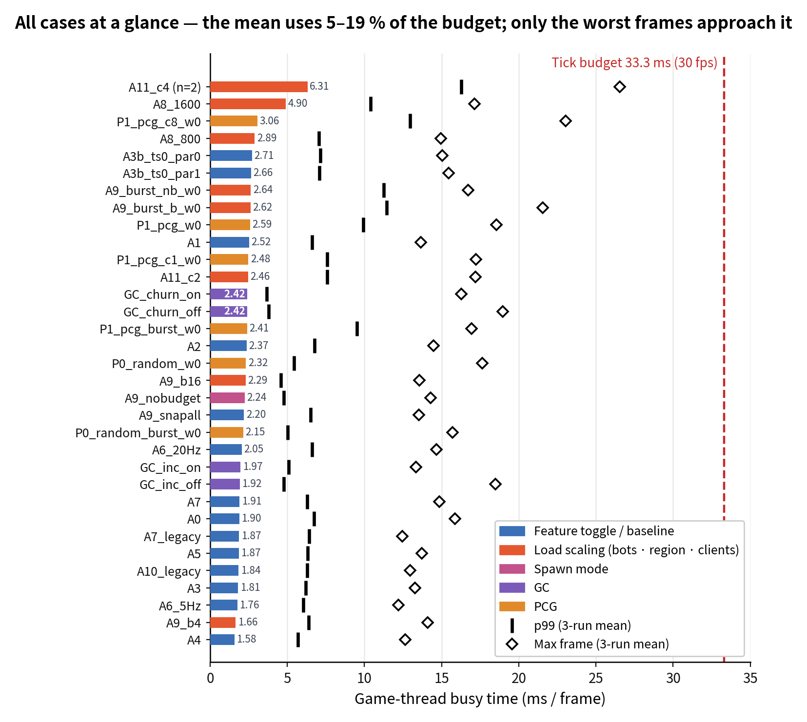
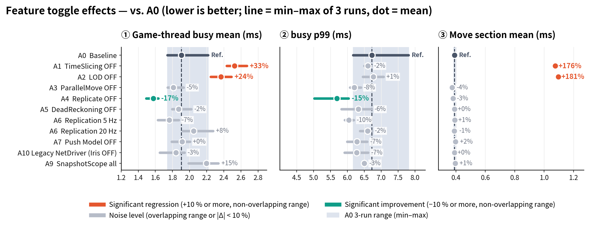
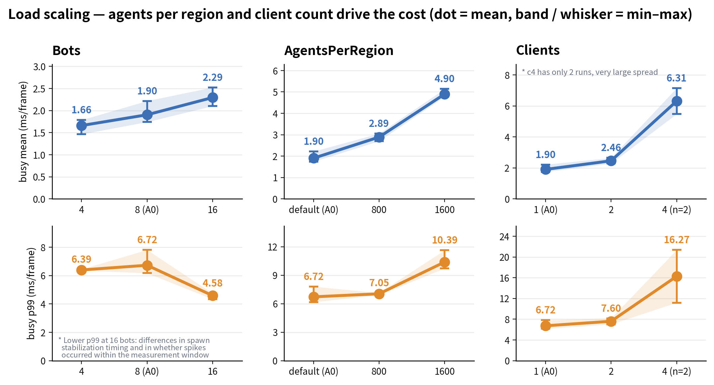
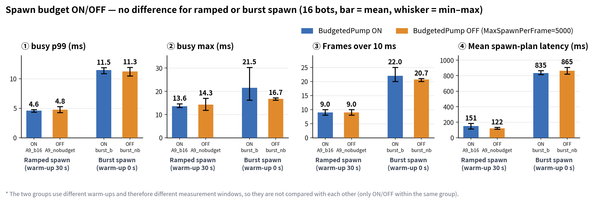
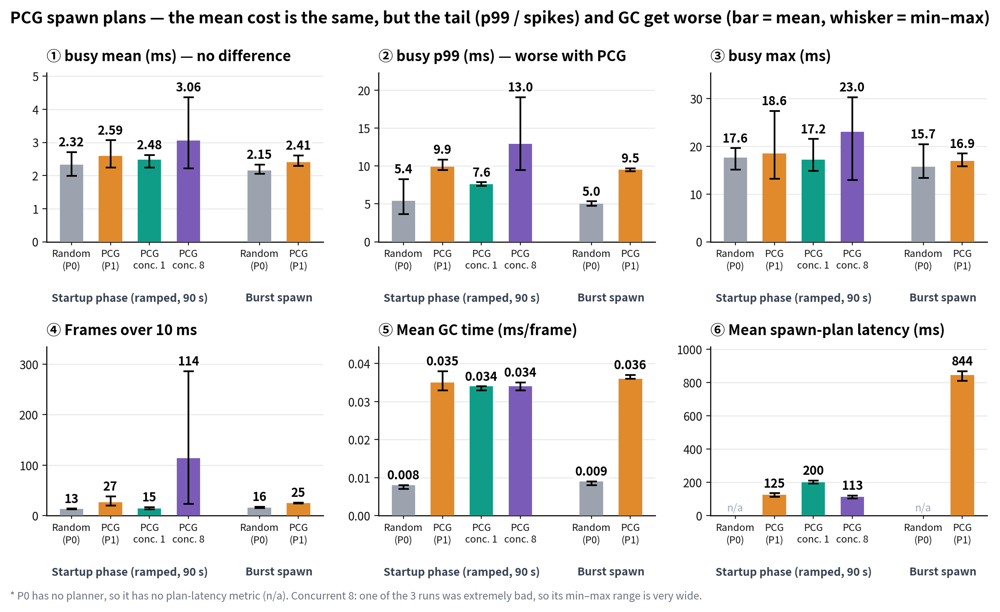
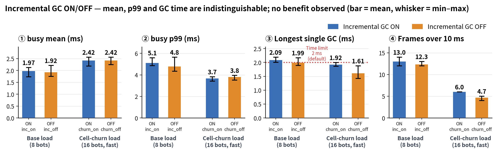

# MassBubble Server A/B Matrix Profiling and Performance Analysis Report

This document provides a detailed analysis of the server performance and optimization effects of the crowd simulation system, based on 3-iteration aggregated data (`summary_agg.csv`, total 33 cases) of the Dedicated Server A/B matrix collected via the [`Run-AB.ps1`](./Run-AB.ps1) script.

---

## 1. Executive Summary

1. **Sufficient Server Resource Headroom:** The game thread busy average ranges from 1.6 to 6.3 ms, maintaining about 5% to 19% of the tick budget (33.3 ms based on 30 fps). None of the 33 cases exceeded the tick budget (>33.3 ms) per frame. The highest single-frame load recorded during measurements was 30.3 ms, observed under extreme conditions where 4 simultaneous clients, 8 concurrent PCG operations, and burst bot injection overlapped.
2. **Proven Core Optimizations — TimeSlicing and LOD:** Disabling these two features increases the busy average by +33% and +24% respectively, while the Move execution cost surges by about 2.8x. Therefore, both features must remain enabled as essential optimizations to maintain server performance.
3. **Features Not Identified as Server CPU Load Drivers:** ParallelMove, DeadReckoning, Push Model, Iris ↔ Legacy NetDriver, replication frequency (5/20 Hz), and SnapshotScope showed no statistically meaningful differences based on server busy time. Since these features primarily target network bandwidth reduction or client perception improvements, they should be evaluated alongside metrics other than pure server CPU load.
4. **Scalability Bottlenecks (Client Count and AgentsPerRegion):** As the client count increased from 1 to 2 and 4, the busy average surged rapidly from 1.9 → 2.5 → 6.3 ms, and the number of frames exceeding 10 ms increased sharply from 8 to 157 (in the `A11_c4` case). Additionally, as AgentsPerRegion increased, the Move execution cost scaled up linearly.
5. **PCG Spawn Planner Trade-offs:** Average processing cost remains similar, but tail latency (maximum frame delay) worsens. Compared to P0 (random), p99 increases by +83% in the baseline and +89% in the burst injection scenario, while frames exceeding 10 ms and GC time noticeably increase. The `PCGMaxConcurrent=1` setting reduces p99 by 24% but increases planning latency by 60%, requiring scenario-based choices.
6. **Spawn Budget (`BudgetedPump`) and Incremental GC:** In the current measurement environment, no clear differences between ON/OFF were distinguished within statistically significant margins. However, limitations in measurement design and metric collection methods mean additional verification is required.

---

## 2. Measurement Environment and Methodology

### 2.1 Test Configuration (Based on `Run-AB.ps1`)
| Item | Setting Value |
| :--- | :--- |
| **Server Environment** | Unreal Engine Dedicated Server, Fixed at 30 fps (Tick budget 33.3 ms), Map `/Game/Maps/L_MassBubbleWorld` |
| **Default Load** | 8 bots, 1 client, 30s warmup, 60s measurement (Script defaults) |
| **Repeated Measurements** | 3 iterations per case, cases executed in alternating order each round to distribute drift (`A11_c4` executed twice) |
| **Data Collection** | CsvProfiler per-frame logs → Exclude warmup section → Aggregate average/p99/maximum → Compute case-wise mean/min/max/sd |
| **Parameter Application** | Runtime CVar (`-ExecCmds`) or Server Commandline/ini overrides utilized |

### 2.2 Key Metric Definitions
| Metric Name | Description | Direction |
| :--- | :--- | :--- |
| **busy** (`GT_ExclusiveSum`) | Actual execution time (ms) spent by the game thread per frame. Sum of Exclusive/GameThread/*. Since server FrameTime is capped by tickrate, this metric is used to measure actual computational cost. | **Lower is better** |
| **p99 / Max** | 99th percentile and maximum values of frame-wise busy time (indicators for hitches and spikes) | Lower is better |
| **Move, Bubble** | Average execution time (ms) per section: `OptCrowd/GameThread/Move`, `OptCrowd/GameThread/Bubble` | Lower is better |
| **GTFrames_gt10ms** | Total number of frames where busy execution time exceeded 10 ms (proportional to measurement window length) | Lower is better |
| **Agents T90 s** | Time (s) at which agent population first reaches 90% of the final target | - |
| **PlanLatAvgMs** | Average latency (ms) from spawn plan request time to completion | Lower is better |

### 2.3 Statistical Judgment Criteria
In this analysis, if the min–max range of 3 runs does not overlap, it is considered a meaningful difference exceeding the repetition measurement deviation. Given the small sample size of n=3, conservative heuristic criteria are applied instead of rigorous statistical testing.
- **Meaningful Difference:** Ranges are mutually exclusive and **|Change Rate| ≥ 10%**
- **Noise Level (No Significance):** Ranges overlap or change rate is less than 10%

**Noise Level References:**
- Repeated comparison of identical settings (`A1` vs `A3b_ts0_par1`): Busy average difference **+5.5%**
- Busy average difference of features expected to have no impact (`A5`, `A7`, `A10`) compared to `A0`: −1.7%, +0.5%, −3.3% respectively
- Fluctuation range of `A0` baseline across 3 runs: 1.74 ~ 2.22 ms (**−9% ~ +16%**, sd 0.27)
- Therefore, **fluctuations within ±10% of the busy average are considered noise** that cannot be reliably distinguished with this dataset.

---

## 3. Detailed Measurement Results Analysis
| Case | Description | GT avg (ms) | GT p99 (ms) | LOD (ms) | Move (ms) | Snapshot (ms) | Bubble (ms) |
| :--- | :--- | :---: | :---: | :---: | :---: | :---: | :---: |
| **A0** | Baseline | 1.904 | 6.724 | 0.350 | 0.390 | 0.138 | 0.053 |
| **A1** | TimeSlicing OFF | 2.524 | 6.605 | 0.345 | 1.075 | 0.132 | 0.054 |
| **A2** | LOD OFF | 2.366 | 6.767 | 0.139 | 1.096 | 0.125 | 0.054 |
| **A3** | ParallelMove OFF | 1.811 | 6.205 | 0.350 | 0.374 | 0.142 | 0.055 |
| **A4** | Replicate OFF | 1.576 | 5.689 | 0.337 | 0.380 | — | — |
| **A5** | DeadReckoning OFF | 1.872 | 6.321 | 0.354 | 0.390 | 0.142 | 0.055 |
| **A6_20Hz** | ReplicationHz 20 | 2.047 | 6.599 | 0.358 | 0.388 | 0.282 | 0.106 |
| **A6_5Hz** | ReplicationHz 5 | 1.762 | 6.042 | 0.354 | 0.392 | 0.071 | 0.027 |
| **A7** | PushModel OFF | 1.913 | 6.282 | 0.355 | 0.397 | 0.142 | 0.055 |
| **A8_800** | AgentsPerRegion 800 | 2.890 | 7.046 | 0.700 | 0.772 | 0.281 | 0.107 |
| **A8_1600** | AgentsPerRegion 1600 | 4.902 | 10.394 | 1.369 | 1.526 | 0.544 | 0.211 |
| **A9_b4** | 4 Bots | 1.660 | 6.392 | 0.226 | 0.272 | 0.119 | 0.054 |
| **A9_b16** | 16 Bots | 2.294 | 4.581 | 0.569 | 0.513 | 0.154 | 0.056 |
| **A9_nobudget** | 16 Bots, BudgetedPump OFF | 2.243 | 4.760 | 0.574 | 0.510 | 0.156 | 0.057 |
| **A11_c2** | 2 Clients | 2.461 | 7.601 | 0.397 | 0.417 | 0.152 | 0.111 |
| **A11_c4** | 4 Clients | 6.314 | 16.271 | 0.504 | 0.504 | — | 0.244 |
| **A9_burst_b_w0** | 16 Bots, Burst Injection (Warmup 0s) | 2.625 | 11.455 | 0.531 | 0.486 | 0.155 | 0.046 |
| **A9_burst_nb_w0**| 16 Bots, Burst Injection + Budget OFF | 2.636 | 11.251 | 0.536 | 0.494 | 0.155 | 0.046 |
| **A7_legacy** | Legacy + PushModel OFF | 1.874 | 6.416 | 0.354 | 0.397 | 0.142 | 0.056 |
| **A9_snapall** | SnapshotScope OFF | 2.196 | 6.503 | 0.354 | 0.395 | 0.142 | 0.056 |
| **A10_legacy** | Legacy Replication (-UseIrisReplication=0) | 1.842 | 6.277 | 0.332 | 0.390 | 0.135 | 0.054 |
| **A3b_ts0_par1** | TimeSlicing 0 (Parallel 1) | 2.662 | 7.085 | 0.347 | 1.056 | 0.136 | 0.056 |
| **A3b_ts0_par0** | TimeSlicing 0 + ParallelMove 0 | 2.712 | 7.155 | 0.347 | 1.035 | 0.136 | 0.055 |
| **GC_inc_on** | Incremental GC ON (Baseline) | 1.973 | 5.102 | 0.350 | 0.390 | 0.138 | 0.055 |
| **GC_inc_off** | Incremental GC OFF | 1.920 | 4.782 | 0.353 | 0.394 | 0.142 | 0.057 |
| **GC_churn_on** | Cell Churn Load + GC ON | 2.417 | 3.675 | 0.470 | 0.524 | 0.153 | 0.057 |
| **GC_churn_off** | Cell Churn Load + GC OFF | 2.417 | 3.808 | 0.470 | 0.524 | 0.153 | 0.056 |
| **P0_random_w0** | No PCG Planner (Random, Warmup 0s) | 2.323 | 5.432 | 0.393 | 0.477 | 0.136 | 0.050 |
| **P1_pcg_w0** | PCG Spawn Applied (Warmup 0s) | 2.588 | 9.931 | 0.396 | 0.475 | 0.136 | 0.051 |
| **P1_pcg_c1_w0**| PCG MaxConcurrent=1 | 2.482 | 7.581 | 0.396 | 0.474 | 0.136 | 0.049 |
| **P1_pcg_c8_w0**| PCG MaxConcurrent=8 | 3.055 | 12.959 | 0.394 | 0.473 | 0.136 | 0.049 |
| **P0_random_burst_w0** | Random + Burst Injection | 2.150 | 5.041 | 0.407 | 0.493 | 0.136 | 0.049 |
| **P1_pcg_burst_w0** | PCG + Burst Injection | 2.410 | 9.520 | 0.407 | 0.493 | 0.136 | 0.050 |

### 3.1 Function Toggle Effects (vs. `A0` Baseline)

- **Must Maintain TimeSlicing and LOD:** Disabling these two features surges the Move computation cost to 1.07 ms and 1.09 ms respectively, severely worsening the busy average.
- **Replication Disabled Effect (`A4`):** Disabling replication showed about a 17% improvement in server busy time.

### 3.2 Load Scaling

- **AgentsPerRegion:** As agent density increases, Move execution costs scale up linearly, and the 1600 setting pushes p99 beyond 10 ms.
- **Client Count:** When clients increase to 4, server load spikes drastically with 157 frames exceeding 10 ms, identifying this as the biggest scalability bottleneck.
- **Busy p99:** The reason why busy p99 appeared lower in the 16-bot setting is that for 4/8 bot cases, instantaneous frame delays (p99 spikes) occurred in initial zones right after bots and agents spawned. In the 16-bot case, as the number of bots increased, spawning or movement schedules completed relatively faster before the 30s warmup, allowing the simulation to enter a stable plateau during the actual 60s measurement window without additional spawn spikes. Also, p99 metrics based on 3 runs fluctuate heavily depending on the presence of intermittent 1–2 frame spikes.

### 3.3 Spawn Budget (`BudgetedPump` ON/OFF)

- No statistically significant difference between budget ON/OFF was observed under both progressive and burst injection conditions. Detailed metrics (`SpawnSlice max`) should be reviewed to clearly demonstrate spawn spike suppression effects.

### 3.4 PCG Spawn Planner

- **Same Average, Increased Tail Latency:** While average frame load is similar with PCG applied, maximum frame delay (p99) worsens by about 80–90%. Detailed control via `PCGMaxConcurrent` is required.

### 3.5 Incremental GC

- Under the current test world scale and load conditions, no meaningful performance difference was observed between incremental GC ON/OFF.

---

## 4. Conclusion and Recommendations

| Category | Item | Recommended Action |
| :--- | :--- | :--- |
| **Must Maintain** | TimeSlicing, LOD | Computation costs surge when disabled. Must remain enabled. |
| **Re-evaluate / Simplify** | ParallelMove | No clear benefit observed under current load levels. Re-verify parallel path behavior and consider simplification. |
| **External Metrics Integration** | DeadReckoning, Push Model, Replication Frequency | Judge based on network bandwidth and client experience in addition to server CPU busy. |
| **Limit Management** | Client Count, AgentsPerRegion | Load spikes steeply in the 3–4 client range; upper limit management and in-depth profiling required. |
| **PCG Optimization** | PCGMaxConcurrent | Set to `1` to reduce maximum frame delay, or keep default to reduce planning latency (concurrent 8 avoided due to extreme spike induction). |

---

## 5. Limitations and Future Work

**Small Sample Size (n=3):** Minor differences within 10% are difficult to distinguish statistically; important changes require re-validation with increased iteration counts.